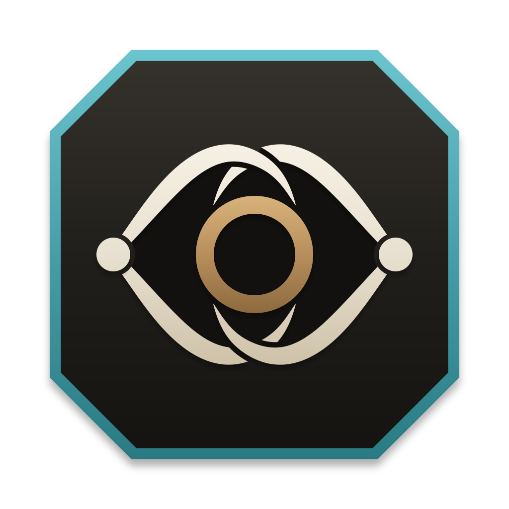
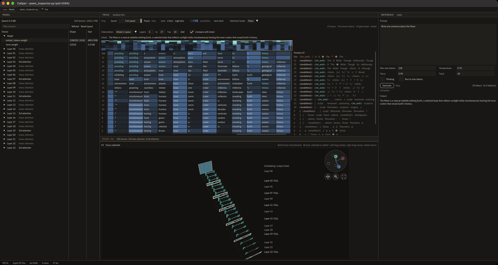

<p align="center">
  
</p>

<h1 align="center">Caliper</h1>

<p align="center">
  <b>Machine learning visualization framework.</b><br>
  Caliper renders live ImGui graphics from GPU-resident MPS and CUDA tensors,<br>
  without CPU staging on its native Metal and Vulkan paths.
</p>

<p align="center">
  
  
  
  
  
</p>

<p align="center">
  <a href="https://ahmedkhan-gh.github.io/caliper/"><b>Website</b></a> ·
  <a href="https://ahmedkhan-gh.github.io/caliper/docs/">Documentation</a> ·
  <a href="docs/plans/roadmap.md">Roadmap</a> ·
  <a href="docs/references/applets.md">Applets</a>
</p>

<br>

<p align="center">
  
  <br>
  <sub>The Caliper inspector attached to Qwen3.5-0.8B: the parameter tree, the Trace pane reading every layer<br>
  through the Jacobian lens while the model writes, Model 3D with every tensor at its true shape, and the inference output.</sub>
</p>

<p align="center">
  <a href="#quick-start">Quick start</a> ·
  <a href="#prerequisites">Prerequisites</a> ·
  <a href="#build-options">Build options</a> ·
  <a href="#libtorch-configuration">LibTorch</a> ·
  <a href="#troubleshooting">Troubleshooting</a> ·
  <a href="#license">License</a>
</p>

<br>

## Quick start

```bash
# 1. Initialize submodules
git submodule update --init --recursive

# 2. Configure and build (the configure step downloads LibTorch)
cmake --preset release
cmake --build --preset release

# 3. Run
./cmake-build-release/caliper            # macOS
.\cmake-build-release\caliper.exe        # Windows
```

The core build compiles no applets. Applets build against the installed SDK
(`cmake --install cmake-build-release --prefix <prefix> --component sdk`), each in
its own folder; [Your first applet](docs/tutorials/first-applet.md) walks through
it, and [SDK package](docs/references/sdk-package.md) describes the package.

`--preset release-notorch` builds the host without LibTorch, into
`cmake-build-notorch/`. The presets need CMake 3.25 or later.

## Prerequisites

### All platforms
- **Git** (for submodule management)
- **CMake 3.25 or later** and **Ninja** (the presets use the Ninja generator; configuring without a preset needs CMake 3.18)
- **A C++20 compiler** for the host and the applets
- **OpenGL**, which the host uses as its fallback renderer and which the build still requires

### Windows
- **Visual Studio 2022** (MSVC v143)
- **CUDA Toolkit** (optional). If CMake finds one, it builds the CUDA paths and picks the matching LibTorch variant. If it finds none, the build falls back to CPU. There is no fixed install path.
- **An NVIDIA GPU and driver** to use the CUDA and Vulkan interop path at run time. Vulkan is loaded at run time (`vulkan-1.dll`), so no Vulkan SDK is needed.

### macOS
- **Xcode** with command line tools
- **Apple Silicon**
- **Metal compiler** (`xcrun --find metal`)

## Build options

| Option | Default | Description |
|--------|---------|-------------|
| `USE_CUDA` | ON | Build the CUDA support. It turns itself OFF when no CUDA toolkit is found, and the `release-notorch` preset sets it OFF. |
| `USE_MPS` | ON on macOS when the Metal compiler is found, otherwise OFF | Build the Metal Performance Shaders support |
| `BUILD_TESTS` | OFF | Build the test suites. The `release`, `debug` and `release-notorch` presets set it ON. |
| `CALIPER_WITH_TORCH` | ON | Download LibTorch for the adapter tests and for the SDK, which names it for the applets that link it |
| `CALIPER_BUILD_APPLETS` | OFF | Also build `applets/` inside the core build; forced OFF without LibTorch |
| `CALIPER_BUILD_PYTHON` | OFF | Build the `caliper` Python extension (nanobind) |
| `CALIPER_WITH_SLANG` | ON | Configure the vendored slang library |
| `CALIPER_WITH_LLAMA` | ON | Configure the vendored llama.cpp library |
| `CALIPER_BUILD_VIEWER` | ON | Build `caliper_viewer`, the live viewer process (macOS) |
| `CALIPER_BUILD_EXAMPLES` | ON | Build the embedding example, `examples/embed_host`. The tutorial applets `hello` and `sine_scope` build with the tests instead. |
| `CALIPER_BUILD_OPENGLLAMA` | OFF | Build the archived opengllama applet; needs `CALIPER_WITH_LLAMA` |
| `CALIPER_STATIC_CRT` | OFF | Use the static MSVC runtime (`/MT`) instead of the dynamic one |

**Examples:**
```bash
cmake --preset debug
cmake --preset release-notorch
cmake --preset release -DCALIPER_WITH_SLANG=OFF
```

## LibTorch configuration

Caliper's applets use **LibTorch 2.5.1**. The host executable and `libcaliper` do not link it. The build downloads the archive at configure time into `third_party/` and does nothing else to it. There is no option that names a variant; the platform and the CUDA toolkit that CMake finds decide it (`cmake/Dependencies.cmake`).

| Platform | Archive | Folder |
|---|---|---|
| macOS (Apple Silicon) | The prebuilt `libtorch-macos-arm64` archive, which includes MPS support. Nothing is built from source. | `third_party/libtorch/` |
| Windows | The prebuilt Windows archive for the variant below. The debug build uses the separate debug archive. | `third_party/libtorch-release/` or `third_party/libtorch-debug/` |
| Linux | The prebuilt CPU archive, or the CUDA archive for the variant below when `USE_CUDA` is ON. | `third_party/libtorch/` |

With `USE_CUDA` ON and a CUDA toolkit found, the variant follows the toolkit version:

| CUDA toolkit | LibTorch variant |
|---|---|
| 12.4 or newer | `cu124` |
| 12.1 or newer | `cu121` |
| 11.8 or newer | `cu118` |
| older than 11.8 | `cpu`, with a warning and `USE_CUDA` turned OFF |

With `USE_CUDA` OFF, or no toolkit, the variant is `cpu`. To use the CPU variant on a machine that has CUDA, configure with `-DUSE_CUDA=OFF`.

The download is skipped when the folder already exists, so switching variants means deleting the folder and configuring again:

```bash
rm -rf third_party/libtorch-release       # or third_party/libtorch on macOS and Linux
cmake --preset release -DUSE_CUDA=OFF
```

To build without LibTorch, use the `release-notorch` preset or set `CALIPER_WITH_TORCH=OFF`. That skips the download and the torch tests, and the SDK installed from such a build cannot build applets that link LibTorch.

At run time LibTorch chooses the device. The same archive runs on the CPU when no GPU backend is available, and a CUDA archive on a machine without a usable GPU or driver falls back to the CPU.

## Python package

Caliper LIB, the `python/caliper` package, opens a live Caliper session from a training script, so that `caliper.show` and the other view calls draw into the viewer. See [`docs/references/python-api.md`](docs/references/python-api.md). It is built with `CALIPER_BUILD_PYTHON=ON` or as a wheel through `pyproject.toml`.

## Project structure

```
caliper/
├── CMakeLists.txt              # Main build config
├── CMakePresets.json           # release, debug and release-notorch presets
├── cmake/
│   ├── Dependencies.cmake      # Dependency management and LibTorch selection
│   └── wrappers/               # ImGui/ImPlot CMake wrappers
├── src/                        # The caliper executable (main.cpp) and the host (src/host/)
├── sdk/                        # The applet SDK: headers, CMake package, test fixtures
├── include/caliper/            # The embedding and live-session C headers
├── applets/                    # First-party applets, each built against the SDK (plus legacy/ and legacy-dev/)
├── examples/                   # hello, sine_scope, embed_host and the Python example
├── python/                     # The caliper Python package and its extension
├── tests/                      # Test suites
├── scripts/                    # Helper scripts
├── assets/fonts/               # UI fonts
├── docs/                       # Documentation source for the site
├── site/                       # The project website
└── third_party/                # Git submodules and vendored headers
```

## Dependencies

**System:**
- OpenGL (fallback renderer)
- Metal on macOS; the Vulkan loader on Windows (loaded at run time)

**Submodules (built from source):**
- [GLFW](https://github.com/glfw/glfw) - Window management
- [GLM](https://github.com/g-truc/glm) - Math library (header-only)
- [ImGui](https://github.com/ocornut/imgui) - UI framework
- [ImPlot](https://github.com/epezent/implot) - Plotting
- [ImPlot3D](https://github.com/brenocq/implot3d) - 3D plotting
- [imgui-node-editor](https://github.com/thedmd/imgui-node-editor) - Node editor widget
- [ImGuiColorTextEdit](https://github.com/BalazsJako/ImGuiColorTextEdit) - Text editor widget
- [ImTerm](https://github.com/Organic-Code/ImTerm) - Terminal widget
- [ImGuiFileDialog](https://github.com/aiekick/ImGuiFileDialog) - File dialog
- [GLEW](https://github.com/nigels-com/glew) - OpenGL loader (downloaded and extracted on Windows)
- [DuckDB](https://github.com/duckdb/duckdb) - The host's query engine
- [llama.cpp](https://github.com/ggerganov/llama.cpp) - GGUF inference, used by the archived opengllama applet
- [slang](https://github.com/MikePopoloski/slang) - SystemVerilog front end

**Vendored:**
- [stb](https://github.com/nothings/stb) - `stb_image_write.h` for PNG export, `stb_image.h` for tests (`third_party/stb/`)

**Fetched by CMake at configure time:**
- [toml++](https://github.com/marzer/tomlplusplus) - Manifest parsing
- [doctest](https://github.com/doctest/doctest) - Tests
- zlib and curl - Windows only, built in-tree
- Vulkan-Headers, volk and glslang - Windows only
- [nanobind](https://github.com/wjakob/nanobind) - The Python extension (a Python build requirement)

**Downloaded:**
- [LibTorch](https://pytorch.org) - Prebuilt archive for every platform

Everything is handled by git submodules and CMake. Run `git submodule update --init --recursive` once.

## Platform-specific notes

### Windows (CUDA)
- The first configure downloads the prebuilt LibTorch archive (about 2 GB)
- CUDA DLLs are copied to the executable directory
- To force a new download: `rm -rf third_party/libtorch-release` (or `libtorch-debug`)

### macOS (MPS)
- The first configure downloads the prebuilt LibTorch archive, which includes MPS support
- MPS support requires the Metal compiler
- To force a new download: `rm -rf third_party/libtorch`

## Troubleshooting

| Issue | Solution |
|-------|----------|
| **CUDA not available** | Check the configure output for the `CUDA support` line. `USE_CUDA` turns itself OFF when CMake finds no CUDA toolkit. Check that the CUDA DLLs sit next to the executable in `cmake-build-release/`. |
| **Submodules missing** | Run `git submodule update --init --recursive` |
| **OpenGL not found** | Update graphics drivers |
| **LibTorch download fails** | Check internet; manually download the archive from the PyTorch website and extract it to the folder named in the LibTorch section |
| **Wrong LibTorch variant** | Delete the LibTorch folder and configure again; see the LibTorch section |
| **MPS not available** | Ensure Apple Silicon Mac, Metal compiler available (`xcrun --find metal`) |
| **Out of memory** | Reduce parallel jobs: `cmake --build --preset release -j2` |
| **Clean rebuild** | `rm -rf cmake-build-release/ && cmake --preset release && cmake --build --preset release` |

## GPU usage examples

### Apple Silicon (MPS)
```cpp
torch::Device device(torch::kMPS);
auto tensor = torch::randn({1000, 1000}, device);
model.to(device);
```

### NVIDIA (CUDA)
```cpp
torch::Device device(torch::kCUDA);
auto tensor = torch::randn({1000, 1000}, device);
model.to(device);
```

## Resources

- [GLFW](https://www.glfw.org/documentation.html) | [GLM](https://github.com/g-truc/glm) | [ImGui](https://github.com/ocornut/imgui/wiki) | [ImPlot](https://github.com/epezent/implot) | [PyTorch C++](https://pytorch.org/cppdocs/)

## License

Caliper is licensed under the [Apache License 2.0](LICENSE), the host and the SDK alike. Copyright 2026 Ahmed Khan; `NOTICE` holds the copyright line. Applet authors need a permissive licence, and Apache 2.0 is as permissive as the MIT licence of ImGui and ImPlot, adds an explicit patent grant and gives no rights to the Caliper name.

## Third-party licenses

Caliper uses the following open-source libraries. Their license texts can be found in the respective directories under `third_party/` and `assets/fonts/`. The libraries that CMake fetches at configure time carry their own license files in their source trees.

| Library | License | Copyright | Permits |
|---|---|---|---|
| [GLFW](https://github.com/glfw/glfw) | Zlib | 2002-2006 Marcus Geelnard, 2006-2019 Camilla Löwy | Use, modify, and distribute freely with no attribution required in binaries. |
| [GLM](https://github.com/g-truc/glm) | MIT | 2005 G-Truc Creation | Use, modify, and distribute freely provided the license notice is included. |
| [ImGui](https://github.com/ocornut/imgui) | MIT | 2014-2026 Omar Cornut | Use, modify, and distribute freely provided the license notice is included. |
| [ImPlot](https://github.com/epezent/implot) | MIT | 2020 Evan Pezent | Use, modify, and distribute freely provided the license notice is included. |
| [ImPlot3D](https://github.com/brenocq/implot3d) | MIT | 2024-2026 Breno Cunha Queiroz | Use, modify, and distribute freely provided the license notice is included. |
| [imgui-node-editor](https://github.com/thedmd/imgui-node-editor) | MIT | 2019 Michał Cichoń | Use, modify, and distribute freely provided the license notice is included. |
| [ImGuiColorTextEdit](https://github.com/BalazsJako/ImGuiColorTextEdit) | MIT | 2017 BalazsJako | Use, modify, and distribute freely provided the license notice is included. |
| [ImTerm](https://github.com/Organic-Code/ImTerm) | MIT | 2018 Lucas Lazare | Use, modify, and distribute freely provided the license notice is included. |
| [ImGuiFileDialog](https://github.com/aiekick/ImGuiFileDialog) | MIT | 2018-2025 Stephane Cuillerdier (Aiekick) | Use, modify, and distribute freely provided the license notice is included. |
| [GLEW](https://github.com/nigels-com/glew) | BSD 3-Clause / MIT | 2002-2007 Milan Ikits, Marcelo E. Magallon, Lev Povalahev | Use, modify, and distribute freely provided the license notice is included and the project name is not used for endorsement. |
| [DuckDB](https://github.com/duckdb/duckdb) | MIT | 2018-2026 Stichting DuckDB Foundation | Use, modify, and distribute freely provided the license notice is included. |
| [LibTorch](https://pytorch.org) | BSD 3-Clause | 2016 Facebook Inc. | Use, modify, and distribute freely provided the license notice is included and the project name is not used for endorsement. |
| [llama.cpp](https://github.com/ggerganov/llama.cpp) | MIT | The ggml authors | Use, modify, and distribute freely provided the license notice is included. |
| [slang](https://github.com/MikePopoloski/slang) | MIT | Michael Popoloski | Use, modify, and distribute freely provided the license notice is included. |
| [stb](https://github.com/nothings/stb) | MIT / public domain | Sean Barrett and contributors | Use, modify, and distribute freely. |
| [toml++](https://github.com/marzer/tomlplusplus) | MIT | Mark Gillard | Use, modify, and distribute freely provided the license notice is included. |
| [doctest](https://github.com/doctest/doctest) | MIT | Viktor Kirilov | Use, modify, and distribute freely provided the license notice is included. |
| [nanobind](https://github.com/wjakob/nanobind) | BSD 3-Clause | Wenzel Jakob | Use, modify, and distribute freely provided the license notice is included and the project name is not used for endorsement. |
| [zlib](https://github.com/madler/zlib) | Zlib | Jean-loup Gailly and Mark Adler | Use, modify, and distribute freely with no attribution required in binaries. |
| [curl](https://github.com/curl/curl) | curl license (MIT-style) | Daniel Stenberg and contributors | Use, modify, and distribute freely provided the license notice is included. |
| [Vulkan-Headers](https://github.com/KhronosGroup/Vulkan-Headers) | Apache 2.0 or MIT | The Khronos Group | Use, modify, and distribute freely provided the license notice is included. |
| [volk](https://github.com/zeux/volk) | MIT | Arseny Kapoulkine | Use, modify, and distribute freely provided the license notice is included. |
| [glslang](https://github.com/KhronosGroup/glslang) | BSD 3-Clause (with other permissive licenses for some files) | The Khronos Group and contributors | Use, modify, and distribute freely provided the license notices are included. |
| [IBM Plex Sans Condensed](https://github.com/IBM/plex) | SIL OFL 1.1 | 2017 IBM Corp. | Use, embed, and redistribute freely; the font may not be sold on its own. |
| [Source Code Pro](https://github.com/adobe-fonts/source-code-pro) | SIL OFL 1.1 | 2010, 2012 Adobe Systems Incorporated | Use, embed, and redistribute freely; the font may not be sold on its own. |

## Acknowledgments

Build system inspired by [PyTorch](https://github.com/pytorch/pytorch).
