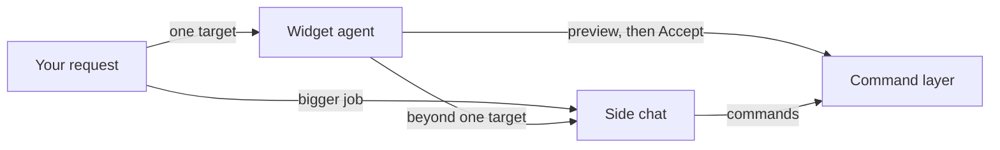

# Agent Roles

Caliper's agents have two roles. The **side chat** is a chat pane where your own agent, such as Claude Code, Codex,
Gemini CLI or opencode, works with you on conversations and bigger jobs. The **widget agent** works inline on one target
at a time, such as a panel, a selection, a dropped file or a property. It shows its change in place for you to accept or
reject.

Both roles change Caliper through the command layer, and the widget agent hands larger requests to the side chat.

## Shared Traits

Both roles speak the Agent Client Protocol (ACP) to Caliper. Thus Caliper shows their messages, their reasoning and each
tool call in the same way, and a Stop control cancels either one.

Both roles act on Caliper through its command layer. A change to a spec is a command. Caliper checks it against the spec
format, records it in the workspace's journal and lets you undo it from the app. Commands that delete or overwrite saved
data, such as saving an applet or running a loader, need your approval in the app. A change to the open spec waits for
your review, with its diff, unless you turn review off. The command layer asks, so this holds for every agent, including
an agent outside the app that uses MCP.

Caliper identifies who sends a command by the token that comes with it, not by what the request says. Commands with the
token in Caliper API's file, `api.json`, get review, and so do those of the side chat's agent and the widget agent, which
have tokens of their own. Only the session token that the app prints
when its API starts runs commands without review, and Caliper writes it to no file
([Caliper API](http-api.md#command-origin)).

You review a waiting change on its card. The card opens in a strip at the bottom of the window, above the jobs tray, on
any page. It shows who asks (MCP agent, Side chat, Widget agent or API), the command and its target, such as
"panel.patch · Loss and accuracy". For a spec, it shows each changed key with its old value struck through and its new
value, the validator's warnings, and the whole diff behind Diff. For saved data, it shows what would be lost, such as
"Applet run42-dashboard overwritten".

The card also shows how long the agent still waits, two minutes at most. On the spec page, the panel that the change
touches carries a REVIEW mark. Approve applies the change as the card showed it. It refuses the change if the spec
changed so that the change would mean something else. Deny tells the agent no, and Caliper withdraws a request that
nobody decides in time. Activity lists each request when it starts to wait and when it ends.

The two roles share one journal and one undo history, and their commands run one at a time in one order. An agent builds
data (specs and loaders), never code that runs in Caliper's process. The [trust model](../applets/trust-model.md)
explains why that matters.

## Side Chat

The side chat is for conversations and for jobs that take more than one step. For example, you might ask "Load the CSV files in runs/, make a loader that joins them on step, and build a dashboard of loss and accuracy for
each run." The agent looks at the files and writes the loader. It runs the loader after you approve, builds the panels
and tells you what it did.

The agent is your own, and Caliper starts it as a separate program. It can be Claude Code (through its ACP adapter),
Codex (through its adapter), Gemini CLI or opencode, which Caliper detects. It can also be any other ACP agent that you
add by its command. The agent uses Caliper's tools through Caliper's MCP server. It also uses its own tools, such as
file edits, commands and web search, as its settings allow.

## Widget Agent

The widget agent is for one small change or question about one target, answered in a few seconds. For example, you
select a dozen points on a loss curve, press ⌘K (Ctrl+K on Windows) and type "Make a table of these points". A table of
those rows appears where the layout would put it, marked as a preview, with the change to the spec beside it. Accept
applies it, Reject discards it, and Refine lets you say more.

The widget agent is `caliper-agent`, Caliper's own agent, which runs out of Caliper's process. Caliper gives it what it
needs to know about the target: the target's part of the spec, the schema and a sample of its data, a picture of the
panel and your selection. It may use only the commands that apply to that target.

## Role Differences

| | Side chat | Widget agent |
|---|---|---|
| What it is for | Conversations and bigger jobs: building from nothing, loader scripts, project code, explanations | One panel, selection, dropped file or property, in a few seconds |
| The agent | Your own ACP agent: Claude Code, Codex, Gemini CLI, opencode, or any other you add by its command | `caliper-agent`, Caliper's own agent |
| Model | Whatever your agent uses, hosted or on your machine | Claude Haiku 5.5 at low effort by default, another Claude model, or a local model server |
| Login | The agent's own, done once in your terminal. Caliper never sees a credential | A Claude API key that you enter once, kept in the system's credential store. A local model server needs none |
| Cost | Your agent's plan or account, as it bills you | Your API account, billed per token. A local model has no bill |
| What it may do | Caliper's tools, plus its own: files, commands, the web, as its settings allow | Only the commands that apply to the target, with every change shown as a preview first |
| How a change lands | As the agent makes it, with approval cards where they apply | As one undo step, when you accept the preview |
| Where your data goes | To your agent's model provider, or nowhere when its model runs on your machine | To the provider you chose, or nowhere when the model runs on your machine |

## Cost and Login

With the side chat, you pay for your agent as you already do. Caliper adds nothing to that bill, but a long session
counts against your plan's limits like any other. You sign in once with the agent's own command in your terminal.

The widget agent bills each request to your Claude API account by the tokens it uses. Each request is small because
Caliper gives the agent the context up front, and the agent finishes in one or two rounds.

The key comes from the Claude Console. Caliper stores it in the macOS Keychain, shows only whether a key is set, and has
a control that removes it. The key reaches the agent only in its environment when Caliper starts it. It never appears in
a file, a log, the journal or a command line. [Set up the widget agent](widget-agent-setup.md) gives the steps.

## Local Operation

Both roles can run on a model on your own machine. This costs nothing per request, but your computer does the work.

- **The side chat** runs any ACP agent on whatever model that agent supports, local models included. Caliper needs
  nothing extra. The worked example is opencode with a model served by Ollama.
- **The widget agent** offers presets for local model servers, Ollama and LM Studio, with no key, in its settings. A
  model must call tools to drive Caliper, and Caliper checks that when you choose Probe. Probe also checks whether the
  model can look at images. [Widget agent conformance](widget-agent-conformance.md) lists how models did on a set of
  test tasks.

A local model shares your computer with everything else. On a Mac, it uses the same GPU and memory as a training run
that streams into Caliper, so both slow down. The widget agent's settings and its ⌘K prompt show Shared GPU while a run
is attached. The side chat's header shows it too when you mark its agent as running on a local model with Local model in
its agent picker. Caliper cannot tell where your agent's model runs. The setup guide gives advice for that case.

## Privacy

Both roles send your prompts, and what the agent reads through Caliper, to a model provider. This includes catalog
entries, samples of your data, spec text and pictures of panels. When the model runs on your machine, none of this leaves
it. For example, Ollama's FAQ says that Ollama does not see your prompts or data when you run it locally.

The side chat's agent may also read files in the workspace folder or elsewhere with its own tools and send their
contents to its provider. Its settings and its mode, which the side chat shows, decide what it may do.

The widget agent reads only what Caliper gives it and what its commands return. It talks only to its model provider and
to Caliper on your machine. When you point it at a model server on another computer, Caliper warns you that your data
will leave this one.

## Role Permissions

The side chat's agent can write a loader script, fix a file or look something up. Its own tools act outside Caliper, so
an edit it makes to a file with them does not pass through Caliper's journal or undo. An agent in a mode that skips permission edits files without asking. You keep control through its permission
prompts, which Caliper shows, and through its settings and modes.

The widget agent can use only the commands that apply to its target and can show their change before they make it. It
cannot delete or overwrite saved data, run a loader, change files or run commands. A rejected change leaves nothing
behind.

## Chat Handoff

The widget agent hands a request to the side chat in three cases:

- You choose **Ask in chat** in its prompt.
- The request goes beyond one target, such as building a dashboard, writing a loader, changing project code or a long
  explanation. The widget agent says so and offers Ask in chat.
- No provider is set up, or the chosen model cannot call tools. Then ⌘K offers only Ask in chat.

The side chat receives your request together with what the widget agent knew. This is the target's part of the spec, the
schema and a sample of its data, your selection, and a picture of the panel when your agent accepts images. It also
receives the conversation so far, including the change that the widget agent proposed, marked as not applied. You see the
whole message in the chat, and the agent goes on from there.
