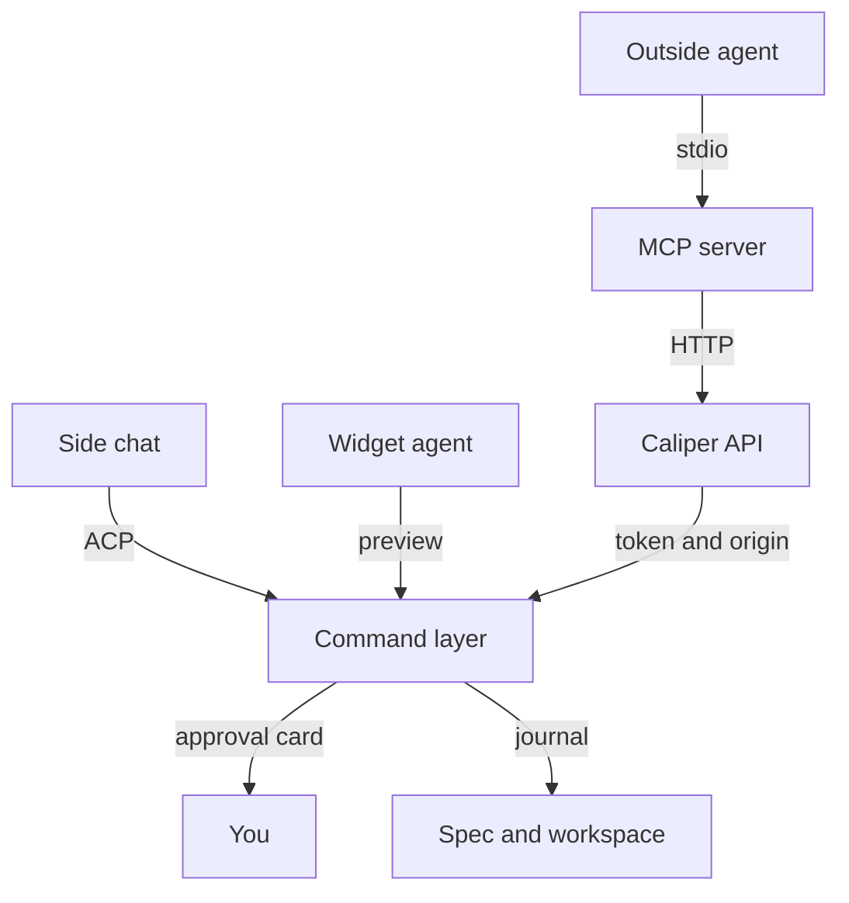

# Agents

Caliper works with AI agents in three ways. This area is for people who want an agent to build or change dashboards with them, and for developers who connect an agent of their own. Every agent changes Caliper through the same command layer, so each change is checked, journaled and open to undo.

## Agent Roles

The side chat is a pane where your own agent works with you. It supports Claude Code, Codex, Gemini CLI, opencode and any other agent that speaks the Agent Client Protocol (ACP). The widget agent is Caliper's own agent. It works on one target at a time, such as a panel or a selection, and it shows its change in place. You accept or reject it. [Agent Roles](agent-roles.md) explains when to use each one.

The third way is an agent outside the app. It drives the running app through the MCP server or the HTTP API. An outside agent has its own token, so Caliper knows who sent each command.

## Command Layer

The command layer is the one path for every change. A command that edits the open spec waits on an approval card until you approve it. This holds for the side chat, the widget agent and outside agents. Only your own session token runs commands without review, and Caliper writes that token to no file. [HTTP API](http-api.md) describes the tokens and the command origins.

## Agent Setup

The side chat needs no setup beyond an agent on your `PATH`. Caliper finds the four built-in agents by their commands, and you can add a custom one by its command line. [Side Chat](side-chat.md) lists the agents and the settings.

The widget agent needs a model provider. You choose Claude, OpenAI, Gemini, OpenRouter, a local server or any server with an OpenAI-compatible API. [Widget Agent Setup](widget-agent-setup.md) shows the steps. Then ⌘K on a panel opens the inline prompt.

An outside agent starts `caliper-mcp` as a stdio server and needs the app to run with `--api`. [MCP Server](mcp-server.md) describes the tools and the options.
