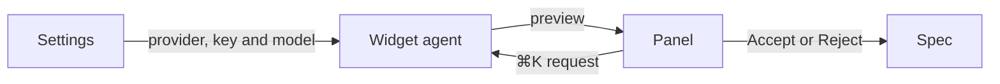

# Widget Agent Setup

The widget agent works inline on one panel and shows each change in place for you to accept or reject. It needs a
model provider: Claude, OpenAI, Gemini or OpenRouter with an API key, a local model server such as Ollama or LM Studio
without a key, or any server with an OpenAI-compatible API. [Agent roles](agent-roles.md) explains how the widget
agent differs from the side chat.

The settings choose the provider, and a ⌘K request on a panel returns a preview that you accept or reject.

Caliper finds the agent through the environment variable `CALIPER_AGENT_PYTHON`. Set it to an interpreter with
`caliper[agent]` installed, for example a virtual environment where you ran `pip install ".[agent]"` in a checkout of
Caliper. The agent reaches your workspace through the Caliper API, so start Caliper with `--api`.

## Settings Access

The settings open over the current page from any of three places:

- The **⌘, Agent** button at the right of the command bar on the landing screen
- The key **⌘,** (Ctrl+, on Windows) on any page
- **Setup** in the ⌘K prompt when no provider is set up, and **Model** after the model declined a request

Escape or **esc Close** closes them. Caliper keeps your choices in `widget-agent.json` in its app-data folder, beside
the settings of the side chat. The file holds the provider, the address, the model and the effort, but never a key.

## Provider Choice

Choose one of the presets under **Provider**. Each preset fills in the address of the model's API.

| Preset | Base URL | Key |
|---|---|---|
| Claude | `https://api.anthropic.com`, fixed | A Claude API key |
| OpenAI | `https://api.openai.com/v1`, fixed | An OpenAI API key |
| Gemini | `https://generativelanguage.googleapis.com/v1beta/openai/`, fixed | A Gemini API key |
| OpenRouter | `https://openrouter.ai/api/v1`, fixed | An OpenRouter API key |
| Ollama | `http://localhost:11434/v1`, which you can change | None |
| LM Studio | `http://localhost:1234/v1`, which you can change | None |
| Custom | The address you type | Optional |

Claude always runs on the API of Anthropic, so its features, such as caching, stay available. The hosted presets keep
their address, so a key only goes to its own service. For any other server, use Custom.

Under the address, a tag warns you where your data goes:

- **Remote address**: An Ollama, LM Studio or Custom address on another computer. Your prompts and workspace data, such
  as samples, spec text and pictures of panels, leave this machine.
- **Unencrypted**: A remote address that starts with `http://`. The data also travel unencrypted.
- **Invalid address**: An address that Caliper does not accept. It must start with `http://` or `https://`. It must not
  hold a user name, a password, a query or a fragment.

## Key Acquisition

For Claude, follow these steps:

1. Sign in to the Claude Console with the account that pays for the requests, or create an account. If your
   organization gives you a key, skip to the next section.
2. Make sure the account has billing or credits, because the agent bills every request by the tokens it uses.
3. Open the API keys page and create a key. Give it a name that says where you use it, such as "Caliper on my laptop".
4. Copy the key. The Console shows it only once.

For OpenAI, Gemini and OpenRouter, create a key on the API keys page of that service. Keep every key private, because
anyone who has it can make requests that your account pays for.

## Key Entry

1. In the settings, choose the preset.
2. Paste the key into the **Key** field, which says **Not set**. Then choose **Save** or press Return.
3. The row now says **Set**, with **Replace** and **Remove**. The settings never show the key again, not even in part.

Each provider has its own key, so an OpenAI key leaves your Claude key unchanged. Ollama and LM Studio have no key row.
A Custom server has an optional key, which Caliper keeps for each address.

Caliper keeps the key in the macOS Keychain, as an item of the service `caliper.agent-keys`. Your Mac must be unlocked
to read it, and Caliper never synchronizes it to your other devices. The item has the name of the preset (`anthropic`,
`openai`, `gemini` or `openrouter`). For a Custom server, it has the address as its name. Caliper does not write the key
to a file, a log, the workspace or the journal. When Caliper starts the agent, it gives the key to the agent in its
environment, and the agent sends it only to the API of the provider.

## Model Choice

Type the model id under **Model**, or choose it from the choices under the field.

- **Claude** offers four models. The default is Claude Haiku 5.5 at low effort. It answers fastest and costs least, and
  a widget request is a small change with its full context.

  | Model | Use it for |
  |---|---|
  | Claude Haiku 5.5 | The default: quick changes, the fastest and cheapest |
  | Claude Sonnet 5.5 | Changes that need more judgement, still fast |
  | Claude Opus 5.5 | Harder requests, slower and dearer |
  | Claude Fable 5.2 | The hardest requests, at the highest cost |

  **Effort** sets how much the model thinks before it acts: low (the default), medium, high, xhigh or max. Higher
  effort is slower and costs more.
- **The other presets** have no default model. **List** asks the server for its models and shows them as choices, if the
  server offers a list. A hosted service needs its key for this.

The widget agent has no review setting, because every change it proposes is a preview that you accept or reject.

## Model Capabilities

Beside the model, **Capabilities** shows three answers, each with its source:

| Row | What it means |
|---|---|
| Tool calling | Whether the model calls tools. A model without it cannot drive Caliper |
| Vision | Whether the model reads images. Without it, the widget agent works without a picture of the panel |
| Context length | How many tokens the model takes. Caliper sizes what it sends to a quarter of it |

**Probe** checks the model with two short test requests. One asks the model to call a tool, and one asks it to name the
color of a small picture. For Claude, Probe reads the model list of Anthropic and spends no tokens. The context length
comes from the server if it reports one. If not, Caliper assumes 8,192 tokens. For Ollama, the preset sets 16,384 tokens
(see [Local Models](#local-models)). Caliper keeps the answers for 30 days.

Each row has **Yes**, **No** and **Auto**, and the context length has a field. An answer that you set wins over the
probe until you choose Auto again. A short tag says when the probe could not answer, such as **Server unreachable**,
**Timeout** or **Key rejected**.

When the model cannot call tools, the settings show **No tool calling**, and ⌘K offers only Ask in chat. Other tags show
what is missing: **No provider**, **No key**, **No model** or **Invalid address**. For a server on your own machine,
**Context cache about N GB** warns that the context length takes that much memory on top of the model.

## Widget Agent Usage

1. Focus a panel and press ⌘K (Ctrl+K on Windows).
2. Type your request, for example "Use a linear y axis", and press Return. The prompt row shows the model.
3. Read the preview on the panel, with the change to the spec beside it.
4. Choose **Accept** (Return) to apply the change as one undo step. Choose **Reject** (Escape) to discard it and leave
   nothing behind. Choose **Refine** to add to the request.
5. If the request is bigger than one panel, choose **Ask in chat**. It sends the request, with what the widget agent
   knew, to the side chat.

To undo an accepted change, press ⌘B for build mode and then ⌘Z, or choose Undo in the page bar there. Outside build
mode, ⌘Z does nothing.

A change in the settings takes effect at once. An open ⌘K prompt closes, its preview is discarded, and a running
request is cancelled. The next ⌘K uses the new settings. If something goes wrong, the prompt shows a short tag, such as
DECLINED or NO PROVIDER, and the actions that help:

- **No provider is set up**, or the model cannot call tools. ⌘K offers Setup and Ask in chat. Setup opens the settings.
- **The API did not accept the key.** The key is revoked or mistyped. Create a new key and enter it with Replace.
- **The API is rate limited.** The agent waits, tries again on its own, and says how long it waits. If it gives up, try
  again later or raise the limits of your account.
- **The model is not available to this key.** Pick another model, or ask the account owner for access.
- **The model declined this request.** The request ends and nothing changes. The prompt shows DECLINED with the model
  name. This can happen with ordinary work, such as chemistry or biology data. Choose Rephrase, Retry, or Model to switch
  to another model or provider, such as a local model. Caliper does not fall back to another model on its own.
- **The agent stopped at its limit.** A request takes at most six model requests. If the agent reaches the limit before
  it finishes, the card shows LIMIT with the number of edits and says that the change is not finished. **Accept** applies
  those edits as they are. **Refine** lets the agent finish on the same preview. The card also shows LIMIT when a
  conversation no longer fits the context length of the model.
- **The preview is out of date.** The spec changed while the preview was open, for example through the side chat. The
  change no longer applies, and the prompt shows CONFLICT. Choose Refine to start again from the current spec.

## Local Models

A local model costs nothing per request and keeps your data on your machine. It uses the GPU and memory of your
computer, and small models do this work less reliably than large ones. It is also slower, and the first request takes
longer while Ollama loads the model.

1. Install a model server, such as Ollama or LM Studio, and download a model that supports tool calling.
2. In the settings, choose the Ollama or LM Studio preset. Change the address if your server listens elsewhere.
3. Choose **List**, then the model.
4. Choose **Probe**. If the model cannot call tools, choose another model.
5. For LM Studio, type the context length that you load the model with into the Context length field. Requests may not
   fit below 8,192 tokens.

Ollama loads a model with room for its whole context length unless you ask for less. That room, the context cache, takes
memory on top of the model. Caliper therefore asks Ollama for 16,384 tokens for ⌘K and 32,768 tokens for the
`caliper-agent` of the side chat. Ollama unloads the model one minute after its last request.

To change the length, type another value into the Context length field (for ⌘K) or give `--context-length` to
`caliper-agent` (for the side chat). The tag **Context cache about N GB** shows what a large length costs. If a
conversation does not fit, Caliper does not send it and says so.

If you reach Ollama through the Custom preset, Caliper cannot set the length, so you set it yourself. Use one of these
methods:

- Start Ollama with `OLLAMA_CONTEXT_LENGTH=16384 ollama serve`. This applies to every model.
- Make a copy of the model with a Modelfile that holds `FROM <model>` and `PARAMETER num_ctx 16384`. Then run
  `ollama create <name> -f Modelfile`.

[Widget agent conformance](widget-agent-conformance.md) lists how models did on the test tasks of the widget agent and
shows how to run the tasks against your own model. A server on another computer works through the address of Ollama,
LM Studio or Custom. Your data then leaves your machine, and the settings show Remote address.

## GPU Sharing

On a Mac, a local model uses the same GPU and memory as a training run that streams into Caliper. Both slow down. If the
model and the run do not fit in memory together, the whole machine slows as it swaps. While a live run is attached and
the provider is a server on this machine, Caliper shows **Shared GPU**. It appears under the presets in the settings and
after the model name in the ⌘K prompt row. The tag means that the model and the run take turns on the same GPU and
memory. To reduce the load:

- Use a smaller or quantized model while a run trains.
- Keep the context length modest, because the context takes memory too.
- Unload the model when you finish. With Ollama, `ollama stop <model>` unloads it at once. Otherwise a model stays
  loaded for five minutes after its last request.
- Check where the model runs. With Ollama, `ollama ps` shows whether a model is on the GPU or the CPU, and with which
  context length.
- Watch the memory pressure in Activity Monitor. If it stays high, switch to a hosted preset for the length of a long
  run.

On a computer with a separate graphics card, the weights of the model take video memory that the run may need. The same
advice holds.

## Side Chat Local Models

The side chat runs your own agent, so it uses the model that your agent is set up for, including a local model.
`caliper-agent` can be that agent. Give the side chat the custom command in [Side chat](side-chat.md#agents), with the
Ollama preset and your model. The chat then runs on the local model with no account.

Caliper cannot tell where the model of your agent runs. When your agent runs a model on this machine, choose **Local
model** in the agent picker of the chat. While a training run is attached, the header of the chat then shows **Shared
GPU**, and the advice above applies ([Side chat](side-chat.md#local-models)).

## Key Removal

In the settings, choose the preset and then **Remove**. The Key row says Not set, the agent that started with the key
stops at once, and ⌘K offers only Setup and Ask in chat until you enter a key again.

The key also appears in the Keychain Access app as an item of the service `caliper.agent-keys`. If you delete it there,
the effect is the same. If you think someone else has seen the key, also revoke it on the API keys page of the service.
Then it stops working everywhere.
