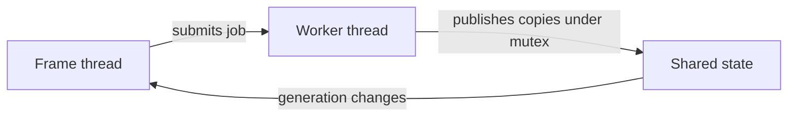

# First ML Applet

You build **SineScope**, a small MLP that learns `y = sin(x)` from noisy samples. It adds one capability at each step.
The applet shows a live loss curve, the model curve as it settles through the scattered points, and the weight matrix as a heatmap.
Synthetic data keeps the applet self-contained, so it needs no downloads.



The frame thread submits the training job, the worker publishes results, and the frame thread draws them when the generation changes.

SineScope is in `examples/sine_scope/`. Every code block below comes verbatim from that source.
The release preset builds a copy beside the executable, so you can run the finished applet first:

```bash
cmake --preset release
cmake --build --preset release
CALIPER_AUTOLAUNCH=dev.example.sine-scope ./cmake-build-release/caliper
```

Before you start, read [Development basics](../development/development-basics.md) and [Your first applet](first-applet.md).

## Build and Manifest

The manifest requires what training needs and marks visualization as optional. Thus the applet still runs without the bridge:

```toml title="examples/sine_scope/sine_scope.caliper.toml"
--8<-- "examples/sine_scope/sine_scope.caliper.toml"
```

The CMake file is the hello file plus one word, `TORCH`, and this is the entire ML build change.
`TORCH` links the libtorch that the host uses, which the SDK names. It also stamps the libtorch version into the built manifest.
As a result, the host refuses the applet if it runs beside another libtorch:

```cmake title="examples/sine_scope/CMakeLists.txt"
--8<-- "examples/sine_scope/CMakeLists.txt"
```

### Local Copy

Build your copy in a folder of its own against the installed SDK, as [Your first applet](first-applet.md#build) does for hello.
Set `CALIPER` to the host you built. The SDK must come from a core build with libtorch, as the release preset is:

```bash
mkdir -p "$HOME/caliper-applets"
cp -R examples/sine_scope "$HOME/caliper-applets/sine_scope"
cd "$HOME/caliper-applets/sine_scope"
cmake -S . -B build -DCMAKE_PREFIX_PATH="$HOME/caliper-sdk" -DCMAKE_BUILD_TYPE=Release
cmake --build build
"$CALIPER" check build/applets
CALIPER_AUTOLAUNCH=dev.example.sine-scope "$CALIPER" dev build/applets
```

`caliper dev` searches your build folder first. At equal versions, the host loads your copy and not the copy beside the executable.
The host keeps a library loaded until it quits, so quit Caliper after each rebuild and run `caliper dev` again.

## Model and State Spine

Two layers are enough to bend a line into a sine:

```cpp
--8<-- "examples/sine_scope/sine_scope.cpp:model"
```

Every live applet uses the same state skeleton: service wrappers, one mutex, published copies and a generation counter:

```cpp
--8<-- "examples/sine_scope/sine_scope.cpp:state"
```

`on_init` probes the services. The manifest already guarantees that the required services exist, so jobs need no null checks.
The optional bridge is falsy-inert: you can call it unconditionally, and it does nothing when absent.
A good demo still shows the degradation, as the Tensor Texture step does:

```cpp
--8<-- "examples/sine_scope/sine_scope.cpp:init"
```

## Training Job

Never compute on the frame thread. A job is a plain function that the host runs on a worker thread.
The job checks for cancel at each step, because jobs must respond to cancel within 100 ms.
It also reports progress, which appears in the jobs tray of the host:

```cpp
--8<-- "examples/sine_scope/sine_scope.cpp:job"
```

The frame side submits the job on click, shows progress and offers cancel:

```cpp
--8<-- "examples/sine_scope/sine_scope.cpp:controls"
```

## Live Plotting

The worker publishes owned copies of the plot data and a tensor handle for the weight display. It does this under the mutex and then bumps the generation:

```cpp
--8<-- "examples/sine_scope/sine_scope.cpp:publish"
```

The frame consumes the data when the generation moves, then draws it.
The prediction curve settles through the noisy samples with a `PlotScatter` and a `PlotLine`.
The loss curve also uses the follow-toggle idiom:

```cpp
--8<-- "examples/sine_scope/sine_scope.cpp:plots"
```

## Tensor Texture

The weight matrix appears as a colormapped texture. The code runs on the frame thread only, is gated by the generation, and releases the texture in cleanup.
When the bridge is absent, the panel says so instead of failing:

```cpp
--8<-- "examples/sine_scope/sine_scope.cpp:bridge"
```

This tutorial copies the weights to the CPU for simplicity. [`tensor_bridge.v1`](services/caliper-tensor-bridge-v1.md) also draws device tensors without them leaving the GPU.

Cleanup adds its symmetric duties: cancel, bounded wait and release:

```cpp
--8<-- "examples/sine_scope/sine_scope.cpp:cleanup"
```

**Run it** with `CALIPER_AUTOLAUNCH=dev.example.sine-scope "$CALIPER" dev build/applets`.
Within seconds, the flat line snaps into a sine while the heatmap blocks reorganize.

## Real Data

Everything above still holds, and only the data acquisition changes. Follow these rules:

- Fetch inside the job.
- Cache in `host.data_dir()`.
- Write atomically with a `.tmp` file and a rename.
- Self-heal corrupt caches.
- Make the transfer cancellable with the progress callback of curl.
- Add `CURL::libcurl` and `ZLIB::ZLIB` to the CMake links, found with `find_package(CURL)` and `find_package(ZLIB)`.

## Remaining Services

Each remaining service is a small change from here:

- **`metrics.v1`**: Call `run = metrics.begin_run("sine", "mlp32")` once, then `metrics.scalar(run, "train/loss", step, loss)` in the loop. The run then survives restarts in the metrics store of the host. The host has no view of stored runs.
- **`artifacts.v1`**: Add Save and Load buttons so a trained model outlives the process. Load and then evaluate without retraining.
- **`data.v1`**: When your published state is tabular, register it and ask SQL questions.
