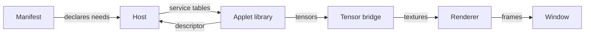

# Applets

Applets are the units of work that the Caliper app loads and shows. This area is for developers who write an applet in C++, and for readers who want to know how the host runs one. It covers how to write, build and debug an applet, and how the host draws and contains it.

## Applet Kinds

A compiled applet is a shared library. The host opens it at run time and calls it through a small C contract. The applet draws its pages with ImGui and ImPlot, and it asks the host for what it needs. A spec applet is different. It has no library, only a manifest and a spec file of sources, panels and a layout. The app draws it as a page and never runs it.

Every applet ships a manifest. The host reads the manifest before it loads any code. The manifest names the applet, the ABI epoch of its build and the services it needs. If the host cannot meet the manifest, it refuses the applet and says why on the landing screen. [Manifest](manifest.md) gives the full schema.

## Host Services

An applet does not reach into the host. It asks for a service by id, such as `caliper.log.v1` for log lines or `caliper.jobs.v1` for background work. A revision of a service is a new id that adds calls and never changes the old ones. Thus an applet built against an older id keeps working. The [Service Catalog](services/service-catalog.md) lists every id the host serves.

The host draws tensors on the GPU and hides the graphics backend from the applet. The applet hands a tensor to the tensor bridge and receives a texture id. [Rendering](rendering.md) explains how this works on each platform.

## Applet Workflow

A new applet starts from the SDK, which installs as a CMake package. The applet builds in its own folder with `caliper_add_applet()`. Then `caliper check` tests it against the host, and `caliper dev` runs it from the build folder. [First Applet](first-applet.md) walks through this path with the smallest complete example, and [First ML Applet](first-ml-applet.md) adds a small model.

A compiled applet runs in the host process with the host's privileges, so the host treats it as trusted code. The host limits the harm of a fault. It guards every call into the applet and quarantines an applet that fails. [Trust Model](trust-model.md) describes these checks. When an applet misbehaves, you attach a debugger to the running host, as [Applet Debugging](applet-debugging.md) shows.
