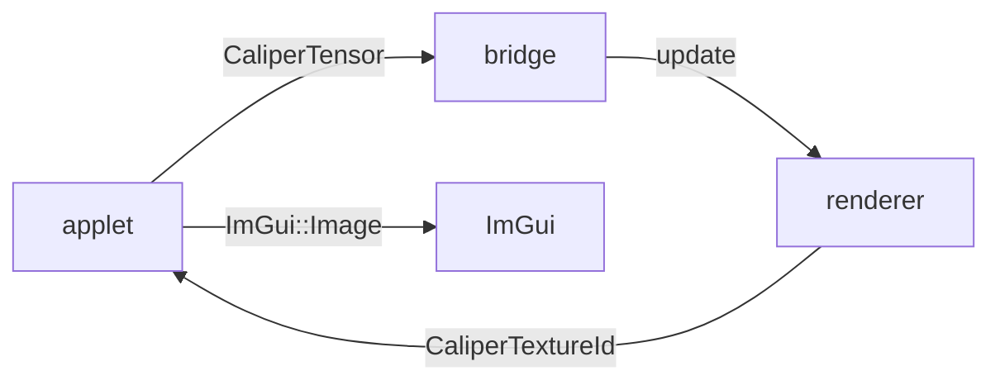

# Rendering

Caliper draws tensors that already live on the GPU, so its renderer must use a graphics API that can reach them. OpenGL
cannot do this on a Mac. It is deprecated there, it stops at version 4.1, and it has no path to the memory that the
MPS backend of PyTorch allocates. Every Mac tensor would take a round trip through the CPU on its way to a texture.

The applet gives a tensor to the bridge, and the renderer fills a texture that the applet shows through ImGui.

To avoid this problem, Caliper keeps graphics out of the applet contract. A `HostRenderer` seam hides the backends, and
each backend updates textures in its own way. The geometry path draws 3-D data. [Zero-copy tensor visualization](../python/zero-copy-tensors.md)
describes how a tensor reaches pixels without a CPU round trip and what each path costs.

## Graphics API Independence

Applets render only through ImGui and ImPlot. A tensor crosses to the renderer as a [`CaliperTensor`](tensor-and-arrow-headers.md#tensor-header),
and the renderer returns an opaque `CaliperTextureId`. The host keeps a table from that id to the handle of the backend,
so the id is never a raw OpenGL, Metal or Vulkan object. Because the contract hides the backend, a change or addition
needs no epoch bump and no applet rebuild.

`HostRenderer` is a host-internal interface that the ABI never sees. The host picks one backend at startup.

## Backends

| Backend | Selected | Update path | Notes |
|---|---|---|---|
| Metal | Default on macOS | A compute pass (f32 with a colormap) or a blit (u8) reads the MPS `MTLBuffer` in place | No CPU staging |
| Vulkan with CUDA interop | Default on Windows | A CUDA kernel writes the Vulkan image directly; see [the update ladder](#windows-update-ladder) | Details in [Vulkan and CUDA on Windows](../development/vulkan-and-cuda.md) |
| OpenGL 3.3 core | `CALIPER_RENDERER=gl`, or the only backend on other platforms | The bridge colormaps on the CPU and uploads the result | The fallback. `tex_update_from_device` always returns `false` |
| WebGPU | The browser views (`web/wasm`) | A WGSL compute pass colormaps the host-memory snapshot into the texture | Browser only; see [the WebGPU backend](#webgpu-backend) |

Metal is the default on macOS and Vulkan is the default on Windows. `CALIPER_RENDERER=gl` selects OpenGL on either. If
the native backend fails to initialize, for example with no driver or in a remote desktop session, the host recreates
the window with OpenGL. Every backend produces the same pixels for the same tensor. The graphics tests compare the
readback of each backend byte for byte with the CPU reference conversion.

## WebGPU Backend

The browser views are the native view layer compiled to WebAssembly. The WebGPU renderer draws them behind the same
`HostRenderer` seam, on the WebGPU of the browser. It covers what the live views use:

- **The frame.** The renderer draws on the WebGPU surface of the canvas and records the ImGui draw data. It uses
  nearest sampling for magnified heatmap cells.
- **Textures.** Images and heatmaps use RGBA8 textures. Every snapshot arrives as host memory, so the bridge asks the
  renderer to colormap it through `tex_update_mapped_from_host`. Native backends leave this hook at its default, `false`.
  A WGSL compute pass gives exactly the bytes of the CPU reference `map_f32_to_rgba8`, so the rounding of the GPU
  cannot change a colour.
- **Points.** A points payload is copied into a GPU buffer through `HostRenderer::import_host_allocation`. Each point
  is drawn as an instanced quad of the native point size, with the native colour rule and depth test, because WebGPU
  draws a point as one pixel.

The WebGPU renderer refuses device tensors and imported GPU memory, because a browser has neither. It also refuses
geometry other than points, and the embed canvas. Its two shaders are written by hand in WGSL, because WebGPU has no
push constants and limits the storage buffers of a vertex stage.

The landing screen, the launch flow and the dashboards of the host use ImGui and no raw OpenGL. They look the same on
every backend.

## Pixel-Space Contract

Applets never issue graphics calls. They describe what to draw in ImGui terms and hand tensors to the bridge. The host
owns the window, the contexts and every GPU call. A tensor becomes a texture through [`caliper.tensor_bridge.v1`](services/caliper-tensor-bridge-v1.md).
That service is the one place where the backend difference lives: device compute or blit on Metal and Vulkan, and CPU
staging on OpenGL. The applet runs the same code on every backend.

## Windows Update Ladder

The Vulkan backend tries three rungs for each device-resident CUDA tensor and takes the first that accepts it.
`last_device_path()` reports which rung ran.

1. **Direct** (`direct-cmap` for f32 with a colormap, `direct-blit` for u8). A CUDA kernel on the stream of the producer
   reads the tensor where it lies and writes the Vulkan image. There is no copy and no Vulkan compute pass.
2. **Buffer** (`compute` or `blit`). The tensor is copied inside VRAM into a buffer shared with Vulkan, and a Vulkan
   pass turns that buffer into the image. This rung runs when the direct path refuses the tensor, and for the
   offscreen canvas.
3. **CPU staging.** The bridge converts on the CPU and uploads. This is the last rung, and the only one for a CPU
   tensor.

Each rung keeps the output byte-identical to the CPU reference. When a rung is unavailable, the next one runs and the
startup log says so, as the [fallback rule](../introduction/architecture.md#design-decisions) requires.

## One-Way Data Flow

Data moves from tensors to pixels to ImGui, and no further, as the [platform rules](../introduction/architecture.md#design-decisions)
require. There is no render-to-tensor entry point, no readback on any hot path, and no way for an applet to supply its
own shader. The `debug_readback_rgba8` function of the backends exists for the test harness only. Training consumes the
same tensors that the renderer reads, and never the output of the renderer.

Several things look as though they need a new host capability, but they do not:

- **Static assets** such as CAD, OBJ or glTF shells. The applet loads the file and fills vertex and index tensors. The
  host never learns about file formats.
- **Picking, hover and selection.** The applet casts rays against its own tensors. Interaction is math that the applet
  owns.
- **Annotation and heads-up displays.** ImGui composites over the view image.

## Geometry Path

Textures show tensors as images, and the geometry path draws a tensor as 3-D geometry. The applet writes vertices,
indices, normals and attributes into device memory. It imports them into the host once through
[`caliper.tensor_bridge.v1_2`](services/caliper-tensor-bridge-v1.md), and it calls
[`caliper.geometry.v1` and its revisions](services/caliper-geometry-v1.md) each frame. The host draws the geometry
in place into an offscreen view. The view is an ordinary `CaliperTextureId` that the applet shows with `ImGui::Image`.

- **Offscreen views.** A view is a texture that the host renders into. It lives in the same id table as bridge
  textures.
- **Depth views.** A view created with the depth flag carries a D32 float depth buffer that is private to the renderer.
  The host refuses depth state on a view without one and never ignores it.
- **Vertex pulling.** There is no vertex-input state. The vertex shader reads positions, indices, normals and
  attributes from the imported buffers by vertex index. An indexed draw becomes a non-indexed draw of `index_count`
  vertices, so one mechanism serves every topology on both backends.
- **One atomic, gated frame.** `draw_primitives` renders a whole frame from an array of draw descriptors. The host
  checks every draw before it encodes anything. One failed check refuses the whole frame and leaves the previous pixels
  intact, which a begin and end API could not promise.
- **Growth by records.** A revision is a new service id. Its table and record begin with the bytes of the previous
  revision, and a new capability bit gates it. A host draws a zero tail exactly as the earlier revision did (see the
  [growth rules](../development/compatibility-and-epochs.md#growth-rules)). Both backends stay byte-exact against one
  shared CPU reference.

Metal compiles its shaders at run time, and Vulkan embeds SPIR-V that the build produces
([Build-time SPIR-V](../development/vulkan-and-cuda.md#build-time-spir-v)).

## Metal Queue Commit Ordering

The Metal renderer submits tensor operations and the drawing of the frame to one `MTLCommandQueue`. Metal starts the
command buffers on one queue in the order of their commits. This gives most of what the Vulkan backend needs explicit
machinery for:

- **Draw after update.** The tensor operation is committed during the `frame()` of the applet, before the command buffer
  of the frame. Thus the frame samples finished texels with no added synchronization.
- **Resource lifetime.** A command buffer retains the resources it references until it completes. A buffer or texture
  that the host releases in flight stays alive until the GPU is done with it.
- **Rapid re-update.** Two updates to one texture are two command buffers on one queue, and the commit order serializes
  them.

Metal therefore keeps no per-texture sync objects, no back-pressure wait and no list of pending waits. An
`MTLSharedEvent` appears only where a second queue exists, which is the queue of the producer when a stream-ordered
handoff is in use. The remaining CPU waits are in readbacks, the offscreen canvas, the geometry rigidity check and a
rare fallback, and not in the update path. [Zero-copy tensor visualization](../python/zero-copy-tensors.md#sync-ladder)
covers the handoff.
