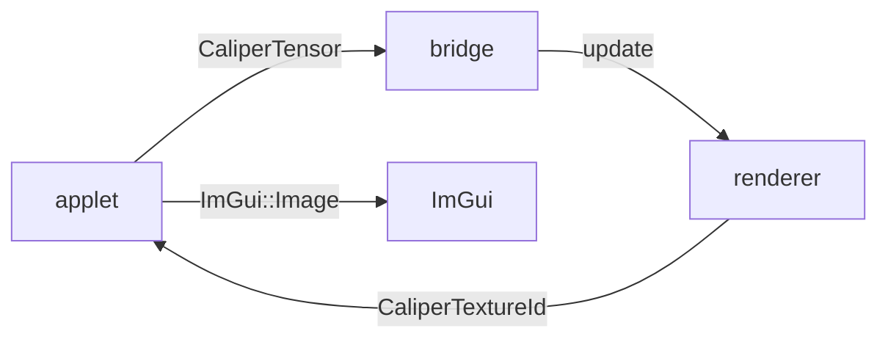

# Rendering

Caliper draws tensors that already live on the GPU, so its renderer must use a graphics API that can reach them. OpenGL
cannot do this on a Mac. It is deprecated there, it stops at version 4.1, and it has no path to the memory that the
MPS backend of PyTorch allocates. Every Mac tensor would take a round trip through the CPU on its way to a texture.



The applet gives a tensor to the bridge, and the renderer fills a texture that the applet shows through ImGui.

To avoid this problem, Caliper keeps graphics out of the applet contract. A `HostRenderer` seam hides the backends, and
each backend updates textures in its own way. [Zero-copy tensor visualization](../python/zero-copy-tensors.md)
describes how a tensor reaches pixels without a CPU round trip and what each path costs. The [graphics layer](graphics-layer.md) and [scene rendering](scene-rendering.md) pages describe the renderer core that the live views draw through.

## Graphics API Independence

Applets render only through ImGui and ImPlot. A tensor crosses to the renderer as a [`CaliperTensor`](tensor-and-arrow-headers.md#tensor-header),
and the renderer returns an opaque `CaliperTextureId`. The host keeps a table from that id to the handle of the backend,
so the id is never a raw Metal or Vulkan object. Because the contract hides the backend, a change or addition
needs no epoch bump and no applet rebuild.

`HostRenderer` is a host-internal interface that the ABI never sees. The host picks one backend at startup.

## Backends

| Backend | Selected | Update path | Notes |
|---|---|---|---|
| Metal | Default on macOS | A compute pass (f32 with a colormap) or a blit (u8) reads the MPS `MTLBuffer` in place | No CPU staging |
| Vulkan with CUDA interop | Default on Windows | A CUDA kernel writes the Vulkan image directly; see [the update ladder](#windows-update-ladder) | Details in [Vulkan and CUDA on Windows](../development/vulkan-and-cuda.md) |
| WebGPU | The browser views (`web/wasm`) | A WGSL compute pass colormaps the host-memory snapshot into the texture | Browser only; see [the WebGPU backend](#webgpu-backend) |

Metal is the default on macOS and Vulkan is the default on Windows, and there is no other choice:
[No Fallback Renderer](#no-fallback-renderer) says what happens where the backend cannot start. Every backend produces
the same pixels for the same tensor. The graphics tests compare the readback of each backend byte for byte with the CPU
reference conversion.

## No Fallback Renderer

Caliper draws with Metal on macOS and Vulkan on Windows, and has no fallback renderer until the WebGPU fallback through
Dawn lands. The OpenGL renderer that used to take over has been removed. Where the renderer of the platform cannot
start, for example on a virtual machine or in a remote session without a working GPU, or with a broken driver, Caliper
refuses with one message that names the renderer and why it could not start:

- **The app** prints `caliper: the Metal renderer could not start (<reason>), and there is no fallback renderer until
  the WebGPU fallback through Dawn lands` (Vulkan on Windows) and exits with 1.
- **`caliper shot`** prints `caliper: shot cannot draw offscreen: ` followed by the same text, and exits with 1.
- **Caliper Embed** refuses to attach a canvas: `caliper_core_attach_canvas` returns 0 and `caliper_core_last_error`
  holds `attach_canvas: ` followed by the same text. The core stays usable.

The reason is the own message of the backend, such as `no Metal device` or `no Vulkan device with a graphics queue`;
each start failure of the Metal and Vulkan backends records one (`HostRenderer::start_error()`). `CALIPER_RENDERER=gl`,
which used to choose OpenGL, is refused before any renderer is made. The app and `shot` print
`CALIPER_RENDERER=gl asks for the OpenGL renderer, which was removed; unset it, and Caliper draws with Metal on macOS
and Vulkan on Windows` after their prefixes, and `caliper_core_create` returns `NULL` and sends the same text to the
log of the embedder. Linux has no renderer at all, and each of the three says so. [Refusal messages](../reference/refusal-messages.md#renderer-refusals)
lists the messages. The test variable `CALIPER_TEST_RENDERER_FAIL=1` makes the start fail, so that the refusals can be
tested on a machine whose GPU works.

## WebGPU Backend

The browser views are the native view layer compiled to WebAssembly, and `src/host/renderer/webgpu_renderer.cpp` draws
them behind the same `HostRenderer` seam, on the WebGPU of the browser through the standard `webgpu.h`. They are the only
WebGPU drawing in a browser: the own views of the `<caliper-view>` element, written in TypeScript, draw with Canvas 2D
where these views do not draw ([Renderer Selection](../web/browser-elements.md#renderer-selection)). The renderer itself
keeps only the surface of the canvas, the frame loop and ImGui, which it records through `imgui_impl_wgpu`, with nearest
sampling for magnified heatmap cells. Every resource and draw of the live views goes through the
[graphics layer](graphics-layer.md) of the renderer core, whose WebGPU backend (`src/host/renderer/webgpu_backend.cpp`)
the renderer makes on its own device and queue:

- **Textures.** RGBA8 textures for images and heatmaps are layer textures, and the upload of an image is a texture write.
  Every snapshot arrives as host memory, so the bridge asks the renderer to colormap it through
  `tex_update_mapped_from_host`, an additive hook that native backends leave at its default, `false`. The renderer writes
  the values into a layer buffer and submits one compute dispatch, whose parameters are a uniform in the arena of the
  frame. The pass gives exactly the bytes of the CPU reference `map_f32_to_rgba8`: the CPU derives, from that function
  itself, the value at which each of the 255 colour steps begins, and the shader only compares values with those
  thresholds, so the rounding of the GPU cannot change a colour.
- **Points.** The points view draws through the scene core over the backend of the renderer, as natively
  ([Points View](scene-rendering.md#points-view)). The buffers of its payload are imported with the `import_buffer` of the
  layer. A browser cannot wrap host memory, so the layer copies them and reports the route `copied-from-host` with the
  bytes copied, and the path label of the view reads `points-cpu-staged`. Each point is an instanced quad of the generated
  points program, and in 3-D the points draw the depth cues of the view. The positions and values are instance-step vertex
  buffers bound at their byte offsets, and the colormap is the uniform block of keys of the draw, so no storage buffer is
  read in a vertex stage, which a WebGPU device in compatibility mode would refuse. The layer keeps released buffers and
  reuses them for the next snapshot of the same capacity.
- **Lifetimes.** The layer destroys a released texture once the last submit that used it has completed, and keeps its
  view to the end of the frame, after the backend of ImGui has dropped the bind groups it made while recording that
  frame. Readbacks for the own checks of the module go through the asynchronous readback of the layer.

The backend implements every hook of the graphics layer on `webgpu.h`: buffers whose capacity is a power of two with a
spare pool of at most 64 MiB, textures and samplers, programs with explicit bind group layouts from their `ProgramDesc`,
render and compute pipelines, bind groups, the uniform arena written once per submit, draw lists with vertex and
instance-step buffers (a stride of 0 makes a stream constant), indexed draws with 32-bit indices, depth, the three blend
modes, the RG32Uint ID target, completion through the callback of the queue and readback through the asynchronous map of
the buffer. It keeps to the default limits of WebGPU, and on a compatibility-mode device to the limits of that level.
WebGPU validates shader modules and pipelines asynchronously, so their errors are collected afterwards rather than
refused at once. Each submit runs in an error scope too, so that a frame that the core passed and WebGPU refuses is
reported in `device_errors()` as `submit <serial>: ...` rather than lost. The colormap pass of the textures is the
hand-written WGSL in `src/host/renderer/webgpu_programs.h`, to be replaced by the table of the shader generator. The
points and scene views draw with the generated programs.

The renderer refuses the rest of the interface: device tensors and imported GPU memory (a browser has neither), geometry
other than points, and the embed canvas. `web/wasm/README.md` gives the build of the module, its size and its checks.
The same backend is planned as the native fallback through Dawn, chosen only when the Metal or Vulkan renderer is
unavailable. Until it lands there is [no fallback renderer](#no-fallback-renderer).

The host's own screens make no graphics API calls either. The landing screen, the launch flow and the dashboards are
drawn with ImGui, so they look the same on every backend.

## Pixel-Space Contract

Applets never issue graphics calls. They describe what to draw in ImGui terms and hand tensors to the bridge. The host
owns the window, the contexts and every GPU call. A tensor becomes a texture through [`caliper.tensor_bridge.v1`](services/caliper-tensor-bridge-v1.md).
That service is the one place where the backend difference lives: device compute or blit on Metal and Vulkan, and CPU
staging for a CPU tensor or a renderer without the device path. The applet runs the same code on every backend.

## Windows Update Ladder

The Vulkan backend tries three rungs for each device-resident CUDA tensor and takes the first that accepts it.
`last_device_path()` reports which rung ran.

1. **Direct** (`direct-cmap` for f32 with a colormap, `direct-blit` for u8). A CUDA kernel on the stream of the producer
   reads the tensor where it lies and writes the Vulkan image. There is no copy and no Vulkan compute pass.
2. **Buffer** (`compute` or `blit`). The tensor is copied inside VRAM into a buffer shared with Vulkan, and a Vulkan
   pass turns that buffer into the image. This rung runs when the direct path refuses the tensor, and for the
   offscreen canvas.
3. **CPU staging.** The bridge converts on the CPU and uploads. This is the last rung, and the only one for a CPU
   tensor.

Each rung keeps the output byte-identical to the CPU reference. When a rung is unavailable, the next one runs and the
startup log says so, as the [fallback rule](../introduction/architecture.md#design-decisions) requires.

## One-Way Data Flow

Data moves from tensors to pixels to ImGui, and no further, as the [platform rules](../introduction/architecture.md#design-decisions)
require. There is no render-to-tensor entry point, no readback on any hot path, and no way for an applet to supply its
own shader. The `debug_readback_rgba8` function of the backends exists for the test harness only. Training consumes the
same tensors that the renderer reads, and never the output of the renderer.

Several things look as though they need a new host capability, but they do not:

- **Static assets** such as CAD, OBJ or glTF shells. The applet loads the file and fills vertex and index tensors. The
  host never learns about file formats.
- **Picking, hover and selection.** The applet casts rays against its own tensors. Interaction is math that the applet
  owns.
- **Annotation and heads-up displays.** ImGui composites over the view image.

## Copy Counters and Frame Statistics

The host counts every copy it makes of tensor data on the way to pixels, so that each route's copies can
be read and compared, and the Metal renderer can record frame times and GPU times. Both exist to measure the
renderer: a change to it must leave a zero-copy route at zero copies and keep the times within bounds.

**What counts as a copy.** An upload of host bytes into GPU memory (a CPU tensor's staged upload; the graphics layer's
copy of a CPU points payload at import, natively and in the browser; in the browser, the host colormap's upload of the
values), a host copy into a staging buffer, a copy inside the GPU (the Vulkan buffer path's copy into
the shared buffer), a network snapshot received into its slot, the values of a series or histogram copied into the
view at apply, and a readback of a payload.
The pass that turns a payload into a view's pixels, such as a colormap dispatch, the blit of an RGBA8 image into the
view's texture or a draw, is the update itself and not a copy, as [Zero-copy tensor visualization](../python/zero-copy-tensors.md#terms)
defines the words. The colormap's 256-entry table is not tensor data and is not counted.

**What the counters read.** The renderer keeps the total, and the core keeps one count per view name and one per
frame. A view reports its copies since it appeared and those of its last update; the core reports the copies made
between the ends of consecutive frames and over a window that a reader resets. They are always on and cost two
additions per copy, none on a zero-copy route. The counters belong to the process that draws. A Caliper LIB producer
first takes a snapshot of the tensor into its slot ([Live streaming](../python/live-streaming.md#snapshot)), one copy on the
GPU for an MPS tensor and one on the host for a CPU tensor, and the viewer then reads the slot in place, so a
heatmap reached through the shared-memory session or the in-process window counts 0 in the viewer for both.

| Route | Copies per update | Bytes |
|---|---|---|
| MPS tensor, imported allocation, shared-memory slot, in-process window slot | 0 | 0 |
| Points from an `MTLBuffer` (also while the view redraws every frame) | 0 | 0 |
| CPU tensor to a heatmap or image view (an embedder's `caliper_core_view_tensor`, an applet's bridge texture) | 1 | width x height x 4 |
| CPU points payload (the graphics layer's copy at import, natively and in the browser) | 1 per buffer | N x 12, and N x 4 for the values |
| Browser heatmap (`tex_update_mapped_from_host`) | 1 | width x height x 4 |
| Network snapshot (`caliper_core_live_attach_url`) | 1, into its slot | the payload and its values |
| Series and histogram values | 1 at apply (a network series adds its received values) | the values |
| Vulkan buffer path | 1, inside VRAM | the tensor's bytes |

**Frame statistics.** With `CALIPER_METAL_STATS` set, the Metal renderer records the interval between the ends of
consecutive frames, the GPU time of every texture update, of every view draw and of the frame's own pass, taken from
each command buffer's `GPUStartTime` and `GPUEndTime`, and the updates by path, such as `compute-imported`. A view
draw is a frame of a points or scene view through the graphics layer, whose GPU time the layer
measures and the view hands to the renderer (`HostRenderer::note_draw_gpu_ms`); a points draw is not an update by
path. Without the variable nothing is recorded and no completion handler is added. At shutdown it
prints one line for the whole run, beside the renderer's copy count, in the form of `CALIPER_VULKAN_STATS`:

```text
[metal] stats: 364 frames, ms p50 20.10 p99 21.21 max 348.49; updates compute 2 compute-imported 478;
gpu ms update p50 0.014 p99 0.114 max 0.270 (480), view draw p50 0.119 p99 0.390 max 0.528 (239),
frame p50 0.116 p99 0.472 max 0.924 (364); copies 224 (344024 bytes)
```

Percentiles are nearest-rank, as on Vulkan. The worst frame of a run is usually the first, which compiles the
pipelines.

**Where to read them.** `caliper-viewer --stats` turns the statistics on and adds them to its line every 2 s: the
window's `copies`, `copy_bytes` and the `copy_frames` they spread over, `frame_ms_p50`, `frame_ms_p99` and
`frame_ms_max`, the GPU percentiles and counts (`gpu_update_ms_p50`, `gpu_draw_ms_p50`, `gpu_frame_ms_p50` and their
`p99` and `_n`), one `upd_<path>` count per path, `now_ns`, the window's end in the clock a producer stamps with, and
for each view `copies` and `copy_bytes` beside its `path`. In Caliper LIB, `view_info` and `live_view_info` return
`copies`, `copy_bytes`, `last_copies` and `last_copy_bytes`, and an in-process window's core has `frame_stats(reset)`
with the core's copies per frame and, when `CALIPER_METAL_STATS` is set, the frame and GPU times. Copies divided by
frames over the same window give the copies per frame. The benchmarks in `python/bench/` report all of them for
every row (`python/bench/README.md`).

## Metal Queue Commit Ordering

The Metal renderer submits tensor operations and the drawing of the frame to one `MTLCommandQueue`. Metal starts the
command buffers on one queue in the order of their commits. This gives most of what the Vulkan backend needs explicit
machinery for:

- **Draw after update.** The tensor operation is committed during the `frame()` of the applet, before the command buffer
  of the frame. Thus the frame samples finished texels with no added synchronization.
- **Resource lifetime.** A command buffer retains the resources it references until it completes. A buffer or texture
  that the host releases in flight stays alive until the GPU is done with it.
- **Rapid re-update.** Two updates to one texture are two command buffers on one queue, and the commit order serializes
  them.

Metal therefore keeps no per-texture sync objects, no back-pressure wait and no list of pending waits. An
`MTLSharedEvent` appears only where a second queue exists, which is the queue of the producer when a stream-ordered
handoff is in use. The remaining CPU waits are in readbacks, the offscreen canvas and a
rare fallback, and not in the update path. [Zero-copy tensor visualization](../python/zero-copy-tensors.md#sync-ladder)
covers the handoff.
