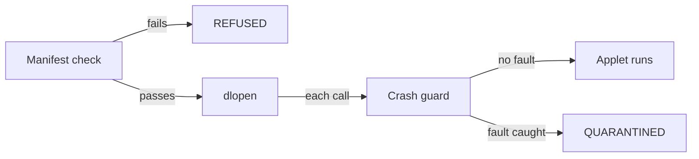

# Trust Model

Caliper runs applets **in-process**. An applet is a shared library that the host loads with `dlopen` and calls directly. This gives raw performance and an API where applets program ImGui and ImPlot directly.

The host checks the manifest before it loads an applet, wraps every applet call in a crash guard, and quarantines an applet that faults.

An applet runs with the privileges of the host and in its address space. Thus **in-process applets are trusted code.** The host limits the harm when that trust is wrong, but it does not sandbox applets. Applets never run out of process. A spec applet is the exception, because it has no code. See [Spec Applets](#spec-applets).

## Pre-Flight Checks

The first line of defense runs before any applet code does. Each applet ships a manifest (`<stem>.caliper.toml`) that declares the ABI epoch it was built against, the minimum host version, and the services it requires. The host checks the manifest **before the `dlopen`**. An applet built for another ABI epoch, or one that needs a service the host cannot supply, never loads. The landing screen lists it as `REFUSED`, and the Inspector gives the reason ("Built for ABI epoch 1; this host speaks 2 — check for an applet update."). Thus a wrong-build applet gives a clear message and not a loader crash.

Two more checks back up the manifest. The applet `id` names its data folder, so the parser and the loader both accept only path-safe ids (`[a-z0-9.-]`, see [Manifest](manifest.md)). An id such as `../../x` cannot reach outside the data root. After the `dlopen`, the loader checks the services in the binary's own list against the host. Thus a manifest that under-declares cannot start an applet that calls a missing service.

## Guarded Applet Calls

A manifest cannot catch a null dereference in the frame code of an applet. Thus the host wraps every call into an applet in a crash guard. The guard covers construction, `frame()` and teardown. The guard has one form for each kind of fault:

- **POSIX (macOS, Linux):** A signal trampoline. The first guarded call installs handlers for `SIGSEGV`, `SIGBUS`, `SIGFPE` and `SIGILL`, once for the whole process. Before each call, the guard records a jump target with `sigsetjmp`. If the applet faults, the handler uses `siglongjmp` to leave the applet call, and the guard returns a failure that names the signal (for example `SIGSEGV (invalid memory access)`). The handler runs on a per-thread alternate signal stack, so it also contains a **stack overflow**. The jump state is per thread, so guarded calls on different threads do not interfere.
- **C++ exceptions:** The guard catches an exception that escapes an applet entry point and treats it like a signal. It reports `C++ exception: <what()>`, or `C++ exception (non-std type)` for a type not derived from `std::exception`. Applets built with the `CALIPER_APPLET` macro already catch at the ABI boundary. The guard catches what a hand-written applet lets through.
- **Windows:** The applet call sits inside a `__try/__except (EXCEPTION_EXECUTE_HANDLER)` frame. The guard reports a hardware exception by its exception code, and it reports a C++ exception by name from a frame beside it. Under `/EHsc`, MSVC may report a C++ throw by its SEH code `0xE06D7363` and not by name. The host still quarantines it, as a signal, so it offers no restart.

The guard does not contain a fault outside a guarded region or on a thread that never guards. It restores the handler that it replaced and re-raises, so the fault reaches the default action or the crash reporter of an embedder. If another library replaces the handlers later (a test harness, or Python `faulthandler`), the guard re-arms them around each applet call and passes other faults to that library. It then prints one line on stderr: `[guard] another library replaced the SIGSEGV handler; re-arming the guard around each applet call`.

The host also wraps every job that an applet submits through `caliper.jobs.v1`. See [Guarded Jobs](#guarded-jobs).

## Fault Quarantine

When the guard catches a fault, the host does not retry the call. It **quarantines** the applet and returns to the landing screen. There the row of the applet reads `QUARANTINED` and the Inspector names the fault. The host never calls the faulted instance again. The host stays interactive, and the failure stays in the one applet that caused it.

What brings the applet back depends on the fault:

- **A C++ exception.** The stack unwound normally and every destructor ran, so the process is unharmed. The loader keeps the instance, uncalled, and the Inspector offers `⌘R Restart`. This releases the old instance (a guarded `cleanup()` if its `initialize()` succeeded, then `destroy()`) and starts a fresh one in the same process.
- **A signal.** The jump skipped every destructor, and the applet may have corrupted memory that a fresh instance would inherit. The host abandons the instance with no `cleanup` or `destroy`, and the Inspector says `restart Caliper to reload`. Nothing of that applet runs again until the host restarts.

### UI Unwinding

An applet draws into the ImGui, ImPlot and ImPlot3D contexts of the host. A fault in the middle of `frame()` or `initialize()` can leave windows, tab bars, style pushes and an open plot behind. The host records the UI stack sizes before each applet frame and launch. After a failed call, it unwinds to those sizes with the error recovery of ImGui, pops the style and colormap pushes of the plot libraries, and drops any half-built plot. It does this before it draws anything else. One stderr line reports the result, for example `[ui] unwound after an applet fault: Missing End() x2, Missing PopStyleColor(), ImPlot: missing EndPlot()`, and nothing asserts. This is best effort. A fault *inside* an ImGui call can leave the state of that call half-written.

## Best-Effort Containment

The crash guard is **best-effort containment, not isolation.** When a signal fires, the applet has already run arbitrary code in the host address space. It may have corrupted the shared heap, left a lock held, or overwritten memory that the host needs. `siglongjmp` runs no C++ destructors, so anything the applet owned leaks or stays half-torn-down. For this reason the host never resumes a quarantined instance. After a signal, it treats its own memory as suspect and asks for a Caliper restart. A C++ exception runs destructors, so an in-process restart is reasonable after one, but it always makes a fresh instance.

Real isolation needs an address-space boundary, which means running applets out of process. Caliper does not do this.

### Quarantined Library Retention

The host never closes the library of a quarantined applet with `dlclose` (or `FreeLibrary` on Windows). Closing an image runs its static destructors, and this can cause a second fault or a hang in an image that just faulted. Leaking the mapped library costs a little address space and nothing else. At shutdown, the host also leaves every applet library mapped, because large dependencies such as libtorch are not safe to unload.

## Frame Watchdog

The crash guard catches applets that fault. The watchdog catches applets that misbehave. The host calls the `frame()` of each applet once per frame, so a `frame()` that does heavy work blocks the UI thread, and the window stops responding. The watchdog times each `frame()`. When a `frame()` exceeds the budget (about 250 ms) for three consecutive frames, the watchdog puts the note `slow: long work belongs in background jobs` in the applet bar at the top of its page. The note points long work to `caliper.jobs` and away from the frame loop. The flag **latches**. It stays until the applet relaunches, and a later fast frame does *not* clear it, so the evidence of a stall does not scroll away. The applet keeps running and the host tears nothing down.

## Guarded Jobs

The worker threads get the same protection as the frame thread. The Caliper host runs every job function submitted through `caliper.jobs.v1` inside the crash guard, on its worker thread. A null dereference, a bad tensor operation or an escaping exception inside a job fails that job with the reason of the guard (`failed: SIGSEGV (invalid memory access)` in the jobs tray and on stderr). The host carries on.

A failed job also quarantines the applet that submitted it, when the host can tell which applet that was. The host tracks the submitter by thread. Around each call into an applet, the loader marks that applet as the owner of any job submitted during the call, and a job passes its owner on to the jobs that it submits. When an owned job faults, the loader quarantines the applet before it calls the applet again, at the next `frame()` or at teardown. The status reads `crashed in background job "train": SIGSEGV (invalid memory access)`. A job that a thread of the applet itself submits has no owner. That job fails, and the applet keeps running.

As with `frame()`, a job that threw leaves its applet restartable with `⌘R Restart`, and a job that took a signal does not. The jobs tray shows the job as `FAILED` with its reason until you clear finished jobs. Activity logs a `job failed` row before the `quarantined` row of the applet.

The limits of best-effort containment apply with more force on a worker. A lock that a job held when it took a signal stays held. A bad pointer passed to a host service that reads applet memory under its own lock leaves that lock held too. These services are `metrics.v1` `histogram` and `image`, `artifacts.v1` `put`, `feed.v1` reads and `log.v1`. The next user of the service blocks, and a crash becomes a hang. Other hosts, such as the fixture host or the host of an embedder, may run jobs with no guard at all. Thus follow these rules:

- Keep job code as careful as any code that runs without protection.
- Poll `cancelled()`, so the host can stop the job within the ≤ 100 ms contract. Home and quit wait at most 5 s, then detach the worker.
- Make the object that you pass as `user` outlive the job. Cancel it and wait for it, with a bound, in `on_cleanup`.

Real isolation for worker code needs an out-of-process boundary, which Caliper does not provide.

## Spec Applets

A [spec applet](manifest.md#spec-applets) is a folder with a manifest and a spec. The spec is a text file of sources, panels and a layout. The folder has no library. The loader lists the applet and never maps or executes anything for it. There is no `dlopen`, no descriptor call and no applet entry point. Thus the crash guard and the frame watchdog have nothing to guard, and the host never quarantines a spec applet. The app draws it as a page with its own code, from the data that the spec names.

The loader checks that the data stays in place and stays small. The manifest names the spec by a plain file name, so the spec is a file in the folder of the applet. It must be a regular file and not a symbolic link, wherever the link points. It may hold at most 512 KiB. The loader reads only the first lines of the spec, for its format version, when it lists the applet. The spec library of the builder parses and validates the whole spec, and it bounds its own work on hostile text.

A person may receive a workspace from anyone, so the loader treats the `applets/` folder of the open workspace as data too. The loader refuses the manifest of a compiled applet there and never opens its library. It reads every manifest there with a size bound of 64 KiB and a bound on its dotted keys before it parses the manifest. A compiled applet runs only from the folders that a person installs into or names for development.

## Supply Chain and Data

The loader trusts the files in the folders it scans. These points apply:

- **Digests.** The artifact store ([`caliper.artifacts.v1`](services/caliper-artifacts-v1.md)) keys every stored file by its sha256 digest. Identical bytes are stored once, and a file is always found by its content.
- **Signing is undecided.** The loader does not check a signature on an applet. The signing of third-party applets is an open question.
- **Data folders are a convention.** Each applet gets its own data folder, `data/<id>/` under the app-data root, but nothing enforces it. An applet runs in the process of the host with the file permissions of the host, and it can read any file the host can read. The restriction on the id (`[a-z0-9.-]`) only keeps the folder name a single, safe path component.
- **No sandbox.** Everything on this page that sounds like a boundary is containment of faults, not protection against a hostile applet. Load only applets that you trust.
