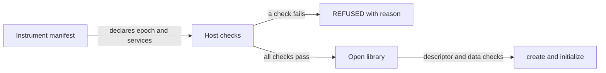

# Compatibility and Epochs

Caliper versions the ABI, the services, the SDK, the instruments and their stored data separately. Each one changes without breaking instruments that are already built.



The loader does not download dependencies.

The host is a **service registry, not a struct of fields**. Instruments with a library obtain capabilities by name through a single extension point:

```c
struct CaliperHost {
    uint32_t    struct_size;
    uint32_t    abi_epoch;              // epoch this host is speaking
    uint32_t    host_version;           // (major<<16)|(minor<<8)|patch, informational
    const char* instrument_data_dir;    // per-instrument data folder, UTF-8
    /* THE extension point. Returns a service table or NULL. The pointer is
       valid for the instrument's lifetime. Unknown ids return NULL — never UB. */
    const void* (*get_service)(const CaliperHost* host, const char* service_id);
};
```

New capabilities arrive as new service ids and never change the base ABI. Thus the base ABI stays small and stable while the host grows. Every instrument must cope with a missing service, which the fallback rule in [Architecture](../introduction/architecture.md#design-decisions) already requires.

## Toolchain Contract

A library instrument is compatible with a host only when both use the same toolchain family for the platform.

| Platform | Compiler and runtime | Notes |
|---|---|---|
| macOS arm64 | AppleClang with libc++ | macOS 14 (Sonoma) or later. Every binary targets macOS 14.0. |
| Windows x64 | MSVC with the dynamic CRT (`/MD`) | Host and instruments share one CRT heap. |

On Windows the dynamic CRT is the default, and thus the CRT state of the host and of every instrument agrees: heap, locale, `FILE*` and `errno`. The CMake option `CALIPER_STATIC_CRT=ON` selects the static runtime (`/MT`) for a build that needs it. Linux is not a supported platform.

## ABI Hygiene

Every type that crosses the boundary follows the same rules:

- C types only. The C++ sugar catches every exception at the edge and reports it through `caliper.log.v1`.
- No third-party C++ or graphics-API type in any signature. Instruments draw through ImGui, ImPlot and textures from `caliper.tensor_bridge`, so the renderer stays swappable.
- The side that allocated memory frees it. A string or buffer that the host returns is host-owned, and its header documents how long it stays valid.
- Every string is UTF-8 `const char*`, and every struct is a plain struct with `struct_size` first.

### Excluded Boundary Types

| Type | Why not | Interchange used |
|---|---|---|
| `torch::Tensor` | The libtorch C++ ABI differs between versions and builds, so using it would tie every instrument to the host's torch. | `CaliperTensor`: a raw pointer with dtype, shape, strides and device. See [Tensor Header](../instruments/tensor-and-arrow-headers.md#tensor-header). |
| `duckdb::*` | The same reason. | SQL strings in, Arrow C streams out. See [Arrow Header](../instruments/tensor-and-arrow-headers.md#arrow-header). |
| `std::string`, `std::vector` | The libstdc++, libc++ and MSVC layouts differ. | `const char*`, or a pointer and a length. |
| Exceptions | They are undefined across runtimes. | A `bool` or error-code return, plus `caliper.log.v1`. |
| ImGui, Metal and Vulkan handles | They would fix the renderer. | `CaliperTextureId`, an opaque 64-bit handle. |

The UI contexts do cross, because library instruments write raw ImGui. `caliper.ui.v1` hands over the ImGui, ImPlot and ImPlot3D contexts together with the host's allocator pair. The `caliper::ui::connect(host)` call in the sugar installs both. On Windows, an instrument DLL would otherwise free ImGui memory on its own heap.

## Versioning

Four layers are versioned separately, so a change in one rarely forces a change in another.

| Layer | What it versions | Scheme | Declared in |
|---|---|---|---|
| [Host ABI Epoch and Service Revisions](#host-abi-epoch-and-service-revisions) | The entry points, the `CaliperHost` layout and the UI-stack pin, and each service table | An integer epoch, 4 now. A service id with a revision suffix. | `[compat].abi_epoch` and `[services]` |
| [SDK Version](#sdk-version) | The installed `caliper-sdk` package | Semver (`0.3.0`) | `[build].sdk`, written by the build |
| [Instrument Versions and Requirements](#instrument-versions-and-requirements) | The instrument and what it requires | Semver, chosen by the instrument's author | `[instrument].version`, `[compat]` and `[services]` |
| [Stored Data Versions](#stored-data-versions) | The instrument's data folder | An integer of at least 1, chosen by the instrument's author | `[data].schema` |

The host application has its own semver version, which an instrument compares against in `[compat].min_host`. [Manifest](../instruments/manifest.md#schema) lists the keys.

### Host ABI Epoch and Service Revisions

The ABI epoch is an integer that versions the frozen contract. The contract is the entry points in [`abi.h`](../instruments/instrument-contract.md), the `CaliperHost` layout and the UI-stack pin. A host speaks exactly one epoch, and the epoch check is exact equality. Before it opens an instrument's library, the host compares `[compat].abi_epoch` with its own epoch. It refuses an instrument built for an older or a newer epoch, so an epoch change means a rebuild of every library instrument. After it opens the library, the host checks that the descriptor carries the same epoch.

Within an epoch, the id of a service carries its version. `caliper.tensor_bridge.v1` is the first version of a table. The ids `caliper.tensor_bridge.v1_1` and `caliper.tensor_bridge.v1_2` are revisions that append to it. A major id such as `caliper.metrics.v2` is reserved for an incompatible change. Epoch 3 removed the geometry service (`caliper.geometry.v1` to `v1_3`) and export service (`caliper.export.v1` and `caliper.export.v1_1`). Epoch 4 renamed the C ABI structs, descriptor export (`caliper_instrument_descriptor`) and host data-directory field (`instrument_data_dir`) under the unified instrument contract. An instrument built for an earlier epoch is refused before its library opens.

!!! note "Why epochs, not a rolling ABI"
    Library instruments write raw ImGui against the host's headers and share its ImGui context. Thus the UI-stack pin is part of the epoch. The pin is the exact ImGui, ImPlot, ImPlot3D and ImGuiFileDialog versions and the `imconfig`. A change of the pin costs an instrument rebuild instead of a silent break. See [Architecture](../introduction/architecture.md).

#### Growth Rules

These four rules let the contract grow without breaking an instrument that is already built:

1. **A published service table is immutable.** A new capability ships as a new service id with a revision suffix, such as `caliper.metrics.v1_1`, `caliper.tensor_bridge.v1_2` or `caliper.ui.v1_1`. The new table starts with a byte-identical copy of the previous table and appends its new entries. The host keeps serving every older id unchanged, so an instrument that asks for `caliper.tensor_bridge.v1` still gets the original table. If a revision adds behavior that a host may not provide, one `caps()` bit per revision says so. A change that cannot be made by appending gets a new major id, served beside the old one.
2. **Hosts may provide any set of services.** An instrument lists the services it cannot run without in `[services].required` and probes optional ones at run time. A host that lacks a required service refuses the instrument, and the landing screen lists it as `REFUSED` with the reason.
3. **`struct_size` is always the first field.** A reader never touches bytes beyond the size that the writer declared.
4. **The ABI epoch changes only for** an entry-point change, a `CaliperHost` layout change, a UI-stack pin change or the removal of a published service.

Under these rules, an instrument built years ago keeps running on a new host. A new instrument checks for a newer id and falls back when the host lacks it. The ABI tests pin every frozen layout.

### SDK Version

The SDK is the installed `caliper-sdk` package (`0.3.0`), and it uses semver. From version 1.0 on, the three numbers have these meanings:

- A patch version fixes the SDK without a change to what it offers.
- A minor version adds services, sugar or build helpers within the same epoch.
- The major version changes when the epoch changes, and only then.

Thus each major version builds instruments for one epoch. Before 1.0, a minor version may also change the epoch.

The package's version file uses the CMake `SameMajorVersion` rule. The call `find_package(caliper-sdk <version>)` accepts an installed SDK with the same major version, at or above the requested one. Without a version, it accepts any installed SDK. While the major version is 0, a request for 0.3 also accepts a later 0.x SDK built for another epoch. Then `caliper_add_instrument()` stops the configure, because the `abi_epoch` of the manifest must equal the epoch of the SDK.

The build records how it built an instrument. `caliper_add_instrument()` copies the manifest that the author writes to the folder beside the built library and adds a `[build]` table to the copy ([Stamped Manifest](../instruments/sdk-package.md#stamped-manifest)). Nobody writes the `[build]` table by hand. It holds two keys:

- `[build].sdk` is the SDK version that built the instrument. It is a record for diagnosis, and the host never compares it. The epoch, the UI-stack hash and service negotiation decide compatibility.
- `[build].ui_stack` is a hash of the ImGui version number, the checked-out commits of ImGui, ImPlot, ImPlot3D and ImGuiFileDialog, the `imconfig.h` and the UI-stack definitions that the instrument used ([UI-Stack Hash](../instruments/sdk-package.md#ui-stack-hash)). Uncommitted edits to those sources do not change it. The epoch number does not catch a mismatch such as a changed `imconfig`, and such a mismatch crashes the shared ImGui context. If the key is present and differs from the host's hash, the host refuses the instrument before it opens the library. A manifest without the key, or a host built without a hash, is not checked.

### Instrument Versions and Requirements

The `[instrument].version` of an instrument is strict semver, chosen by its author. For a library instrument, the descriptor compiled into the library must carry the same string. The manifest also states what the instrument requires, and the host checks each requirement before it opens the library:

| Requirement | Key | The host accepts the instrument when |
|---|---|---|
| ABI epoch | `[compat].abi_epoch` | The value equals the host's epoch. |
| Oldest host | `[compat].min_host` | The host's version is at least this one, compared numerically. Without the key there is no floor. |
| Required services | `[services].required` | The host serves every id. The refusal names the first missing one, and the host checks the binary's own list again after it opens the library. |
| Optional services | `[services].optional` | Always. The instrument probes these services at run time and falls back when one is missing. |
| libtorch | `[compat].torch` | The value equals the version of the libtorch that the host provides. Instruments that do not link libtorch leave the key out. |

A process loads one libtorch, which the host provides for every instrument in it (see [Embedding](../introduction/architecture.md#embedding)). The libtorch C++ ABI differs between versions, so an instrument that links libtorch runs only beside the exact version it used at build time. A host that provides no libtorch, such as one built with `CALIPER_WITH_TORCH=OFF`, refuses every instrument that sets `[compat].torch`. The call `caliper_add_instrument(... TORCH)` writes the key into the built manifest, with the libtorch version that the SDK names.

#### Several Copies of One Instrument

Several copies of one instrument id can be installed at once, such as a shipped copy, a user copy and a development build. The host loads one copy per id. It takes the highest version whose library or spec is present and that passes every check made before opening. These checks are the requirements above, the [UI-stack hash](#sdk-version) and the [data schema](#stored-data-versions). If the host refuses the newest copy, it falls back to the next highest, and so on. The choice never runs instrument code. The landing screen lists every copy: a refused copy with its reason, and each other passing copy as `SHADOWED`, with the name of the chosen copy.

The host searches in this order:

1. The development folders: the `caliper dev` folder, those given with `--instruments <dir>` in order, then those in `CALIPER_INSTRUMENT_PATH` (see [CLI](../reference/cli.md#search-order)).
2. The `instruments/` folder of the open workspace, which holds [spec-based instruments](../instruments/manifest.md#spec-based-instruments) only.
3. The user instruments folder.
4. The `instruments/` folder beside the executable, which holds the instruments shipped with the app.

Instruments written as specs and instruments with libraries share one set of ids, and the same rule compares their copies. An instrument written as a spec has no library. It passes when its spec file is in place and the host meets its `min_host` and spec format version (`2`).

Version decides, and the search order only breaks ties between equal versions in favor of the copy found first. Thus a development build replaces an installed copy only when its version is at least as high.

### Stored Data Versions

Each library instrument owns a data folder, `data/<id>/` under the app-data root, which the host passes to it as `instrument_data_dir`. `[data].schema` is an integer of at least 1 that versions what the instrument stores there.

- The instrument migrates its own data upward in `initialize()`. A version that finds data written under a lower schema converts it before use. The host never migrates the data.
- The host records the highest schema that has opened the folder in a stamp file, `.caliper-data.toml`. It raises the stamp before it calls `create()` and `initialize()`, because migration begins there. Thus data that a failed `initialize()` left half-migrated is still marked. The stamp belongs to the host, and the instrument does not write or remove it.
- The host refuses an instrument whose declared schema is lower than the recorded one, before it opens the library. With the fallback in [Several Copies of One Instrument](#several-copies-of-one-instrument), this stops an older version from opening data written under a higher schema.
- An instrument that declares no schema is never checked and leaves the stamp unchanged. An older version without the key can open data that a newer version migrated. Thus an instrument that stores data declares a schema from its first version that does.

An author raises the schema when a change to the stored data makes it unreadable for older versions. The author keeps it when older versions can still read the data.

## Promotion Rule

A feature moves into the core only when a second instrument needs it. Until then it stays in the instrument that built it. A published table cannot be taken back, so a service comes from working code.

A promoted feature arrives as a new service id or as a new revision of an existing service, never as a change to a published table (see [Growth Rules](#growth-rules)). From then on:

- An instrument that needs the feature declares the new service id. A host that lacks the service refuses the instrument when the id is in `[services].required`. The instrument falls back when the id is in `[services].optional`.
- An instrument that bundles its own copy of the feature keeps working unchanged, because nothing it depends on changed. It can move to the service in a later release of its own.

Sugar that is compiled into the instrument, such as the `caliper::viz` components, needs nothing from the host at run time. It arrives in a minor version of the SDK, changes no table, and reaches an instrument when the instrument is rebuilt.

## Load Negotiation

The checks run in order, and the first nine happen **before `dlopen`**. The first failure becomes the status of the instrument on the landing screen, with the reason (see [Refusal Messages](../reference/refusal-messages.md)), instead of a loader crash:

1. The manifest parses, with a valid, path-safe `id`.
2. The platform binary is present.
3. The `abi_epoch` of the manifest equals the host's epoch.
4. `min_host` is satisfied.
5. `[build].ui_stack` equals the host's UI-stack hash, when both are present.
6. `[compat].torch` equals the host's libtorch version, when the key is present.
7. The required services are available (the list in the manifest).
8. `[data].schema` is not lower than the recorded schema, when the key is present.
9. Of the copies of one id that pass, the host chooses the highest version.
10. The data-schema check runs again, then `dlopen`.
11. The descriptor id, version and epoch agree with the manifest.
12. The required services are available (the list in the binary).
13. The host raises the data-schema stamp, then `create` and `initialize` run.
