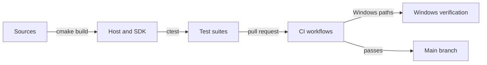

# Development

Development is for people who build Caliper from source or change it. It covers the build, the tests, the checks that run on each change, and the rules that keep Caliper compatible and consistent. It does not teach how to write an instrument. That subject has its own area.

## Build and Test

The host owns the window, the renderer, the frame loop and the stores. A library instrument is one shared library that the running host loads. The usual loop builds the host once and installs the SDK. Then it builds your instrument against that SDK, checks it and runs it. [Development Basics](development-basics.md) shows the sources of each library and the files of a C++ instrument.

Tests use doctest and run through ctest. The fast unit suite needs no window and no GPU. [Testing](testing.md) lists the layers and what each one proves. [Performance](performance.md) gives measurements with their computer, scripts and method.

## Continuous Integration

Caliper builds and tests on GitHub Actions. Four workflows run: Build, Browser views, Docs and Deploy Pages. Two lanes build the code, one for macOS and one for Windows, and caches speed up the runs. [CI](ci.md) lists the triggers and what each workflow does.

macOS compiles out the Windows GPU paths. A change to the Vulkan backend, the tensor bridge or the CUDA kernels needs a check on Windows with an NVIDIA GPU. [Windows Verification](windows-verification.md) gives the procedure. [Vulkan and CUDA](vulkan-and-cuda.md) explains how Caliper shares GPU memory between the two.

## Rules

Caliper versions the ABI, the services, the SDK, the instruments and their stored data separately. Each one changes without breaking instruments that are already built. [Compatibility and Epochs](compatibility-and-epochs.md) states how. [Live Session Layout](live-session-layout.md) gives the session file and shared-memory layout that the viewer reads. [UI Principles](ui-principles.md) sets the structural rules that apply to the host and to every instrument.
