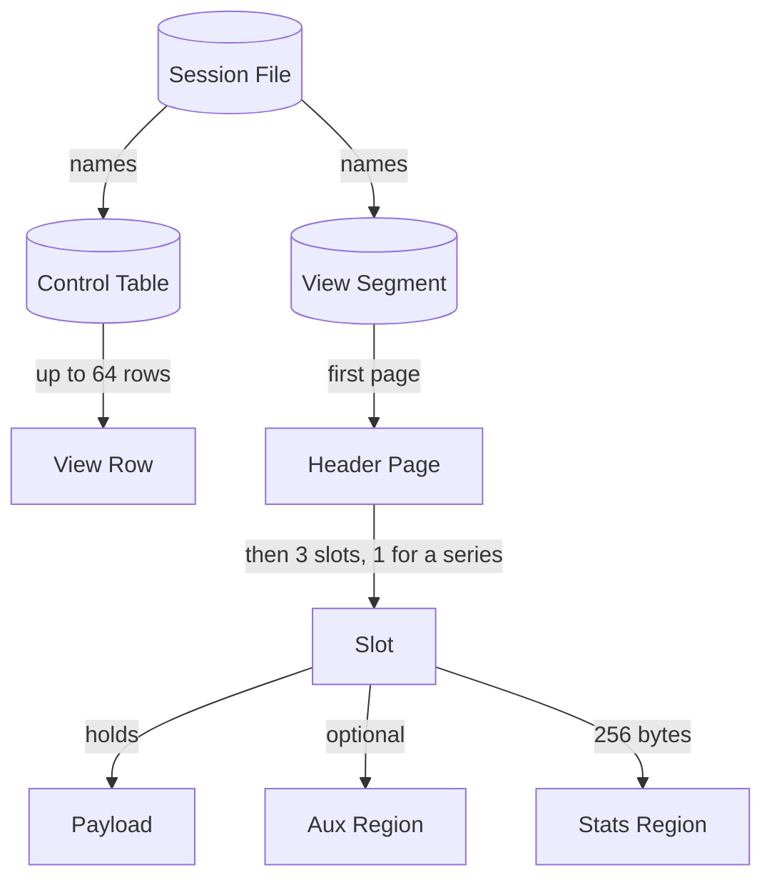

# Live Session Layout

The session file, shared-memory segments and slots of one local live session, as Caliper's own viewer reads them.

Parts of a live session, from the session file down to one slot.

## Fields

### Session File

Each live session has one session file, `<data_root>/live/<pid>.json`, where `data_root` is the first of these that is set.

| Order | Source |
|---|---|
| 1 | The client's `data_dir` |
| 2 | `$CALIPER_DATA_DIR` |
| 3 | Caliper's app-data folder (macOS default `~/Library/Application Support/Caliper`, or the `data_dir` of an embedding core in the same process) |

The file is written atomically at open and on every view change, and removed at close. It names the pid and its start time (against pid reuse), the session token, the script, the views and the segment names.

### Shared Memory

The client creates and unlinks page-aligned segments.

| Segment | Contents |
|---|---|
| `/<session>-ctl` | The control table: a session header and up to 64 view rows, guarded by a `generation` seqlock. `magic` is stored last, so 0 means "still starting". |
| `/<session>-v<id>` | One per view: a header page with the sync words, then 3 slots (1 for a series). Each slot is a payload, an optional aux region and a 256-byte stats region. |

Each process wraps its mapping of a segment as one shared-storage `MTLBuffer` with `newBufferWithBytesNoCopy`. The file mode and access rules are in [Live Streaming](../python/live-streaming.md#security).

Every shared struct carries magic, version and `struct_size`; a reader refuses a mismatch.

## Slot Synchronization

The viewer writes a heartbeat into the control table on every poll. Publish and claim are lock-free, and both sides store with seq_cst. Either the client sees the viewer's claim and avoids the slot, or the viewer sees the newer publish.

`caliper_core_live_view_read_done` polls the renderer's completion handles, so the viewer's GPU reads are never waited on. The claim words are single-reader, so a session has one viewer.

## Slot Claims

How long the viewer holds a slot depends on how the kind reads it.

| Kind | Payload Read | Slot Release |
|---|---|---|
| Heatmap, image | Once per apply, into the view's texture | When every apply's device update has completed, the last one included |
| Points | Redrawn on the GPU when payload, camera or window size changes | The current payload stays claimed; a superseded one is free once the last frame that drew it retired |
| Series | One append-only ring slot; the viewer copies the window it draws | Never claimed (an overwrite during the copy is a one-sample glitch at the old end) |
| Histogram | Bin counts copied at apply | At once |

## Versions

| Interface | Version | Header |
|---|---|---|
| Live Protocol | v2 | `include/caliper/live.h` |
| Embed Typed Views | v1.3 | `include/caliper/live_views.h` |

## Source Files

| Component | Identifier | Source |
|---|---|---|
| Snapshot Ring | `SnapshotRing` | `python/caliper/_ring.py` |
| Session Transport | `SessionTransport` | `python/caliper/live.py` |
| Window Transport | `WindowTransport` | `python/caliper/_inproc.py` |
| Session Reader | `ShmSource` | `src/host/live/live_session.mm`; a `Source` as declared in `src/host/live/live_source.h`, read by `live_core` |
| Viewer Core | `live_core` | `src/host/live/live_core.cpp` |
| Hosted Viewer | The Caliper app's hosted Caliper Embed | `src/host/live/live_attach.h` |
| Caliper Embed | `caliper_core_live_apply()`, where both transports end | `include/caliper/live_views.h` |

## Related Pages

- [Live Streaming](../python/live-streaming.md)
- [Performance](performance.md)
- [Folders and Environment](../reference/folders-and-environment.md)
- [Embedding API](../web/embedding-api.md)
