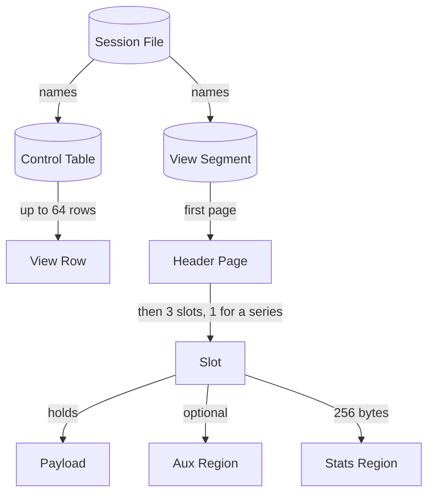

# Live Session Layout

A local live session has a session file, shared-memory segments and slots, and the Caliper viewer reads them in this layout.

Parts of a live session, from the session file down to one slot.

## Fields

### Session File

Each live session has one session file, `<data_root>/live/<pid>.json`. The `data_root` is the `data_dir` of the client. If the client has no `data_dir`, it is `$CALIPER_DATA_DIR`, and if that variable is not set, it is the app-data folder of Caliper. On macOS, this folder is `~/Library/Application Support/Caliper` by default, or the `data_dir` of an embedding core in the same process.

The client writes the file atomically when it opens the session and at each view change. It removes the file when it closes the session. The file gives the pid and its start time, which prevents an error when the system uses the pid again. It also gives the session token, the script, the views and the segment names.

### Shared Memory

The client makes and unlinks page-aligned segments of two kinds. The control table is in `/<session>-ctl`. It has a session header and up to 64 view rows, and a `generation` seqlock controls access to them. The client stores `magic` last, and thus a `magic` of 0 shows that the session is "still starting".

Each view has one segment, `/<session>-v<id>`. It starts with a header page that contains the sync words, and then it has 3 slots, or 1 slot for a series. Each slot has a payload, an optional aux region and a 256-byte stats region.

Each process makes one shared-storage `MTLBuffer` from the segment that it maps, with `newBufferWithBytesNoCopy`. [Live Streaming](../python/live-streaming.md#security) gives the file mode and the access rules.

The client creates and unlinks every name. A lister unlinks the names of a dead client, and the viewer only maps them. Each shared struct has a magic, a version and a `struct_size`, and a reader does not accept a struct that does not agree.

## Protocol Constants

The sizes, the magic numbers and the other constants of the protocol are in `include/caliper/live.h`.

<!-- c-api ids include/caliper/live.h CALIPER_LIVE_PROTOCOL_VERSION CALIPER_LIVE_*_MAGIC CALIPER_LIVE_MAX_VIEWS CALIPER_LIVE_SLOTS CALIPER_LIVE_NAME_MAX CALIPER_LIVE_SEGNAME_MAX CALIPER_LIVE_SESSION_MAX CALIPER_LIVE_SCRIPT_MAX CALIPER_LIVE_STATS_BYTES CALIPER_LIVE_SLOT_NONE CALIPER_LIVE_ATTACH_WINDOW_NS -->

## Enums

The kind of a view, the state of a table row and the state of a session are enums.

<!-- c-api types include/caliper/live.h CaliperLiveKind CaliperLiveEntryState CaliperLiveSessionState level=3 -->

### Snapshot Flags

The `flags` field of a slot holds these bits.

<!-- c-api ids include/caliper/live.h CALIPER_LIVE_SNAP_* -->

## Shared Structs

The control segment and each view segment hold these structs. They are append-only, as the section on versions explains.

<!-- c-api types include/caliper/live.h CaliperLiveControl CaliperLiveViewEntry CaliperLiveSlotMeta CaliperLiveSegmentHeader level=3 -->

## Slot Synchronization

The viewer writes a heartbeat into the control table each time it polls. `caliper_live_client_attached` reads it, and with no viewer the client takes no snapshot at all. A snapshot is one GPU-to-GPU copy on the torch stream into a free slot, and the viewer samples at its own frame rate. Thus it can skip snapshots by design.

Publish and claim are lock-free, and the sync words use the atomic builtins of the compiler on the shared mapping. The two sides store with seq_cst. Thus the client sees the viewer's claim and does not use the slot, or the viewer sees the new publish.

The viewer holds at most two claims for each view. `viewer_reading_slot` is the snapshot that it applied last, and a points view draws it every frame. `viewer_prev_slot` is the one before it, until the GPU read of it retires. The client may write a slot that is not `published_slot`, not a claim and not one of its own pending slots. If no such slot is left, the client drops the new snapshot and counts it in `dropped_client`. Thus it never overwrites a snapshot in flight, and the oldest pending snapshot always completes and publishes.

The client publishes after the GPU work of the snapshot completes, which it finds with a polled `torch.mps.Event`. It fills the slot metadata, stores `published_slot` with seq_cst, and then adds 1 to `seq` with release order. To take a snapshot, the viewer sees that `seq` changed and stores `viewer_prev_slot` as its current claim. Then it loads `published_slot`, stores `viewer_reading_slot` with seq_cst, and loads `published_slot` again. If the slot moved, it tries again. It takes a new snapshot only when `viewer_prev_slot` is free again, and it polls for this and never waits.

`caliper_core_live_view_read_done` polls the completion handles of the renderer, and thus no part of Caliper waits for the viewer's GPU reads. The claim words have one reader only, and thus a session has one viewer.

## Slot Claims

The time that the viewer holds a slot is different for each view kind, because it changes with how the kind reads the payload.

| Kind | Payload Read | Slot Release |
|---|---|---|
| Heatmap, image | Once per apply, into the view's texture | When every apply's device update has completed, the last one included |
| Points | Redrawn on the GPU when payload, camera or window size changes | The current payload stays claimed; a superseded one is free once the last frame that drew it retired |
| Series | One append-only ring slot; the viewer copies the window it draws | Never claimed (an overwrite during the copy is a one-sample glitch at the old end) |
| Histogram | Bin counts copied at apply | At once |

## Versions

The live protocol is at v2 in `include/caliper/live.h`, and the embed typed views are at v1.3 in `include/caliper/live_views.h`.

The fields of the shared structs are append-only. Version 2 appended the aux region, the second claim, the slot metadata for points, series and histograms, and the session identity. A reader refuses another magic or protocol version, and it refuses a `struct_size` that is smaller than its own. The dtype values are the `CaliperDType` values of `caliper/tensor.h`.

## Threading

A client function may run on any one thread at a time for each client, and the Python glue serializes them with the GIL. `caliper_live_client_attached` may run on any thread, and so may the listing functions. The viewer functions, `caliper_core_live_*`, run on the frame thread only, like the embed views that they drive.

## Source Files

| Component | Identifier | Source |
|---|---|---|
| Snapshot Ring | `SnapshotRing` | `python/caliper/_ring.py` |
| Session Transport | `SessionTransport` | `python/caliper/live.py` |
| Window Transport | `WindowTransport` | `python/caliper/_inproc.py` |
| Session Reader | `ShmSource` | `src/host/live/live_session.mm`; a `Source` as declared in `src/host/live/live_source.h`, read by `live_core` |
| Viewer Core | `live_core` | `src/host/live/live_core.cpp` |
| Hosted Viewer | The Caliper app's hosted Caliper Embed | `src/host/live/live_attach.h` |
| Caliper Embed | `caliper_core_live_apply()`, where both transports end | `include/caliper/live_views.h` |
