# Live Session Layout

A local live session has a session file, shared-memory segments and slots, and the Caliper viewer reads them in this layout.

```mermaid
flowchart TB
    file[("Session File")] -->|names| ctl[("Control Table")]
    file -->|names| view[("View Segment")]
    ctl -->|up to 64 rows| row[View Row]
    view -->|first page| head[Header Page]
    head -->|then 3 slots, 1 for a series| slot[Slot]
    slot -->|holds| pay[Payload]
    slot -->|optional| aux[Aux Region]
    slot -->|256 bytes| stats[Stats Region]
```

Parts of a live session, from the session file down to one slot.

## Fields

### Session File

Each live session has one session file, `<data_root>/live/<pid>.json`. The `data_root` is the `data_dir` of the client. If the client has no `data_dir`, it is `$CALIPER_DATA_DIR`, and if that variable is not set, it is the app-data folder of Caliper. On macOS, this folder is `~/Library/Application Support/Caliper` by default, or the `data_dir` of an embedding core in the same process.

The client writes the file atomically when it opens the session and at each view change. It removes the file when it closes the session. The file gives the pid and its start time, which prevents an error when the system uses the pid again. It also gives the session token, the script, the views and the segment names.

### Shared Memory

The client makes and unlinks page-aligned segments of two kinds. The control table is in `/<session>-ctl`. It has a session header and up to 64 view rows, and a `generation` seqlock controls access to them. The client stores `magic` last, and thus a `magic` of 0 shows that the session is "still starting".

Each view has one segment, `/<session>-v<id>`. It starts with a header page that contains the sync words, and then it has 3 slots, or 1 slot for a series. Each slot has a payload, an optional aux region and a 256-byte stats region.

Each process makes one shared-storage `MTLBuffer` from the segment that it maps, with `newBufferWithBytesNoCopy`. [Live Streaming](../python/live-streaming.md#security) gives the file mode and the access rules.

Each shared struct has a magic, a version and a `struct_size`, and a reader does not accept a struct that does not agree.

## Slot Synchronization

The viewer writes a heartbeat into the control table each time it polls. Publish and claim are lock-free, and the two sides store with seq_cst. Thus the client sees the viewer's claim and does not use the slot, or the viewer sees the new publish.

`caliper_core_live_view_read_done` polls the completion handles of the renderer, and thus no part of Caliper waits for the viewer's GPU reads. The claim words have one reader only, and thus a session has one viewer.

## Slot Claims

The time that the viewer holds a slot is different for each view kind, because it changes with how the kind reads the payload.

| Kind | Payload Read | Slot Release |
|---|---|---|
| Heatmap, image | Once per apply, into the view's texture | When every apply's device update has completed, the last one included |
| Points | Redrawn on the GPU when payload, camera or window size changes | The current payload stays claimed; a superseded one is free once the last frame that drew it retired |
| Series | One append-only ring slot; the viewer copies the window it draws | Never claimed (an overwrite during the copy is a one-sample glitch at the old end) |
| Histogram | Bin counts copied at apply | At once |

## Versions

The live protocol is at v2 in `include/caliper/live.h`, and the embed typed views are at v1.3 in `include/caliper/live_views.h`.

## Source Files

| Component | Identifier | Source |
|---|---|---|
| Snapshot Ring | `SnapshotRing` | `python/caliper/_ring.py` |
| Session Transport | `SessionTransport` | `python/caliper/live.py` |
| Window Transport | `WindowTransport` | `python/caliper/_inproc.py` |
| Session Reader | `ShmSource` | `src/host/live/live_session.mm`; a `Source` as declared in `src/host/live/live_source.h`, read by `live_core` |
| Viewer Core | `live_core` | `src/host/live/live_core.cpp` |
| Hosted Viewer | The Caliper app's hosted Caliper Embed | `src/host/live/live_attach.h` |
| Caliper Embed | `caliper_core_live_apply()`, where both transports end | `include/caliper/live_views.h` |
