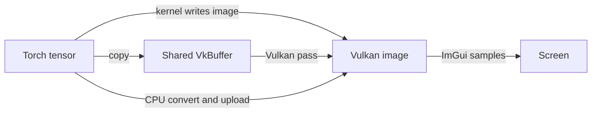

# Vulkan and CUDA

On Windows with an NVIDIA GPU, Caliper renders with Vulkan and shares GPU memory with CUDA. As a result, a torch tensor reaches the screen without passing through host memory. The renderer seam is in [Rendering](../instruments/rendering.md), and the general idea is in [Zero-Copy Tensors](../python/zero-copy-tensors.md).

The direct path writes the image from a kernel, the buffer path copies through a shared buffer, and CPU staging is the last resort.

The backend is `src/host/renderer/vulkan_renderer.cpp`, a Windows-only translation unit. The host loads the CUDA driver API from `nvcuda.dll` at run time (`src/host/renderer/cuda_driver.h`). It uses the Vulkan loader that ships with the GPU driver. Thus a build or run needs neither the CUDA toolkit nor the Vulkan SDK. A machine without an NVIDIA GPU builds and runs the same binary, and the Vulkan backend then renders without interop through the CPU-staged paths.

## Device Pairing

Vulkan and CUDA each enumerate their own devices, and Vulkan can reach a tensor only when both name the same physical GPU. The backend picks a Vulkan device and prefers a discrete GPU that exports external memory. It then walks the CUDA devices and chooses the one whose device UUID equals the Vulkan device's (`VkPhysicalDeviceIDProperties::deviceUUID` against `cuDeviceGetUuid`). A match makes that pair the interop pair for the session. The CUDA side retains the device's primary context, which is the context torch uses.

With no match, interop is off and the backend does not fall back to device 0, because the wrong GPU would corrupt images. This applies to hybrid laptops where Vulkan picks the integrated GPU, to machines without CUDA, and to software Vulkan drivers. Vulkan still renders, and the bridge CPU-stages tensors.

## Update Paths

Interop has two independent parts: the memory that the APIs share, and the order of work between them. [Rendering](../instruments/rendering.md#windows-update-ladder) introduces the update ladder. This section gives the detail.

### Direct Image Path

The first rung gives CUDA the Vulkan image to write. Each texture's `VkImage` is an exportable dedicated allocation. The backend imports it into CUDA once, maps it with `cuExternalMemoryGetMappedMipmappedArray` and opens it as a surface object. Each update launches one kernel on the producer's stream. The kernel reads the tensor in place and writes the image. No Vulkan pass runs, and the tensor is not copied.

- **The kernels ship as PTX.** `src/host/renderer/kernels/cmap_direct.ptx` is checked in, embedded in the binary at build time and loaded with `cuModuleLoadData`. Only the driver API is in use, so no build needs the toolkit. The colormap is a third implementation, beside the GLSL and Metal ones. The gfx tests hold it byte-exact to `map_f32_to_rgba8`. The kernels compile without fused multiply-add and without fast math, because either would change rounding.
- **What it accepts.** The tensor is either an f32 tensor of shape `(H, W)` with a colormap, 4-byte aligned, or a u8 tensor of shape `(H, W, 4)`. The shape must equal the texture's. The image must use a format that CUDA arrays support, and RGBA8 is one. Anything else takes the buffer path. The caller checks the tensor's extent against its allocation first, so a bad read cannot poison torch's context.
- **A second image per texture.** After a frame samples a texture, the next update writes a second image and the two swap. The `ImTextureID` that the instrument holds stays stable. With one image, the producer's stream would wait for the frame that samples it, and that frame waits for its swapchain image. A texture that no frame has drawn yet is written in place and never allocates the second image.
- **The offscreen canvas stays on the buffer path**, because it composites without the frame's timeline waits.

`last_device_path()` reports `direct-cmap` or `direct-blit` for this rung. If the exportable image cannot be created or the CUDA import fails, the backend logs the reason once and the texture uses the buffer path.

### Buffer Path

The fallback rung works at the level of buffers. Each texture has a shared `VkBuffer`, created with `VkExportMemoryAllocateInfo` and an opaque Win32 handle. CUDA imports it with `cuImportExternalMemory`, so one allocation is visible as both a `VkBuffer` and a CUDA pointer. An update has three steps:

1. Check the tensor's byte extent against its CUDA allocation with `cuMemGetAddressRange`, and refuse on a miss.
2. Copy the tensor into the shared buffer with `cuMemcpyDtoDAsync`, one copy inside VRAM.
3. Run a Vulkan pass that turns the buffer into the image. It is a compute shader that implements the colormap index rule for f32, or `vkCmdCopyBufferToImage` for u8 with four channels.

The paths are reported as `compute` and `blit`. CUDA never touches an optimally tiled image on this path, so it avoids the tiling and alignment problems of image sharing. The direct path accepts those problems to remove the copy and the pass.

### CPU Staging

When no device path applies, the bridge converts on the CPU and uploads. CPU tensors also take this path.

### `alloc_shared` and Imported Allocations

`alloc_shared` on Vulkan returns a device-backed tensor. `HostRenderer::alloc_device_shared` makes the texture's shared buffer the tensor's memory and returns its CUDA pointer. The instrument's kernels write the texture's memory directly, and the update runs the buffer-to-image pass with no copy. An optimally tiled image cannot alias linear buffer memory the way a unified-memory buffer can back a Metal texture. Thus zero-copy here means zero copies of the data, not zero GPU work. Without interop (CUDA unpaired), `alloc_shared` falls back to a CPU vector.

An [imported allocation](../python/zero-copy-tensors.md#imported-allocations) is a block that the instrument exports with `cuMemCreate` and a shareable handle. `import_allocation` duplicates the handle and imports the block into Vulkan with `VkImportMemoryWin32HandleInfoKHR`. On failure it unwinds fully. `update_texture_from_alloc` then reads the block at a byte offset with no copy. It uses a descriptor offset for the f32 compute pass and a `bufferOffset` for the u8 blit, and reports `compute-imported` and `blit-imported`. The f32 offset must be a multiple of the device's `minStorageBufferOffsetAlignment`, and the u8 offset must be a multiple of four. Torch sub-allocations are 512-byte aligned, so real offsets pass.

### Caching Allocator Limits

Vulkan can import only memory that was allocated as exportable with a Win32 handle. `cudaMalloc` memory, which torch's caching allocator hands out, has no handle. For this reason Vulkan exports and CUDA imports in this backend. The direct path avoids the problem because it never makes the source tensor visible to Vulkan, and only the output image crosses. Torch tensors in general are therefore not exportable. `ExportablePool` is the opt-in route for tensors that an instrument allocates on purpose.

### DLPack

DLPack is a C descriptor of a tensor: pointer, dtype, shape, strides, device, and a deleter for ownership. In Python, `__dlpack__(stream=...)` also lets a consumer name the CUDA stream on which the producer orders its work. `CaliperTensor` follows the same shape, and `CaliperTensor.stream` does the job of the stream argument. DLPack does not make caching-allocator memory importable into Vulkan. Its value here is framework coverage, because jax, cupy and mlx can reach the bridge through the same descriptor.

## Synchronization

The producer's CUDA work and Vulkan's work run on different queues. Thus the backend orders them on the GPU and does not wait on the CPU.

### Timeline Semaphores

Each texture has a shared timeline semaphore. Vulkan creates it with `VK_KHR_timeline_semaphore` and exports it as an opaque Win32 handle, and CUDA imports it with `cuImportExternalSemaphore`. On the buffer path, CUDA's stream-ordered copy signals `base+1`. The texture's Vulkan pass waits for it and signals `base+2`. The frame's submission waits for `base+2` before ImGui samples the texture. On the direct path, the kernel is ordered on the producer's stream, and CUDA signals the value that the frame submission waits for. A second timeline, which each frame's submission signals and CUDA imports, lets a kernel that would overwrite an image wait for the last frame that sampled it.

The one remaining host wait on the buffer path is `retire()`. If the same texture is updated before its previous update finishes, the frame thread waits. The command buffer is re-recorded and the shared buffer is overwritten. The direct path has no such wait.

When the producer hands over a non-NULL stream, the host honors the stream-ordered handoff. The copy and the signal then ride that stream, and the adapter skips its full-device drain.

### Synchronous Fallback

A device that cannot export timeline semaphores cannot pipeline. It needs both the `timelineSemaphore` feature and the Win32 external-semaphore extension. The texture then uses the synchronous model: copy, `cuCtxSynchronize`, and a fence-waited Vulkan submission. Correctness never depends on the optimization. The host reports that it does not honor stream-ordered handoff in this mode, so adapters keep draining. The direct path needs the pipelined objects and is unavailable in this mode.

### Build-Time SPIR-V

An in-tree glslang compiles the Vulkan shaders to SPIR-V at build time, and the binary embeds them as byte arrays. The byte-exact contract fixes the colormaps, so run-time code generation has no benefit. The build fetches the Vulkan headers and volk, so no SDK is necessary. All shaders go through one CMake function, `caliper_compile_shader`, because the generated headers must stay bit-identical for the byte-exact guarantee to hold.

### Runtime WGSL Compiler

A second compiler works at run time. The library `tools/shaders/caliper-wgsl` is Naga behind the C interface `caliper/wgsl.h`. It validates a WGSL source and translates one entry point to MSL for Metal or to SPIR-V for Vulkan. It uses the same pinned Naga and the same options as the developer-time driver, thus an agent program and a built-in shader follow one convention for bindings and bounds checks.

`caliper_wgsl_module_create()` parses and validates a source and keeps an immutable module. The calls `caliper_wgsl_module_binding()` and `caliper_wgsl_module_entry_point()` list the bindings and the entry points. `caliper_wgsl_translate_msl()` and `caliper_wgsl_translate_spirv()` translate one entry point. Each call that can fail returns a status and fills an optional error with the message and the line and column of the fault, both counted from 1. A panic of Naga never leaves the library. The library owns each pointer that it returns, and a caller frees it with `caliper_wgsl_buffer_free()`, `caliper_wgsl_error_free()` or `caliper_wgsl_module_destroy()`.

The library is a Rust static library, which CI prebuilds for each platform, so that a build of Caliper needs no Rust. CMake makes it the imported target `caliper::wgsl` only when the library is present. Without it the build does not change, and the tests that need it are skipped. Three options give the library, and an option that cannot give it fails the configure with the reason:

- `CALIPER_WGSL_LIBRARY=<file>` names a library that a script or another build placed.
- `CALIPER_WGSL_DOWNLOAD=ON` downloads the archive for the platform at configure time and checks its SHA-256. `CALIPER_WGSL_URL` names the release folder of the archives.
- `CALIPER_WGSL_FROM_SOURCE=ON` builds the library with cargo at build time. It needs Rust and Python. The configure presets in `CMakePresets.json` enable this option until prebuilt archives are published.

## Log Lines and Switches

The backend prints one-time lines to stderr, each tagged `[vulkan] device path:`, so a run shows which path is live. Each message prints once per process.

| Line | Meaning |
|---|---|
| `sync mode: pipelined (shared timeline semaphores)` | Interop is paired and timeline semaphores work. Printed at startup |
| `sync mode: synchronous (timeline semaphores unavailable)` | Interop is paired without pipelining |
| `CUDA interop OK — zero-copy (kernel reads the tensor, writes the image)` | The first update took the direct path |
| `CUDA interop OK — GPU-resident (no CPU staging)` | The first update took the buffer path, with one in-VRAM copy |
| `CUDA interop OK — zero-copy (alloc_shared in place)` | An `alloc_shared` tensor was updated in place |
| `import path OK — zero-copy (imported allocation in place)` | An update read an imported allocation |
| `direct image: ... using the buffer path` | The direct path failed to set up for a texture |
| `external-memory interop unavailable`, `tensor not CUDA-resident` | The update falls back to CPU staging |

Two environment variables change the backend's behavior:

- `CALIPER_VULKAN_NO_DIRECT` (any value) disables the direct path, so every update takes the buffer path in the same binary.
- `CALIPER_VULKAN_STATS` (any value) records frame times and update stalls and prints a summary at exit, in the form `[vulkan] stats: N frames, ms p50 .. p99 .. max ..; updates direct .. buffer ..; kernel waits on a frame ..; retire blocks .. (.. ms total)`.

There is no fallback renderer: when Vulkan cannot start, the app refuses with a message that names the reason ([No Fallback Renderer](../instruments/rendering.md#no-fallback-renderer)). [Windows Verification](windows-verification.md) gives the full procedure.

On WebGPU, Caliper destroys a released texture at once. It releases the view of that texture at the end of the frame, after ImGui drops its bind groups. Caliper reuses released point buffers for the next snapshot of the same size.
