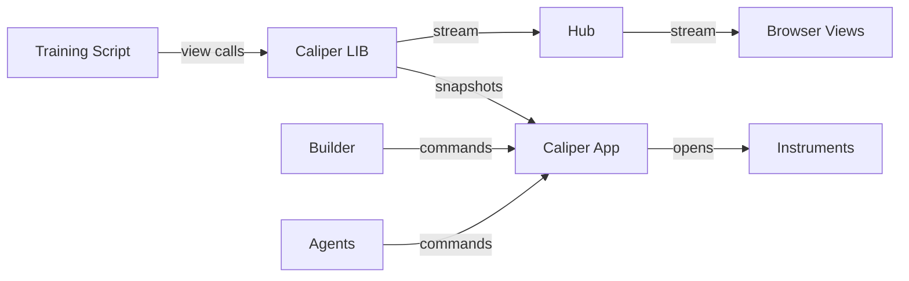

# Overview

Caliper is a desktop application that draws live graphics from tensors that stay on the GPU. It is for people who train models and write tools for them. A host program owns the window, the renderer and the frame loop. An instrument is anything the Caliper app opens, written in C++ or written as a spec. Caliper is built from source. This version of the repository is host 0.6.0, SDK 0.3.0 and ABI epoch 4.

## Components

The host draws and the instruments supply content. An instrument written in C++ adds ImGui user interface and compute, and it talks to the host through a frozen C ABI and named service tables. An instrument written as a spec declares panels, scenes, controls and queries in TOML, and the host draws it directly. [Development Basics](development/development-basics.md) explains the host, instruments and the build, and [Instrument Contract](instruments/instrument-contract.md) is the C ABI contract.

Caliper LIB is the Python package `caliper`. A training script calls `show()` and its sibling calls, and the tensors become live views. The views appear in the Caliper app, in the `caliper-viewer` program, in a notebook widget or in a browser tab. A hub, started with `caliper serve`, holds the sessions of several scripts at one address.

## Backends

On the Metal and Vulkan paths, tensors reach the screen without a trip through the CPU. On macOS the default is Metal with MPS, and Metal processes accepted MPS buffers without host staging. On Windows the default is Vulkan with CUDA, and a CUDA kernel writes a tensor update straight into the Vulkan image. There is no fallback renderer yet: where neither Metal nor Vulkan starts, Caliper refuses with a message that says why ([No Fallback Renderer](instruments/rendering.md#no-fallback-renderer)).

The host reports the path that drew each image and claims zero-copy only when that path ran. [Rendering](instruments/rendering.md) explains how the host chooses a backend.

## Entry Points

A reader who wants live views of a PyTorch run starts with Caliper LIB. The [Introduction](introduction/index.md) and [Python](python/index.md) areas cover that path. A reader who wants to write an instrument starts with [First Instrument](instruments/first-instrument.md), which builds the smallest UI instrument.

The builder lets you assemble an instrument from sources and panels by hand. Agents work in the app too. A widget agent edits one target in place, an agent in the side chat takes bigger jobs, and an outside agent can drive the app through the MCP server and the HTTP API. [Embedding Caliper](web/embedding-api.md) describes how another program hosts the instrument canvas. Plans for work that is not built yet live in the repository's `design/` folder and are not part of this site.
