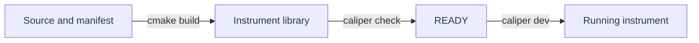

# First Instrument

*(New here? [Development Basics](../development/development-basics.md) explains what you write and what the host provides, and where every library comes from.)*

This page walks through the **Hello World** instrument, the smallest torch-free Caliper instrument on ABI epoch 4. It has one manifest, one macro, and three lifecycle methods. For the canonical LibTorch ML instrument, see `examples/mnist/instrument/`. No single example covers the whole service catalog.



The instrument builds into a library, passes the host checks, and then runs in Caliper.

The whole instrument lives in `examples/hello_world/`. It builds the same way in a folder of your own outside the repository:

```
examples/hello_world/
├── hello_world.caliper.toml   # the manifest — identity + what the host must provide
├── hello_world.cpp            # the instrument — one class + one macro
└── CMakeLists.txt             # the build — find_package(caliper-sdk) + caliper_add_instrument()
```

## Manifest

The host reads `hello_world.caliper.toml` **before it loads any of your code**. The manifest declares who the instrument is, which ABI epoch it uses, and which framework services it needs:

```toml
--8<-- "examples/hello_world/hello_world.caliper.toml"
```

The `required` services are a gate. If the host cannot provide `caliper.ui.v1` or `caliper.log.v1`, it refuses to load the instrument. The `id`, `version`, and `services` **must agree** with the fields you pass to the `CALIPER_INSTRUMENT` macro. The loader checks both and rejects the instrument if they differ. See [Manifest](manifest.md) for the full schema.

## Macro

One include and one class make the whole C++ surface. `#include <caliper/caliper.hpp>` pulls in the sugar layer (the `Instrument`, `Host`, and `Frame` types) and the pinned ImGui and ImPlot stack. You program raw ImGui, with no wrapper to learn:

```cpp
--8<-- "examples/hello_world/hello_world.cpp"
```

The `CALIPER_INSTRUMENT(HelloWorldInstrument, ...)` macro at the bottom is the whole ABI boundary of the dylib. It generates the descriptor the loader looks for (`caliper_instrument_descriptor`) and the exception-safe C bridge functions. It also generates the `ui::connect()` call, which shares the host's ImGui and ImPlot contexts and allocators with your dylib. As a result, `ImGui::` and `ImPlot::` calls land in the single UI world of the host. The field order is fixed: `id`, `version`, `name`, `summary`, `tag`, `services`.

## Instrument Lifecycle

Your class overrides three methods from `caliper::Instrument`:

- **`on_init(Host& host)`** runs once when the instrument opens. The `Host&` stays valid for the whole life of the instrument, so keep the pointer. Do setup here. Log through the host (`host.log_info(...)`) and never use `printf` (see [Instrument Debugging](instrument-debugging.md) for why). Return `false` to abort loading.
- **`on_frame(const Frame& f)`** runs every frame. Everything visible happens here, and nothing slow, because you share the frame thread with the host and every other instrument. `f.fb_width` and `f.fb_height` are **physical** pixels. `f.dpi_scale` converts them to the logical units that ImGui uses. Drive animation from `f.time_sec` and `f.delta_sec`, never from a wall-clock sleep.
- **`on_cleanup()`** runs when the instrument closes. It mirrors `on_init`: persist, release, and log. After it returns, the host destroys your object, so do not touch host services afterwards.

Hello World also reads `CALIPER_HELLO_WORLD_CRASH` in `on_init`. When it is set, the instrument faults in `on_frame` before any ImGui call. The crash-quarantine tests of the loader use this hook, and your own instruments do not need it.

## Input Buttons

The button above the plot teaches three ideas of ImGui input that you will use in every instrument:

- **A widget call both draws and reports.** `ImGui::Button(...)` draws the button and returns `true` on the single frame of the click. There is no callback and no event queue:
  ```cpp
  if (ImGui::Button(playing_ ? "Pause" : "Play")) playing_ = !playing_;
  ```
- **The label comes from state, every frame.** There is one button, and its label is an expression over `playing_`. The click flips the same `bool`, so the button relabels itself on the next frame.
- **The state lives in your instrument, not in ImGui.** `playing_` is a member of `HelloWorldInstrument`, and ImGui only owns the pixels and the click. Thus the state is a `bool` on the class, initialized in the header, and not a `static` inside `on_frame`.

This is *immediate mode*: the UI is a function of your state, and you issue it again every frame.

A pausable animation needs its own clock. The value `f.time_sec` is the monotonic wall clock of the host, and it advances no matter what the instrument does. Hello World thus accumulates its own `phase_`, and it advances `phase_` by `f.delta_sec` **only while playing**:

```cpp
if (playing_) phase_ += (float)f.delta_sec;   // ...then draw sin(x + phase_)
```

Derive what you draw from state you control, and let the widgets edit that state. The same shape works for sliders (`SliderFloat` returns an edited value), checkboxes, and the live training controls of the ML instruments.

## Build

An instrument builds against the installed SDK, in a folder of its own outside the Caliper repository. First build Caliper and install the SDK from your checkout:

```bash
cmake --preset release
cmake --build --preset release
cmake --install cmake-build-release --prefix "$HOME/caliper-sdk" --component sdk
CALIPER="$PWD/cmake-build-release/caliper"   # the host you just built
```

Then copy `examples/hello_world` to a folder of your own and build it there:

```bash
mkdir -p "$HOME/caliper-instruments"
cp -R examples/hello_world "$HOME/caliper-instruments/hello_world"
cd "$HOME/caliper-instruments/hello_world"
cmake -S . -B build -DCMAKE_PREFIX_PATH="$HOME/caliper-sdk" -DCMAKE_BUILD_TYPE=Release
cmake --build build
ls build/instruments/   # libhello_world.dylib + hello_world.caliper.toml
```

The `CMakeLists.txt` is short:

```cmake title="examples/hello_world/CMakeLists.txt"
--8<-- "examples/hello_world/CMakeLists.txt"
```

When you build the folder on its own, the `if` block declares the project and finds the SDK. Inside the Caliper repository, the core build also includes the folder as the fixture that the loader tests load. The core build then provides `caliper_add_instrument()` itself. An instrument of your own can drop the `if` and keep its three lines. `caliper_add_instrument()` checks the manifest when you configure. It builds the library against `caliper::sdk` and `caliper::ui_stack`. It also writes a copy of the manifest beside the library, with a `[build]` table that records the SDK version and the UI-stack hash. [SDK Package](sdk-package.md) describes the function and the package.

This tutorial copies Hello World. The walk-through then matches the code you build. To start an instrument of your own, `caliper new <name>` writes a project of the same shape, as [Development Basics](../development/development-basics.md#development-loop) shows.

## Instrument Loading

First check the build. `caliper check` runs the checks that the host makes before it opens a library, without a window:

```bash
"$CALIPER" check build/instruments
```

```text
READY  dev.caliper.hello-world  0.1.0  <your folder>/build/instruments
1 of 1 instruments pass the checks
```

Then start Caliper with that folder searched first:

```bash
"$CALIPER" dev build/instruments
```

On Windows the executable is `cmake-build-release\caliper.exe`. The `caliper dev` command puts the folder ahead of every other instrument folder. The release preset also builds its own copy of Hello World beside the executable for the loader tests. At equal versions, the host loads the copy it finds first, which is yours, and lists the other copy as `SHADOWED`. The host keeps a library loaded until it quits. After each rebuild, quit Caliper and run `caliper dev` again.

To keep the instrument installed, `"$CALIPER" install build/instruments` runs the same checks. It then copies the library and its manifest into the user instruments folder, which the host searches at every start. [Caliper CLI](../reference/cli.md) describes every subcommand.

## App Visibility

Hello World appears as a row in the **Instruments** pane of the landing screen. Select the row and press Enter, or double-click it, to open the instrument. The loader finds every instrument through two signals: its `<stem>.caliper.toml` manifest and the `caliper_instrument_descriptor` export. If the row is missing, run `caliper check` on the folder. If its status is `REFUSED`, `FAILED`, or `QUARANTINED` and not `READY`, the **Inspector** shows the reason of the loader under Status (see the [refusal reference](../reference/refusal-messages.md)). Esc, or the `esc Home` button, returns to the landing screen. [Development Basics](../development/development-basics.md#landing-screen) describes the panes and keys.
