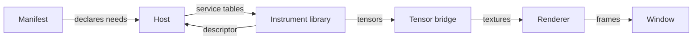

# Instruments

An instrument is anything that the Caliper app opens. This area is for developers who write an instrument in C++, and for readers who want to know how the host runs one. It covers how to write, build and debug an instrument, and how the host draws and contains it.

## Implementation Forms

How an instrument is built is an implementation detail. An instrument written in C++ (`kind = "library"`, the default) is a shared library that the host opens at run time and calls through a small C contract. The instrument draws its pages with ImGui and ImPlot, and it asks the host for what it needs. An instrument written as a spec (`kind = "spec"`) has no library, only a manifest and a spec file of sources, panels, controls and a layout. The app draws it as a page and never executes code from it.

Every instrument ships a manifest. The host reads the manifest before it loads any code. The manifest names the instrument, the ABI epoch of its build and the services it needs. If the host cannot meet the manifest, it refuses the instrument and says why on the landing screen. [Manifest](manifest.md) gives the full schema.

## Host Services

An instrument with a library does not reach into the host. It asks for a service by id, such as `caliper.log.v1` for log lines or `caliper.jobs.v1` for background work. A revision of a service is a new id that adds calls and never changes the old ones. Thus an instrument built against an older id keeps working. The [Service Catalog](services/service-catalog.md) lists every id the host serves.

The host draws tensors on the GPU and hides the graphics backend from the instrument. The instrument hands a tensor to the tensor bridge and receives a texture id. [Rendering](rendering.md) explains how this works on each platform, and [Shader Authoring](shader-authoring.md) covers how a developer writes or changes a shader of the host's graphics layer, regenerates its MSL and SPIR-V and checks them.

## Instrument Workflow

A new C++ instrument starts from the SDK, which installs as a CMake package. The instrument builds in its own folder with `caliper_add_instrument()`. Then `caliper check` tests it against the host, and `caliper dev` runs it from the build folder. [First Instrument](first-instrument.md) walks through this path with the smallest complete example.

An instrument with a library runs in the host process with the host's privileges, so the host treats it as trusted code. The host limits the harm of a fault. It guards every call into the instrument and quarantines an instrument that fails. [Trust Model](trust-model.md) describes these checks. When an instrument misbehaves, you attach a debugger to the running host, as [Instrument Debugging](instrument-debugging.md) shows.
