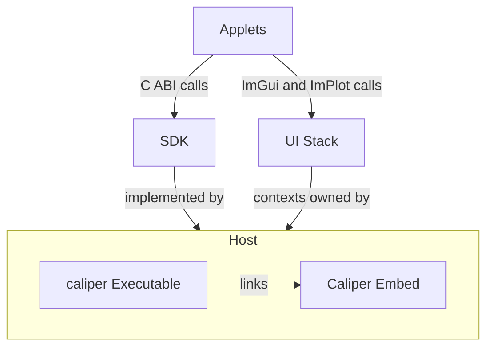

# Architecture

Caliper has four layers with one dependency rule, and the host loads the applets as shared libraries at run time.

Arrows point down only, from each layer to the layer that it depends on or that implements it.

## Components

The top layer holds the applets. An applet is a shared library that stands beside a `<stem>.caliper.toml` manifest, and the host loads it at run time. The repository holds two example applets under `examples/`: `examples/hello_world/` and `examples/mnist/applet/`.

The SDK is the `caliper-sdk` package. It holds the frozen C entry ABI in `abi.h`, which an epoch versions, and the `CaliperTensor` interchange type in `tensor.h`. It also holds the Arrow C Data Interface in `arrow_c.h`, the named C service tables in `services/*.h` and the header-only C++ sugar in `caliper.hpp`. Header-only adapters for torch and allocations, the fixture host and the CMake package with `caliper_add_applet()` complete it. [Applet Contract](../applets/applet-contract.md), [Tensor and Arrow Headers](../applets/tensor-and-arrow-headers.md) and [SDK Package](../applets/sdk-package.md) describe these parts.

The UI stack is a set of pinned libraries: ImGui, ImPlot, ImPlot3D and ImGuiFileDialog. The SDK ships them as sources.

The host is the `caliper` executable and Caliper Embed, which is the library `libcaliper`. It holds the window and the frame loop, `HostRenderer`, the applet loader, the service implementations, the crash guard and the frame watchdog. Embedders link it as one shared library, `caliper_embed`.

## Dependency Rule

Applets depend on the SDK and the UI stack, and the host implements the SDK. The SDK depends on nothing else in Caliper. Torch and DuckDB types stay out of every SDK header, because the interchange types `CaliperTensor` and Arrow C streams cross the boundary instead ([Compatibility and Epochs](../development/compatibility-and-epochs.md)).

Only `caliper.ui.v1` is allowed to know the toolkit or the renderer. Every other service describes data, such as tensors, tables and files, and never an ImGui, Metal or Vulkan type. A host that draws with a different toolkit can thus use these services. The ABI never mentions a graphics API, and applets render only through ImGui and ImPlot. Textures cross the boundary as an opaque `CaliperTextureId`, and as a result a renderer change causes no epoch bump and no applet rebuild ([Rendering](../applets/rendering.md)). [`caliper.ui.v1`](../applets/services/caliper-ui-v1.md) is the one service that gives applets the ImGui, ImPlot and ImPlot3D contexts.

The repository holds all four layers, but the core build compiles no applet, and the `caliper` target depends on none. Each applet builds against the installed SDK with `find_package(caliper-sdk)` and `caliper_add_applet()`, as an applet outside the repository does. [SDK Package](../applets/sdk-package.md) gives the build options for the applets in the repository.

## Frame Loop

The host owns the GLFW window, the rendering backend, the ImGui, ImPlot and ImPlot3D contexts and the frame clock. In each frame the host begins the ImGui frame. Then the `on_frame` call of the active applet renders its UI and can use GPU results from the background jobs of the applet. After that the host ends the frame and swaps the buffers. Applets never make windows and never touch the graphics API. Metal on macOS and Vulkan on Windows are the backends, and there is no fallback renderer: where neither starts, the host refuses with a message that names the renderer and why it could not start ([No Fallback Renderer](../applets/rendering.md#no-fallback-renderer)).

The frame thread does no I/O: no file access, no network call, no SQL query and no store call. The cost of I/O changes with the machine and grows with the age of a session. Thus a call that is fast on one machine freezes the window on another.

Work that lasts more than about 5 ms goes to another thread. A `caliper.jobs.v1` job is for work that a user watches or cancels. A thread of the applet is for the upkeep of the applet.

A table that the applet rebuilds several times each second for a live display is a DuckDB `TEMP` table. The persistent store is for data that a user saves on purpose and reads back. The watchdog of the host flags applets that stall the loop ([Trust Model](../applets/trust-model.md)).

## Embedding

Caliper Embed is the host without the window, built as the static library `libcaliper`. It holds the applet loader, the service registry, the services, `HostRenderer` and the tensor bridge behind a small C interface. Thus another program can operate the applet canvas in a view of the embedder. The `caliper` executable is the first embedder.

The embedder supplies a native view and its input events, and `libcaliper` owns the applet canvas end to end. The ImGui context, the renderer and the bridge all operate inside it. The chrome of the embedder wraps around the canvas and never paints applet pixels. A toolkit such as wxWidgets paints through graphics backends of its own and cannot paint pixels that applets make on the GPU. One owner of the canvas keeps the applet contract the same in every host.

A program outside this repository embeds the core through the `caliper-embed` package, which holds one shared library, `caliper_embed`. [Embedding API](../web/embedding-api.md) gives the package layout and the include roots, and [Program Embedding](../web/program-embedding.md) builds an embedder against the package. A process has one libtorch, and the core owns it. An embedder must not link a torch of its own, and `caliper_core_create` refuses a second live core in the same process.

## Design Decisions

Four rules hold across the host, the SDK and all applets.

### C ABI in Process

Applets operate in the process of the host and call it through a C ABI. An applet is a native library that the host loads. It talks to the host through plain C functions, with the optional header-only [C++ sugar](../applets/cpp-sugar.md) on top. Applets use no C++ interfaces and no protocol between processes.

An applet in the frame loop of the host can hand over a tensor without a copy. In addition, a C ABI stays stable across compilers and standard libraries. The cost is that an applet crash can stop the host. The [Trust Model](../applets/trust-model.md) shows how far the host contains that.

### No ML Framework in the Host

The `caliper` executable and `libcaliper` link neither libtorch nor the CUDA toolkit. The tensor bridge talks to Metal and to the CUDA driver directly. The stores use an embedded DuckDB, and torch is a concern of the applets that use it. Thus the host stays small, and torch comes only with an applet that must have it.

### One-Way Data Flow

Data flows one way, from tensors to pixels. Tensors become textures, and ImGui shows them. Nothing flows back, thus there is no render-to-tensor readback. Applets cannot supply shaders, and the appearance of an image comes from a fixed menu of shading modes. [Rendering](../applets/rendering.md#one-way-data-flow) lists what this rules out and what it does not.

The purpose of the instrument is to show the state of a model. Shaders from applets break the boundary between applet and host and weaken its security. A fixed menu keeps each image reproducible against the CPU reference.

### Fallback Paths

A missing capability of a renderer falls back to a slower path that works, and the host reports that. This applies to paths inside a backend, such as staging a tensor through the CPU, and not to the renderer itself, which has no fallback ([No Fallback Renderer](../applets/rendering.md#no-fallback-renderer)). The host never makes a wrong image and never prints a status line that is not true. It claims zero-copy only when the zero-copy path drew the image. Thus applets operate on all machines, and users can trust what the instrument reports. The cost is a second tested path for each capability.
