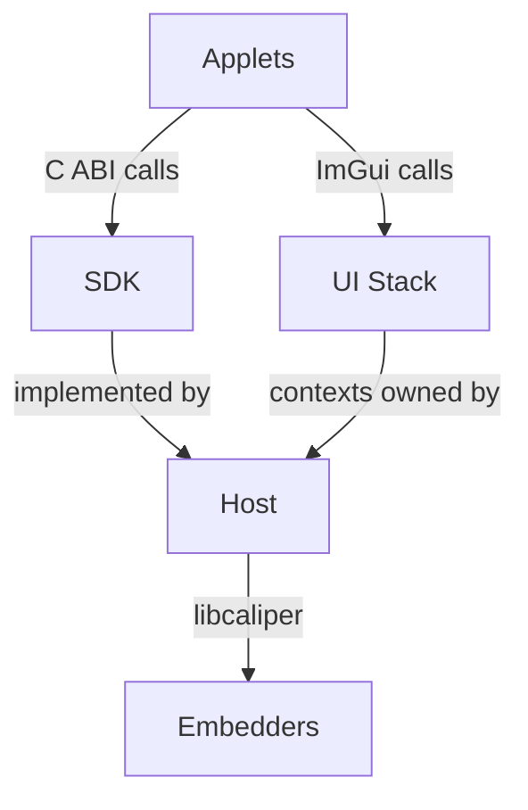

# Introduction

This area is for a reader who meets Caliper for the first time. It explains what Caliper is, shows how to put live views on a PyTorch training loop and describes how the parts of Caliper fit together. The pages here stay short and point to the other areas for detail.

## Platform Overview

Caliper is a desktop application that draws live graphics from tensors that stay on the GPU. A host program owns the window, the renderer and the frame loop. Applets are shared libraries that the host loads at run time. The [Overview](../index.md) describes the whole product and its parts.

## First Steps

The quickest start is Python. The [Python Quickstart](python-quickstart.md) builds the Caliper LIB wheel from the source tree and adds five live views to a training script. The views show a weight matrix, the activations of a convolution, a hidden layer as a point cloud, the loss and a weight histogram. The script keeps its full training speed, because Caliper samples it and never makes the loop wait.

The quickstart needs Apple Silicon, macOS 14 or later, Python 3.12 and PyTorch with MPS. The first call of a script opens a live session, and no other setup is necessary. You then attach the Caliper app or `caliper-viewer` to that session and detach again while the script trains.

## Layer Structure

The [Architecture](architecture.md) page explains the layering. Applets sit on top. They depend on the SDK and on a pinned UI stack of ImGui and ImPlot. The host implements the SDK, so the SDK depends on nothing else in Caliper. Dependencies point down only.

Four rules hold across all layers. Applets run in the process of the host and call it through a C ABI. The host links no ML framework. Data flows one way, from tensors to pixels. A missing capability falls back to a slower path that works, and the host says so.

A reader who wants to write an applet moves on to the Applets area. A reader who wants more from Caliper LIB moves on to the Python area.
