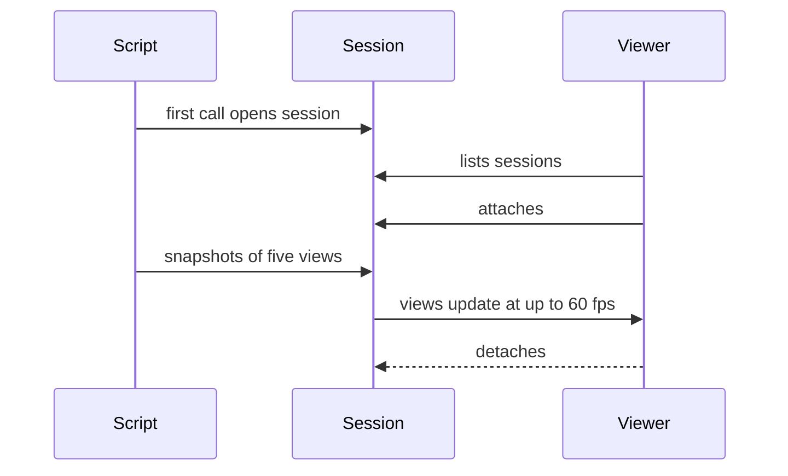

# Python Quickstart

A PyTorch training loop gets five live views in the Caliper app or in `caliper-viewer` and keeps its full training speed.



Calls between the training script, its live session and a viewer, in the order of the steps below.

## Requirements

Apple Silicon, macOS 14 (Sonoma) or later, Python 3.12 and PyTorch with MPS are necessary. CMake and Ninja on `PATH` are also necessary.

The worked example is `examples/python/train_show.py`. It trains a `TinyCNN` model on synthetic data, with no download, to tell which quadrant of a 28x28 image holds a Gaussian blob. The excerpts below are short versions of it, and the file itself has the full code.

The training loop gets five kinds of live view. Two views show a weight matrix as a heatmap and the activations of a convolution as a channel mosaic. Three views show a hidden layer as a point cloud colored by class, the loss as a curve and a weight histogram.

The script keeps training at full speed, and Caliper samples it.

## Steps

The `--mode` option of the example selects `none`, `app`, `attach` or `window`. The `window` mode is the default. It opens the own window in the training process, which [Live Streaming](../python/live-streaming.md#display-modes) describes. The steps below use the other three modes. The first call of a script opens a live session, and no other setup is necessary.

### Wheel Installation

Build the wheel from the source tree, because Caliper has no published wheel and its sdist does not work. Start in the repository root, in a Python 3.12 virtual environment that has `torch`, `numpy`, `scikit-build-core` and `nanobind` installed.

```sh
MACOSX_DEPLOYMENT_TARGET=14.0 uv build --wheel --no-build-isolation --python .venv/bin/python --out-dir dist
uv pip install --python .venv/bin/python --reinstall --no-deps dist/caliper-*.whl
```

With plain pip, the command `pip install dist/caliper-0.1.0-cp312-cp312-macosx_14_0_arm64.whl` does the same. The first build compiles `libcaliper` and its dependencies, DuckDB among them, from source for several minutes, and later builds reuse `build/<wheel tag>`.

### Installation Check

The wheel contains the `caliper` package, its two native modules and the viewer process, which it installs as `caliper/bin/caliper-viewer`. The `none` mode of the example trains for a few seconds, prints the throughput and the cost of each call, and thus checks the installation.

```sh
.venv/bin/python examples/python/train_show.py --mode none --seconds 5
```

### Model Setup

The model and the optimizer are plain PyTorch, and two forward hooks keep the latest outputs of `conv1` and `fc1`. A fixed random projection turns the 64-unit hidden layer into 3-D points.

```python
model = TinyCNN().to(device)
opt = torch.optim.Adam(model.parameters(), lr=1e-3)
acts = {}
model.conv1.register_forward_hook(lambda m, i, o: acts.__setitem__("conv1", o))
model.fc1.register_forward_hook(lambda m, i, o: acts.__setitem__("hidden", o))
proj = (torch.randn(64, 3, generator=torch.Generator().manual_seed(1)) / 8.0).to(device)
```

### Training Loop Calls

The training step does not change, and the Caliper calls follow it. [Caliper LIB API](../python/caliper-lib-api.md) gives every call, argument and layout.

```python
import caliper

for step in range(steps):
    x, y = make_batch(64, device)
    loss = F.cross_entropy(model(x), y)
    opt.zero_grad(set_to_none=True)
    loss.backward()
    opt.step()

    caliper.show(model.fc1.weight, "fc1.weight", cmap="rdbu")     # (64, 784) heatmap
    caliper.show(acts["conv1"], "conv1.act")                       # (64, 8, 28, 28) -> mosaic
    caliper.points(acts["hidden"] @ proj, y, "embedding", classes=4)
    caliper.series(loss.detach(), "loss")
    caliper.histogram(model.fc1.weight, "fc1.weight.hist")
```

| View | Detail |
|---|---|
| `fc1.weight` | Heatmap with the red-blue colormap |
| `conv1.act` | Item 0 of the batch, with its 8 channels in a 3x3 mosaic of 84x84 and the empty cell padded |
| `embedding` | `classes=4` colors the labels 0 to 3 with a categorical palette |
| `loss` | `series` takes the loss tensor, and not `loss.item()`, because `item()` makes the loop wait for the GPU |

### Watch Call

As an alternative to the hooks, `caliper.watch(model)` shows the output of each leaf module as a view named `<module>.act`. With `gradients=True` it also shows the gradient of each weight as `<module>.<param>.grad`.

```python
handle = caliper.watch(model, gradients=True, include=["conv*", "fc1"])
...
handle.remove()          # takes the hooks off again
```

### Caliper App Attachment

The `app` mode of the example opens the live session before it trains. It waits two minutes by default for the Caliper app, and `--wait` changes the wait.

```sh
.venv/bin/python examples/python/train_show.py --mode app --seconds 60
```

Start the script, then attach from Caliper:

1. While the script operates, start the Caliper app with `cmake-build-release/caliper`, as [Development Basics](../development/development-basics.md) shows.
2. On the landing screen, push F4 or click `F4 Attach to process` in the Projects pane.
3. Select the row of the script and push Enter, or double-click it, or click `⏎ Attach`.

### `caliper-viewer` Attachment

The wheel contains `caliper-viewer`, which is the same viewer as the Caliper app but without the rest of the app. Start it from another terminal while the script operates, and click **Attach** on the row of the script to open the windows of the views.

```sh
"$(.venv/bin/python -c 'from caliper import live; print(live.viewer_executable())')"
```

### Viewer Launch

To make the script start the viewer, open the session explicitly before the training starts. The `attach` mode of the example does this.

```python
sess = caliper.session(auto_launch=True)     # spawns caliper-viewer --session <token>
sess.wait_attached(15.0)                     # optional: wait for the first heartbeat
```

```sh
.venv/bin/python examples/python/train_show.py --mode attach --seconds 20
```

## Result

The live page shows one window for each of the five views, and the views update at up to 60 fps. The script does not wait for Caliper. If you detach with `⌘D Detach`, the training continues and you can attach again. When the script stops, the page keeps the last frames and shows `SESSION ENDED`.

## Related Pages

- [Live Streaming](../python/live-streaming.md)
- [Script Attachment](../python/script-attachment.md)
- [Caliper LIB API](../python/caliper-lib-api.md)
- [Development Basics](../development/development-basics.md)
