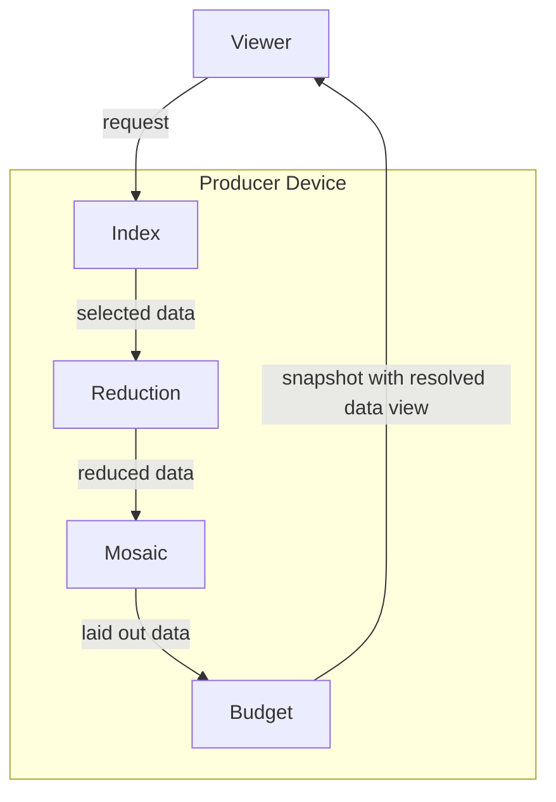

# Data Views

A data view lets a viewer choose which slice, selection or reduction of a tensor the producer streams, so that only the result leaves the device.

A request passes through the index, the reduction, the mosaic and the budget on the device, and the viewer receives the resolved result.

## Components

| Component | Role |
|---|---|
| Data View | The data that travels: a slice, selection, projection or aggregation of a tensor, such as one layer, one head or a mean over the batch. |
| Live View | The way the viewer draws the data. |
| Source | A tensor that a view offers, with named dimensions and their sizes. |
| Index | A selection of one position, which drops the dimension, or of a range, which keeps it. |
| Reduction | A mean, a sum, a maximum, a minimum or a norm over a dimension. |
| Mosaic | A layout of one dimension of a heatmap as tiles. |
| Budget | The limit to which the producer pools a heatmap or samples points. |
| Resolved Data View | The data view with each default filled in. |

A data view decides which data travels, and a live view decides how the viewer draws it. The viewer asks for a data view, the producer computes it on the device, and the network streams only the result. The idea is the same as a view of a tensor in torch or a view in a database.

## Request

A producer offers data views when it names the dimensions of a tensor, such as layer, sequence, head, query and key. The view then advertises its sources, with their named dimensions and sizes, and a default data view. A viewer builds its picker from that information.

A request can index a dimension, reduce a dimension, lay out one dimension of a heatmap as a mosaic and set a budget. The producer applies the index, then the reduction, then the mosaic and the budget. The budget pools a heatmap or samples points down to the limit of the viewer.

The producer refuses a request that does not fit the live view, such as a request that leaves three dimensions for a heatmap. The view then keeps the data view that it had. The reply to a request that fits carries the resolved data view, and so does each snapshot. As a result, a viewer always knows what it draws. A choice of layer or head in a picker, and a zoom that needs another resolution, are requests for a different data view.

## Subscriptions and Defaults

Each subscription has its own data view, so two viewers can show different heads of one view at the same time. The producer computes each distinct data view once for each snapshot, for all the subscriptions that share it. A source that no subscription selects costs nothing.

The script sets the default data view of a view, with the `data_view` argument of the call or with `caliper.set_data_view()`. The window and the live session draw that default, and a new subscription starts from it. A view whose tensor has no named dimensions still offers its payload as one source. A viewer can then range it to zoom in, or pool it to a smaller budget.

## Rate and Budget

Data views and sampling divide the work. Sampling in time, with the rate limit, decides how often a view travels. Data views and the budget decide how much of the view travels each time.
