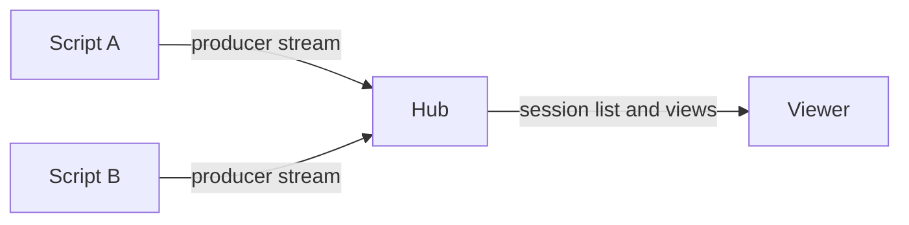

# Hub Setup

The hub is a separate process, `caliper serve`, that holds the live sessions of several training scripts at once. Each script connects to it as a producer. Viewers connect to it, list the sessions and attach to one. The hub speaks [wire protocol v3](../reference/wire-protocol.md), and [Caliper CLI](../reference/shot-and-serve-commands.md#caliper-serve) lists every option.



A script streams to the hub, and a viewer attaches to one session through the hub.

## Hub Use Cases

`caliper.serve()` serves the views of one script from inside that script, and its viewers lose the stream when the script ends. Use the hub instead in these cases:

- Several scripts stream at the same time and you want them at one address.
- A viewer must move from one run to the next, for example after a notebook kernel restarts.
- You want to look at a run after its script exits.

A viewer written for `caliper.serve()` works with the hub unchanged. When the hub holds exactly one live session, it attaches a new viewer to that session.

## Hub Startup

```sh
caliper serve
```

```text
viewers   http://127.0.0.1:7340/?token=<token>
producers ws://127.0.0.1:7340/v3/stream (address and token in <hub file>)
stop with Ctrl-C
```

The hub listens on 127.0.0.1 only, on port 7340 unless `--port` names another port. `--port 0` takes any free port. The hub makes a random session token for each run. To keep the same viewer link across restarts, put a token in a file that only you can read and pass the file:

```sh
python -c "import secrets; print(secrets.token_urlsafe(24))" > ~/.caliper-hub-token
chmod 600 ~/.caliper-hub-token
caliper serve --token-file ~/.caliper-hub-token
```

The token never goes on the command line, because other users can read the arguments of a process.

To open the stream in a browser, the hub must also serve the viewer page. Caliper LIB ships the page in its package, so pass that folder:

```sh
caliper serve --assets "$(python -c 'import caliper, os; print(os.path.join(os.path.dirname(caliper.__file__), "_web"))')"
```

Without `--assets`, the link opens a short note that says where the page is. The stream works either way.

## Script Connection

A script connects to `ws://127.0.0.1:<port>/v3/stream?token=<token>` as a producer, as [The producer connection to a hub](../reference/wire-protocol.md#producer-connection) describes. It sends HELLO with the role `producer` and its session identity: an id, the script name, its pid and its start time. The hub answers WELCOME with the id it chose. It keeps the proposed id unless a live session of another process holds it. In that case it appends `-2`, `-3` and so on.

Scripts on the same machine find the hub through the **hub file**. The hub writes it at startup and removes it at shutdown. The file is `hub.json` in the app-data folder (`~/Library/Application Support/Caliper/hub.json` on macOS) or the path in `CALIPER_HUB_FILE`. Only its owner can read it, because it holds the token and the port.

In Python, `caliper.connect()` connects the script to the hub:

```python
import caliper

hub = caliper.connect()
```

It takes the address and token from its argument. The argument is the stream URL or the viewer link that the hub prints. Without an argument it reads `CALIPER_HUB_URL`, and then the hub file. It raises `RuntimeError` when there is no hub file. It returns at once and connects in the background, so the training loop never waits for the hub. A script can also run `caliper.serve()`. Then every view call reaches the hub and the viewers of the script. `connect()` needs the native sender, which `python scripts/build_netio.py` builds. The [Python API](network-streaming-calls.md#caliper.connect) lists what it returns.

When the hub cannot be reached or the connection drops, the script tries again after half a second. It doubles the wait up to 30 seconds and proposes the session id the hub gave it. It stops when the hub closes the connection with BYE `replaced`.

A script that connects again with the same id, pid and start time **resumes** its session. The hub closes the old connection, if it is still open, with BYE `replaced`. It keeps the viewers attached and subscribes again to every view they watch.

## Viewer Connection

Any viewer of protocol v3 connects to the hub with the viewer link or the stream link that `caliper serve` prints:

- **A browser tab** opens the viewer link, `http://127.0.0.1:<port>/?token=<token>`, when the hub serves the page (`--assets`).
- **A notebook widget or a `<caliper-view>` element** takes the stream link, `ws://127.0.0.1:<port>/v3/stream?token=<token>`, as its source.
- **The Caliper app and caliper-viewer** take either link, as [Attach to a stream by its link](stream-links.md) describes. With several sessions, add `&session=<session id>` to choose one:

```sh
caliper-viewer --headless --url "http://127.0.0.1:7340/?token=$TOKEN&session=clp-41222-9f03ab" --exit-after 5 --stats
```

## Session Choice

After a viewer connects, the hub sends it the list of sessions. It sends the list again each time it changes. Each entry has the session id, script, pid, start time, number of views and state, `live` or `ended`.

A viewer that has not chosen a session follows the hub default. When the viewer is not attached to a live session and the hub holds exactly one live session, the hub attaches the viewer to it. Thus a viewer that stays open moves to the next run when one script ends and another starts. A viewer that attaches to a session by id chooses for itself from then on. Attaching to another session ends its subscriptions to the previous one.

A new script can propose the id of an ended session of another process. The hub then forgets the ended session and moves its viewers to the new session. This happens when a notebook kernel restarts and the notebook streams under the same id.

## Script Exit

When a script disconnects, its session stays in the list with the state `ended`. Attached viewers keep it, and a viewer can attach to it later and subscribe. A subscription to a data view that a viewer watched while the script ran receives its last snapshot at once. A subscription to a series view receives the retained values.

Only the script can compute a data view, so a data view that nobody watched cannot be computed after the script ends. The hub then answers with the data view of that view that was watched last, and the reply names it. A view that nobody watched at all gets the error `unknown_view`.

The hub keeps an ended session for 24 hours, and keeps at most 32 ended sessions. The oldest goes first. When a limit forgets a session, its viewers detach, or attach to the one live session if there is one.

## Hub State

The hub keeps data so that a late viewer sees something at once and so that a session can be viewed after its script ends. It keeps these items:

- **The latest snapshot of every producer subscription.** Viewers that ask for the same view under equal resolved data views share one subscription and one snapshot. When the last viewer of a data view leaves, the hub ends the subscription at the script but keeps the last snapshot. It keeps at most 64 such idle data views per session, and the least recently used goes first.
- **The values of every series view.** The hub subscribes to each series view when the script lists it, so a late viewer sees the whole curve. It keeps the newest 1,048,576 values of each series view (4 MiB).
- **The controls and selections of every session.** These are the latest CONTROLS, with the run state, the parameters and the registered actions, and the latest SELECTION of each item space, at most 16 spaces per session. They stay after the session ends. See [Controls and selections](#controls-and-selections).

All of this together has a budget of 1 GiB. Over the budget, the hub forgets the oldest ended sessions first. Then it forgets the stored snapshots of unwatched data views, least recently used first. If live sessions alone fill the budget, series stop growing and keep their newest values, at least 4,096 per series view.

A connection whose send queue passes 160 MiB closes with code 1008. Only a viewer that stopped reading while the hub sent it many control messages can reach this limit.

## Hub Forwarding

The hub applies the protocol [flow control](../reference/wire-protocol.md#flow-control) on every viewer connection, so one slow viewer slows only itself:

- A newer snapshot replaces a pending one, and a late viewer gets the newest snapshot, never a backlog.
- Series values go out from the retained values by index, and the hub does not drop them while it retains them.
- Control messages go first, then series, then snapshots.
- Each viewer subscription receives at most its `max_rate` messages per second on average, in bursts of at most two.
- The subscription at the script runs at the largest `max_rate` among the viewers that share it.

## Controls and Selections

From [protocol 3.1](../reference/run-control-messages.md#hub-forwarding), a viewer can pause, resume and step the training loop of a script, change the parameters the script registered and run its actions. A selection in one view highlights the same items in the other views of the session. The hub announces both capabilities, `controls` and `selection`, to viewers and to scripts.

**Controls are off unless you allow them.** Without `--allow-control`, the hub tells every viewer in WELCOME that it may not control. It answers every CONTROL with the error `forbidden`. Viewers still show the run state, the parameters and the actions, but they cannot change them. To forward controls, start the hub with the option:

```sh
caliper serve --allow-control
```

The hub then forwards the CONTROL of a viewer only to the script of the session that viewer attaches to. It numbers each request itself, so two viewers that use the same request id never get each other answers. It routes each CONTROL_REPLY back to the viewer that asked. The hub answers a CONTROL itself in these cases:

- `not_attached`: the viewer is not attached to a session.
- `unsupported`: the session has ended or its script does not take controls.
- `timeout`: the script gives no answer after a minute, or after ten minutes for a queued action.
- `limit`: the viewer has 64 requests waiting, or the session has 1,024.

When a script disconnects with requests waiting, the hub answers them `unsupported`.

**Selections need no permission.** Selecting is not a control. The select events of a viewer reach the script whether or not the hub allows control. The SELECTION of the script reaches every viewer of the session that announced `selection`. A viewer that attaches late gets the latest CONTROLS and every non-empty selection right after its VIEWS. A viewer that did not announce a capability gets none of its messages, and a script that did not announce `selection` gets select events without item spaces. Thus viewers and scripts of protocol 3.0 work with this hub unchanged.

An ended session keeps its last controls and selections. A viewer shows them with the controls disabled, and the hub answers its controls `unsupported`.

## Resource Limits

The hub reads every script whatever its viewers do, so a slow viewer never holds a script back.

| Limit | Value | Beyond it |
|---|---|---|
| Viewer connections | 256 | ERROR `limit`, then close code 4005 |
| Live sessions | 64 | ERROR `limit`, then close code 4005 |
| TCP connections, plain HTTP included | 512 | Closed at once |
| Subscriptions on one viewer connection | 256 | VIEW_REPLY with the error `limit` |
| Subscriptions of the hub at one script | 256 | VIEW_REPLY with the error `limit` |
| Ended sessions | 32, for 24 hours each | The oldest is forgotten |
| Idle data views per session | 64 | The least recently used is forgotten |
| Series values per series view | 1,048,576 | The oldest values go |
| Stored snapshots, series values, controls and selections | 1 GiB | See [Hub State](#hub-state) |
| Item spaces whose selection is kept, per session | 16 | A new space's SELECTION is dropped |
| Controls waiting for a script, per viewer connection | 64 | CONTROL_REPLY with the error `limit` |
| Controls waiting for a script, per session | 1,024 | CONTROL_REPLY with the error `limit` |
| Send queue per connection | 160 MiB | Closed with code 1008 |

The timers are the protocol timers. A connection that sends no HELLO within 10 seconds closes with 4003. A peer silent for 10 seconds gets PING, and one silent for 30 seconds closes with 4004.

## Security

The hub follows the protocol [security](../reference/wire-protocol.md#security) rules. It listens on 127.0.0.1 only. Every request must name 127.0.0.1 or localhost with the hub port in its Host header. A stream connection must come from no origin, a loopback origin or a VS Code webview, and must carry the session token. The viewer page and its files need no token, because they are public code and hold no data.

The hub forwards data and viewer events to the script of the viewer session. With `--allow-control`, it also forwards controls that name a parameter or an action the script registered. It never runs anything a message names, and the stream never carries host commands. Whoever holds the token of a hub started with `--allow-control` can pause the connected scripts, change their registered parameters and run their registered actions. Give that option only to a hub whose token you keep to yourself. The token appears in the viewer link, so it can reach the history of a browser.

## Hub Shutdown

Press Ctrl-C or send SIGTERM. The hub sends BYE `shutdown` on every connection and closes them with code 1001. It removes the hub file and exits with 0. Connected scripts keep training and lose only the connection.
