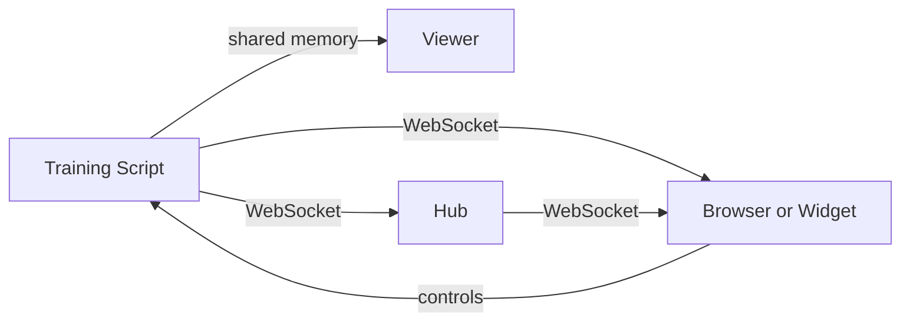

# Python

This area is for people who train models in PyTorch and want to see them while they train. It covers Caliper LIB, the `caliper` Python package. The package opens a live session from a training script or a notebook and shows its tensors in the Caliper app, in `caliper-viewer` or in a browser.

## Live Views

A script makes views with a few calls. `show` draws a heatmap or an image, `points` draws a point cloud, `series` draws a curve and `histogram` draws a distribution. `watch` hooks a whole model. Each call makes a snapshot of a tensor and offers it to every open route. With nothing attached, a call costs one atomic load and a clock read.

The script does not wait for the display, the viewer or the GPU. A rate limit of 60 snapshots per second applies to each view by default. Tensors stay on the device, and the render path does not copy them through the CPU. [Caliper LIB API](caliper-lib-api.md) lists every call, and [Scene Calls](scene-calls.md) lists the calls that send scenes of 3-D and 2-D geometry.

## Viewing Routes

The first way is a live session on the same computer. The first view call opens a session with shared memory, and a viewer attaches to it and detaches again. The second way is a network stream. `serve()` streams over a WebSocket on 127.0.0.1 to a browser tab or a notebook widget. `connect()` sends the same views to a hub.

The hub is the `caliper serve` process. It holds the sessions of several scripts, and it outlives each script. A viewer can move from one run to the next, or look at a run after its script exits. [Hub Setup](hub-setup.md) shows how to start it.

## Run Control

Viewers can also reach back into the script. A viewer can pause the training loop, run it one step at a time and change a parameter that the script registered. It can also run an action and link a selection across views. All of these act at one place, the call `caliper.step()`, so the script never sees a change in the middle of a step. [Script Control](script-control.md) adds each control to a loop.

Data views let a viewer choose which slice or reduction of a tensor travels. The producer computes the result on the device, and only that result leaves it. [Data Views](data-views.md) explains the idea.

## Usual Workflow

A reader starts with [Notebook Training Runs](notebook-training-runs.md) or the [Python Quickstart](../introduction/python-quickstart.md). [Loss Landscape](loss-landscape.md) is a second notebook, which streams the loss surface around the weights of a model as a 3-D scene. Then the reader attaches a viewer to a running script, as [Script Attachment](script-attachment.md) describes. [Live Streaming](live-streaming.md) and [Network Streaming](network-streaming.md) explain why the script keeps its speed.
