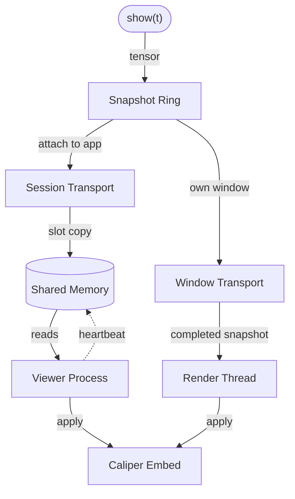

# Live Streaming

A PyTorch training script keeps full speed while Caliper shows its tensors live, because `show()` does not wait for the GPU, display or viewer.

A snapshot goes from `show()` to Caliper Embed through shared memory and a viewer process, or through a render thread in the training process.

## Components

Each `show()` call makes a snapshot, as do the calls for points, series and histograms. A snapshot goes to Caliper Embed through one of two transports. One snapshot ring in the training process selects the slots, uses the rate limit and polls the events for the two transports. A transport only allocates slots and receives completed snapshots.

The two modes use one view layer in Caliper Embed and go to the same apply call. As a result, the code that draws a view does not know which transport sent a snapshot.

In attach to app, a second process, the viewer, reads the session's shared memory and draws snapshots. This viewer is the Caliper app, through F4 Attach to process on its landing screen, or the standalone `caliper-viewer`. The Caliper app operates the same viewer side in its window. There, a hosted Caliper Embed uses the app's renderer, and thus the views draw in the app's frame.

In the own window, a render thread in the training process repaints the window. Caliper Embed then shares that process with the torch that the script imported. This is possible because Caliper's core, Metal renderer and embed C ABI do not include a torch header ([Embedding API](../web/embedding-api.md#torch-free-build)).

## Session

The training process is the client. Its first call opens a local live session with POSIX shared memory and a session file in the `live/` folder of the data folder ([Folders and Environment](../reference/folders-and-environment.md)). The client writes the file when the session opens and when a view changes, and removes it when the session closes. [Live Session Layout](../development/live-session-layout.md) gives the file, the segments and the slots.

### Viewer Attachment

A viewer lists the sessions, attaches to one of them and writes a heartbeat each time it polls. The client uses one atomic load and a clock read to find if a viewer monitors the session. A heartbeat from less than 1 s before the check shows a viewer. When no viewer is attached, `show()` returns after that check, with no snapshot and no GPU work.

### Session End

The two sides do not wait for each other. When a viewer detaches or crashes, the heartbeat is cleared, or no new heartbeat comes in 1 s. Then the snapshots stop, the training continues, and a different viewer can attach.

When the script closes the session, it records that the session is closed, unlinks its names and removes the session file. It does not wait for a viewer. If the script is killed with SIGKILL, it cannot unlink its segments, and the viewer continues to draw the last frames and shows "session ended". The names stay until the next viewer lists the sessions. That viewer finds the stopped script's pid, unlinks the names of that session and removes its file.

## Snapshot

A snapshot is one GPU-to-GPU copy into shared memory that the CPU can read, on the same stream that torch uses. The transport gives each slot to torch through DLPack. On MPS, the slot is a `kDLMetal` capsule for the segment's `MTLBuffer`, at the slot's offset. The snapshot is a queued `slot.copy_(src)`.

Each process maps a segment as one shared-storage `MTLBuffer`. Thus the tensor in the trainer and the draw source in the viewer are the same physical pages.

The GPU calculates the autoscale ranges with `torch.aminmax(src, out=...)` into the slot's stats. A points view also adds a bounding box, and the device bins histogram values. Caliper reads no value back with `.item()`, `.cpu()` or `synchronize()`. The viewer reads the stats from the CPU side of the same pages.

An MPS tensor has no host copy at any point. Caliper copies a CPU tensor one time into the shared pages, and it moves a tensor on a different device to the CPU first.

### Slot Ring

A view has 3 slots, or 1 for a series. The client writes a new snapshot only to an available slot. A slot is available when these three conditions are true:

- It is not the last published slot.
- The viewer does not claim it.
- No snapshot in it waits for the GPU.

When no slot is available, the client discards the new snapshot and counts it. This makes sure that the first snapshot in the queue completes and that the ring publishes it.

After the ring queues a snapshot, it records a `torch.mps.Event` and returns. The ring publishes completed snapshots, first in first out, when it polls `Event.query()`. It polls from the calls that come after, and from a publisher thread that polls each 2 ms while snapshots wait. As a result, a snapshot from before a long step gets to the viewer.

Caliper also does not wait for the viewer's GPU reads. The time that the viewer holds a slot changes with the view kind, as [Live Session Layout](../development/live-session-layout.md#slot-claims) shows.

## Sampling

Each view has a rate limit, 60 Hz by default. A call in the interval returns after a clock check. The viewer draws the newest completed snapshot of each view at up to 60 fps. It does not draw previous snapshots that completed between two frames. The viewer does not show all steps by design. A display cannot show more frames than its frame rate, and each snapshot uses GPU time.

`show()` has no back-pressure and does not wait for a slot, the GPU or the viewer. In a GPU loop with no sync point, torch queues more work than the GPU completed. A snapshot then completes only when the GPU gets to it. Thus the latency increases with the run-ahead until the loop gets to a sync, such as `loss.item()` or a call that writes a log.

## Display Modes

Attach to app is the primary mode. Its second process keeps the window and its input in operation, because the training loop cannot stop that process. The viewer process also continues after the script stops. As a result, the window repaints and gets input during a long step, and it keeps the last frames when the script stops or crashes. If the window crashes or hangs, the training continues. This mode does not freeze, and the Caliper app's landing screen attaches to it.

You open the own window with `caliper.window()`. This mode does not use a second process. Thus the window stops when the script stops or crashes, and the script crashes or hangs when the window does. During a long step the render thread repaints the window at 60 Hz. But AppKit sends mouse, keyboard, resize and close events only to the main thread, which is the training thread. Input then waits, unless you use `run(train)`.

`run(train)` runs the training on a worker thread and gives the main thread to Caliper. This gives input to the window, but it changes how you run the script. A process can have only one own window.

## Limits

Live streaming operates only on the local computer and has no Windows or Linux path.

| Limit | Value |
|---|---|
| Platform | macOS with Metal on Apple silicon |
| Viewers per Session | 1 |
| Slots per View | 3, or 1 for a series |
| Default Rate Limit | 60 Hz |
| Verified Torch Version | 2.14.1 |
| Throughput Kept | 98.3 to 99.5 % in the own window, 98.1 to 99.4 % in attach to app |

The throughput values compare live streaming at 60 Hz with a commit-matched control on one computer, which [Performance](../development/performance.md#live-streaming) gives.

A session has one viewer, because the viewer's slot claims have one reader only. Thus attach does not accept a session when its viewer is attached, and a second viewer makes per-reader claims necessary.

A points view keeps a claim on the slot that it shows while the viewer draws it. Because a view has 3 slots, a points view's ring is full more frequently than for other kinds. The view continues to update approximately 50 times each second.

The torch documentation does not include `torch.from_dlpack` for a `kDLMetal` buffer that torch did not allocate. This path was examined on torch 2.14.1, where it operates correctly. It is not known if torch's command buffers keep that buffer. For this reason, `remove` and `close` wait for the view's events before they release the buffer.

The viewer repaints on a 60 Hz timer. A display link at the screen's refresh rate can decrease the pickup delay. It is not known if the viewer stays smooth when a model uses the full GPU.

Shape errors and argument errors show only when Caliper makes a snapshot. A bad shape is then not found until something attaches.

In the in-process mode with `run()`, the worker thread cannot call `signal.signal`, and Ctrl-C arrives between bytecodes.

## Security

Only the same user can attach, because the shared-memory names and the session file have mode 0600. A live session has no network path.
