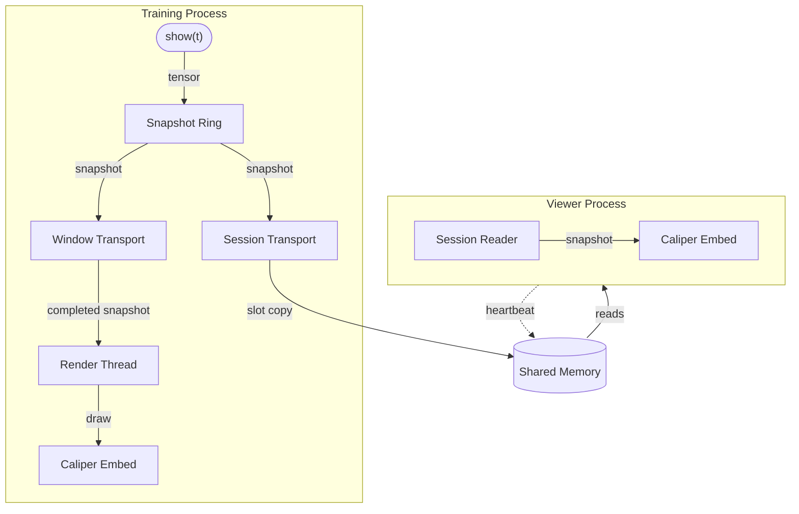

# Live Streaming

A PyTorch script trains at full speed while Caliper shows its tensors live, and `show()` never waits for the GPU, the display or the viewer.

Path of a snapshot from `show()` through either transport to Caliper Embed, which draws it in the training process or in the viewer process.

## Components

Every `show()` call, and each of its siblings for points, series and histograms, produces a snapshot. Both modes sit behind one view layer in Caliper Embed, so the drawing code never knows which transport carried a snapshot.

| Component | Process | Role |
|---|---|---|
| `show(t)` | Training | Takes a tensor from the script and produces a snapshot. |
| Snapshot Ring | Training | Owns slot choice, the rate limit and event polling for both transports. |
| Session Transport | Training | Allocates slots in shared memory and receives completed snapshots, for attach to app. |
| Window Transport | Training | Allocates slots and receives completed snapshots, for the own window. |
| Render Thread | Training | Repaints the own window. |
| Shared Memory | Mapped by Both | Holds the session's slots and the viewer's heartbeat. |
| Session Reader | Viewer | Reads the shared-memory session for the viewer. |
| Caliper Embed | Both | Draws each snapshot through one apply call: in the training process for the own window, and in the viewer process for attach to app. |

Attach to app draws in a separate viewer: the Caliper app, through F4 Attach to process on its landing screen, or the standalone `caliper-viewer`. The Caliper app runs the viewer side inside its own window, where a hosted Caliper Embed borrows the app's renderer.

The own window draws inside the training process. Caliper's core, Metal renderer and embed C ABI include no torch header, so Caliper Embed shares that process with the torch the script imported ([Embedding API](../web/embedding-api.md#torch-free-build)).

## Session

The training process is the client. Its first call opens a local live session: POSIX shared memory plus a session file in the `live/` folder of the data folder ([Folders and Environment](../reference/folders-and-environment.md)). The file is written at open and on every view change, and removed at close.

[Live Session Layout](../development/live-session-layout.md) describes the file, the segments and the slots.

### Viewer Attachment

A viewer lists the sessions, attaches to one and writes a heartbeat on every poll. The client's "is anyone watching" check is one atomic load and a clock read: a heartbeat younger than 1 s. With no viewer, `show()` returns after that check, with no snapshot and no GPU work.

### Session End

Neither side ever waits for the other.

| Event | Outcome |
|---|---|
| Viewer Detach or Crash | The heartbeat is cleared, or ages past 1 s, and snapshots stop. Training is untouched, and another viewer can attach. |
| Script Close | The session is marked closed, its names are unlinked and its session file is removed, without waiting for a viewer. |
| Script Kill | The viewer keeps drawing the last frames and shows "session ended". The next session listing sees the dead pid, unlinks that session's names and removes the file. |

## Snapshot

A snapshot is one GPU-to-GPU copy on torch's own stream into CPU-readable shared memory. The transport hands torch each slot through DLPack (for MPS, a `kDLMetal` capsule over the segment's `MTLBuffer` at the slot's offset), and the snapshot is a queued `slot.copy_(src)`.

Each process maps a segment as one shared-storage `MTLBuffer`, so the trainer's tensor and the viewer's draw source are the same physical pages.

| Part | Behaviour |
|---|---|
| Autoscale Ranges | `torch.aminmax(src, out=...)` computes them on the GPU into the slot's stats. Points add a bounding box, and histograms are binned on the device. |
| Readback | None: no `.item()`, no `.cpu()`, no `synchronize()`. The viewer reads the stats from the CPU side of the same pages. |
| MPS Tensor | No host copy anywhere. |
| CPU Tensor | Copied once into the shared pages. |
| Other Devices | Moved to the CPU first. |

### Slot Ring

| Rule | Detail |
|---|---|
| Slots | A view has 3 slots, or 1 for a series. |
| Slot Choice | The client writes a slot that is not the last published one, not claimed by the viewer and not pending. |
| Full Ring | With no free slot, the new snapshot is dropped and counted, which guarantees that the oldest pending snapshot completes and publishes. |
| Completion | After queueing a snapshot, the ring records a `torch.mps.Event` and returns. |
| Publication | Completed snapshots are published oldest first by polling `Event.query()`, from later calls and from a publisher thread that polls every 2 ms while snapshots are pending, so a snapshot taken before a long step still arrives. |
| Viewer Reads | The viewer's GPU reads are never waited on either. How long the viewer holds a slot depends on the view kind, as [Live Session Layout](../development/live-session-layout.md#slot-claims) lists. |

## Sampling

| Rule | Detail |
|---|---|
| Rate Limit | Each view has one, 60 Hz by default. A call inside the interval returns after a clock check. |
| Viewer Draw | The viewer draws the newest completed snapshot of each view at up to 60 fps. Older ones that completed in between are superseded. |
| Skipped Steps | Skipping is by design: a display shows no more than its frame rate, and every snapshot costs GPU work. |
| Back-Pressure | None. `show()` never waits for a slot, the GPU or the viewer. |
| Loop without a Sync | Torch runs ahead, and a snapshot completes only when the GPU reaches it, so latency grows with the run-ahead until the loop hits a sync (`loss.item()`, logging). |

## Display Modes

| Property | Attach to App | Own Window |
|---|---|---|
| Window Owner | A separate viewer process | The training process, where a render thread repaints it |
| Long Step | Repaints and takes input | Repaints; input waits for the main thread unless `run(train)` is used |
| Script End or Crash | The viewer keeps the last frames | The window goes with it |
| Window Crash or Hang | Training continues | The script crashes or hangs with it |
| Limit | One viewer per session | One window per process |

Attach to app is the primary mode, because only a separate process keeps the window and its input alive whatever the training loop does. It survives the script, never freezes, and is what the Caliper app's landing screen attaches to.

The own window, opened with `caliper.window()`, needs no second process, but AppKit delivers input only to the main thread, which is the training thread. `run(train)` runs training on a worker thread and gives the main thread to Caliper, which fixes input but changes how the script is run.

## Limits

| Limit | Detail |
|---|---|
| Platform | macOS and Metal on Apple silicon only, and local only. Live streaming has no Windows or Linux path. |
| One Viewer per Session | Attach refuses a session whose viewer is still attached. The viewer's slot claims are single-reader, so a second viewer would need per-reader claims. |
| Names of a Killed Script | A script killed with SIGKILL cannot unlink its segments. The next session listing sees the dead pid and removes the names and the session file, so in practice they last until a viewer lists sessions. |
| Points View Slots | A points view keeps its current slot claimed while it is drawn, and a view has 3 slots, so the ring is full more often. The view still updates about 50 times a second. |
| Foreign `MTLBuffer` through DLPack | `torch.from_dlpack` over a `kDLMetal` buffer that torch did not allocate is not documented torch behaviour; it was verified on torch 2.14.1. Whether torch's command buffers retain that buffer is not known, so `remove` and `close` wait for the view's events before they release it. |
| Viewer Repaint | The viewer repaints on a 60 Hz timer. A display link at the screen's refresh rate would cut the pickup delay. |
| Smoothness under Load | Viewer smoothness while a model saturates the GPU has not been measured. |
| Late Argument Errors | Shape and argument errors appear when a snapshot is built, so a bad shape goes unnoticed until something attaches. |
| In-Process Mode under `run()` | The worker thread cannot call `signal.signal`, and Ctrl-C is delivered between bytecodes. |
| Throughput Cost | At the default 60 Hz rate limit, training keeps 98.3 to 99.5 % of the throughput of a commit-matched control in the own window and 98.1 to 99.4 % in attach mode, measured on one machine. [Performance](../development/performance.md#live-streaming) has the machine and the method. |

## Security

Only the same user can attach: the shared-memory names and the session file are mode 0600, and a live session has no network path.

## Related Pages

- [Python Quickstart](../introduction/python-quickstart.md)
- [Script Attachment](script-attachment.md)
- [Caliper LIB API](caliper-lib-api.md)
- [Embedding API](../web/embedding-api.md)
- [Performance](../development/performance.md)
