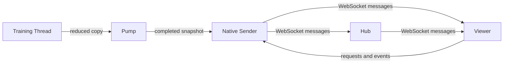

# Network Streaming

Network streaming sends the live views of a script through a WebSocket to a notebook widget, a browser tab or the hub, while the script trains at full speed.

A reduced snapshot goes from the training thread through the pump and the native sender to a viewer, either directly or through the hub.

## Components

| Component | Role |
|---|---|
| Producer | The process that makes the view calls, such as a training script or a notebook kernel. `caliper.serve()` starts its server. |
| Viewer | A program that connects to the stream and draws, such as a notebook widget or a browser tab with the viewer page. |
| Hub | The `caliper serve` subcommand of the `caliper` binary. It stands between the producers and the viewers. |
| Training Thread | The thread of the producer that makes the view calls. |
| Pump | The Python thread `caliper.net`, which hands completed snapshots to the sender. |
| Native Sender | The C++ module `caliper._netio`, which serves the viewer page and sends the stream. |

Any number of producers stream to the hub, and any number of viewers watch it. The hub outlives the producers. It holds one session for each producer, and a viewer chooses one. A viewer written for `caliper.serve()` works against the hub unchanged, and the [Wire Protocol](../reference/wire-protocol.md#roles-and-terms) reference gives the reason. The same reference defines version 3 of every message on the stream.

## Calls and Transports

A script calls `show()`, `points()`, `series()` and `histogram()` in the same way for each viewer. Each call goes to every open route, and each route with an attached viewer takes its own snapshot. The live session writes to shared memory for the Caliper app or `caliper-viewer`, and the own window uses a render thread in the same process. Both routes are zero-copy, and [Live Streaming](live-streaming.md) describes them. The third route, `caliper.serve()`, sends copies through a WebSocket.

The kinds of live view are the same on each transport: heatmap, image, points, series and histogram. The names, the arguments, the rate limit and the device-side snapshot are also the same. As a result, the same training code shows in the Caliper app, a widget and a browser tab at the same time.

What differs is where a snapshot ends. The two local transports give the viewer the memory that the snapshot was written to, with no copy ([Zero-Copy Tensors](zero-copy-tensors.md)). A socket can send only bytes, so the network transport copies each snapshot off the device and encodes it as one binary message. As a result, the zero-copy claim applies only to viewing on the same machine, through a live session or the own window. A viewer on the network receives copies.

A browser draws each view with Caliper's views compiled to WebAssembly where WebGPU gives an adapter, and with views written in TypeScript where it does not. Both kinds select, pick and hover with the same gestures and send the producer the same events, in source indices. Thus the `selection` of a widget and the `events()` of the server do not depend on which views draw. [Browser Elements](../web/browser-elements.md) gives the details, and the [WebGPU Backend](../applets/rendering.md#webgpu-backend) draws the WebAssembly views.

## Device-Side Reduction

A tensor in training can be far larger than a viewer can show. A 4096 by 4096 float32 weight is 64 MiB, so at the default 60 snapshots per second it makes 3.75 GiB/s on the socket, for a widget a few hundred pixels wide. The network transport thus reduces each snapshot on the device before it copies anything, and only the result leaves the GPU. With the default budget, the transport pools a heatmap snapshot to at most 512 by 512 values, which is 1 MiB. [Data Views](data-views.md) explains how a viewer chooses which part of a tensor travels.

The reduction runs where the data is, because the alternative defeats its purpose. A read-back of the full tensor to the host costs the transfer that the reduction must prevent. On MPS, a read-back also waits for the queue of torch, which stalls training, and [Performance](../development/performance.md#live-streaming) records that wait. The viewer never needs the full tensor. Thus no computation runs in the browser, and torch stays native in the producer.

## Latest-Wins Delivery

A snapshot carries the newest state of one view with a sequence number, and the newest snapshot wins. The producer gives one data message at a time to the socket of a connection. It keeps at most one pending snapshot for each subscription, and a newer snapshot replaces the pending one. As a result, a viewer that cannot keep up sees fewer frames, but not older frames. The memory of the producer does not grow with the backlog of the viewer.

A series is the exception, because a curve needs each value. A series message is a delta. It holds the absolute index of its first value and the values that are new since the last message. The producer joins the values that are not yet sent into one pending message and does not drop them.

The producer keeps the last 1,048,576 values of each series, whether or not a viewer watches, and the protocol asks for at least 4096. When a viewer subscribes, the producer sends that history first and then the deltas. Each delta has an absolute index, thus a viewer that joins late draws the same curve as a viewer that watched from the start.

A viewer subscribes to the views that it shows. Apart from the series values that it keeps, the producer does no work for a view that no viewer subscribes to. A notebook widget that shows one view costs the producer that one view and no other.

## Non-Blocking Training

A view call queues its snapshot on the device and goes back to the script, as it does for the local transports. The server encodes and sends outside the training loop. As a result, the loop does not wait for a viewer, the socket or the browser. A viewer that falls behind loses intermediate snapshots, and a viewer that disconnects loses its subscriptions. Neither changes how fast the script trains. The calls do not read a value back to the host, thus the advice of the other pages stays the same: pass `loss.detach()` and not `loss.item()`.

Streaming costs the loop the work that the view calls add to its thread, and the time that other threads hold the Python global interpreter lock (the GIL). The server thus keeps as little work as possible in Python. The training thread reduces each due snapshot on the device and queues a non-blocking copy into pinned host memory. The due views take their snapshots together in a tick, at the session rate of 60 a second. The pump polls for the completed copies and hands each snapshot to the native sender. The native sender keeps the latest snapshot for each subscription, and it encodes and sends with the GIL released.

A view called with a lower rate, or a subscription with a lower `max_rate`, joins only the ticks that its rate lets it join. It does not go above that rate. If the native sender is not built, `caliper.serve()` uses a sender written in Python, which encodes and sends on an asyncio thread that holds the GIL, and it says so once. [Performance](../development/performance.md) gives the measured cost of each part.

## Limits

Network streaming sends copies of reduced snapshots to a browser on the same machine, with the limits below.

| Limit | Value |
|---|---|
| Platform | macOS only. Caliper LIB, and with it the server, is built and tested only on macOS. |
| Machine | The browser must run on the machine of the producer. A notebook on a remote Jupyter server cannot show the widgets, because the browser connects to its own 127.0.0.1. |
| Copies | Each snapshot on the network is a copy off the device. Data views and the budget keep it small, but do not remove it. |
| Browser Work | The browser draws what a producer sends and computes nothing. It runs no applet. The producer computes the data views on its own device. |
| WebAssembly Heap | WebAssembly in a browser is 32-bit, so the views cannot hold more than 4 GB. The module caps its heap at 512 MB, which bounds the size of the snapshots that the views accept. |
| Browser Copy | The browser copies each snapshot a second time, from WebAssembly memory into its GPU process. Sampling and data views keep snapshots small for this reason too. |
| Canvas | Caliper's views draw into one canvas. The pointer, the wheel, keys and text reach them while the canvas has focus. The clipboard and multi-touch gestures do not. A screen reader cannot read the canvas. |
| Browsers | Only headless Chromium is tested, on SwiftShader and on the GPU of the Mac, at device pixel ratios 1 and 2. Chromium-based browsers ship WebGPU. Support in Safari and Firefox depends on the version and the platform, and neither is tested. Windows is not tested. Where WebGPU is absent, the TypeScript views draw. |
| Widget Traits | The `selection` and `data_view` traits of a widget travel over the message channel of the notebook, which the kernel reads only while no cell runs. The picker of a widget works during training, because its requests go over the stream. |
| Stream Order | One WebSocket stream delivers messages in order, so a large snapshot delays the messages behind it. |
| Queued Requests | The native sender queues at most 256 requests of a viewer for each connection. A viewer that fills the bounded reply queue and reads nothing loses its connection. |
| Throughput Kept | 95.4 to 99.0 % of a commit-matched control, with one or two viewers on the benchmark workload that [Performance](../development/performance.md) gives. |

## Security

The server listens only on the loopback interface, 127.0.0.1, thus only programs on the same machine can connect to it. Each server makes a random session token, and the stream requires it. The viewer page and its files hold no data, so the server sends them without the token. The page reads the token from its own link and passes it to the stream.

The link that `caliper.serve()` prints carries the token. Anyone who has the link can watch the views while the server runs, thus you must keep the link like a password. The server also checks the `Host` header of each request and the `Origin` header of each stream connection. As a result, a web page from another site, opened in a browser on the same machine, cannot reach the stream, even by DNS rebinding.

The stream carries data and nothing else. Snapshots and series go to the viewer. Subscriptions, data view requests and viewer events (`select`, `pick` and `hover`) go back. A data view request can name only a slice, selection or reduction of a source that the producer offered. An event is data that the Python code of the producer reads, through `server.on_event()` or `server.events()`. The stream does not carry host commands, and nothing that a viewer sends runs as code.

The server cannot listen on another interface, and the stream is not encrypted. This is permitted because the stream does not leave the loopback interface.

## Related Pages

- [Live Streaming](live-streaming.md)
- [Data Views](data-views.md)
- [Caliper LIB API](caliper-lib-api.md#serve)
- [Wire Protocol](../reference/wire-protocol.md)
- [Notebook Training Runs](notebook-training-runs.md)
