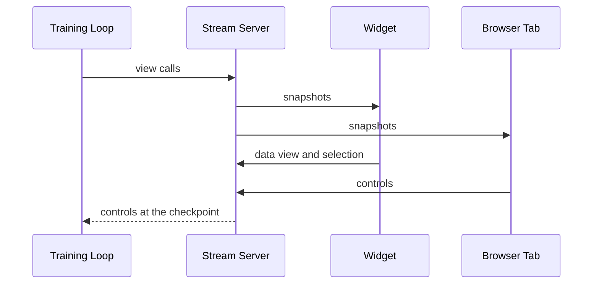

# Notebook Training Runs

A Jupyter notebook trains a model and shows its loss, attention weights, embedding and predictions as live views in widgets, a browser tab and the Caliper app.



The stream server sends snapshots from the training loop to each viewer and passes the controls of a viewer back to the loop.

## Requirements

The canonical notebook example is `examples/mnist/train.ipynb` in `examples/mnist/`. The excerpts below show the stream server, controls and widgets. These items are necessary:

- Apple Silicon with macOS 14 (Sonoma) or later.
- Python 3.12 with PyTorch and MPS.
- JupyterLab, or VS Code with its Jupyter extension.
- The Caliper LIB wheel, built as [Python Quickstart](../introduction/python-quickstart.md#wheel-installation) describes.

## Steps

The notebook shows four views of the model: the loss, the attention weights, the embedding of an evaluation set and its predictions. The loop operates at full speed, and Caliper samples it.

### Wheel Installation

Install the wheel with the extra `caliper[notebook]`, which adds anywidget for the widgets and a notebook front end. Start in the repository root.

```sh
uv pip install --python .venv/bin/python --reinstall-package caliper "$(ls dist/caliper-*.whl)[notebook]" jupyterlab
.venv/bin/python scripts/build_netio.py   # the native sender, a few seconds
.venv/bin/python scripts/fetch_wasm.py    # or scripts/build_wasm.py, with Emscripten
.venv/bin/jupyter lab examples/mnist/train.ipynb
```

The script `build_netio.py` builds the native sender of `caliper.serve()` and copies it into the installed package. Run it again after each reinstall of the wheel. The widgets draw with views of Caliper compiled to WebAssembly, which the repository does not hold. The script `fetch_wasm.py` downloads the build of CI, and `build_wasm.py` builds the views. Both scripts work before or after the wheel install, and a wheel that you build after either one ships the views.

The server needs only Caliper LIB, which depends on `websockets`. In VS Code, select `.venv/bin/python` as the kernel. The variable `CALIPER_NOTEBOOK_STEPS` sets the number of training steps, 8000 by default, and a value of 200 gives a run of a few seconds.

### Stream Server

The first cell starts the server:

```python
import caliper

server = caliper.serve()
```

The call `serve()` starts a server in the kernel, on 127.0.0.1 and a free port, and prints a link:

```text
http://127.0.0.1:<port>/?token=<token>
```

The kernel is now a producer. Each view call goes to the server, which sends snapshots to each viewer that subscribes to the view.

### Model and Controls

Each example is a sequence of 24 random tokens with one marker token. The token after the marker sets one of six classes. The class tokens also occur at random in other places, thus the model must find the marker. The device makes a new batch at each step, and the first eight sequences are always the same probe sequences.

The model is a transformer with two layers of four heads. It computes attention explicitly, and a 3-D embedding layer precedes the classifier. Thus the point cloud is the embedding itself and not a projection of it. The forward pass returns the logits, the embedding and the attention weights:

```python
def forward(self, x):
    h = self.tokens(x) + self.positions
    attention = []
    for block in self.blocks:
        h, weights = block(h)
        attention.append(weights)
    z = self.embed(self.norm(h[:, 0]))
    return self.classify(z), z, torch.stack(attention)  # attention: (layer, batch, head, query, key)
```

The next cell registers a fixed evaluation set of 512 sequences and the controls that a viewer can use while the model trains:

```python
EVAL = 512
eval_x, eval_y = make_batch(EVAL)
eval_marker = (eval_x == MARKER).int().argmax(1)
evaluation = caliper.items("eval", details={"class": eval_y, "marker at": eval_marker})

lr = caliper.param("lr", 2e-3, min=1e-4, max=1e-1, log=True, help="learning rate")
CHECKPOINT = os.path.join(tempfile.gettempdir(), "caliper-live-training.pt")


@caliper.action("save checkpoint", help="saves the model's weights")
def save_checkpoint():
    torch.save(model.state_dict(), CHECKPOINT)
    return f"saved {CHECKPOINT}"
```

The learning rate is a slider on a log scale from 0.0001 to 0.1, and the action is a button that saves the weights. Each sequence of the item space `eval` has its class and marker position as details. [Script Control](script-control.md) explains each call.

### Widget Layout

The widget cell makes one widget for each view and a panel of controls:

```python
from ipywidgets import HBox, VBox

loss_widget = caliper.widget("loss", "series", height=200)
attention_widget = caliper.widget("attention", "heatmap")
embedding_widget = caliper.widget("embedding", "points")
predictions_widget = caliper.widget("predictions", "heatmap", height=160)
attention_widget.layout.flex = embedding_widget.layout.flex = "1 1 0"

VBox([caliper.controls(), loss_widget, HBox([attention_widget, embedding_widget]), predictions_widget])
```

The call `caliper.widget(name, kind)` returns a widget for the live view `name`. Without `kind`, the widget gets the kind from the stream. The panel `caliper.controls()` shows the run state, the Pause, Resume and Step buttons, the learning rate and the save action. The header of each widget shows the run state with the Pause and Step buttons.

Each widget reads the WebSocket stream of the server directly. Thus the widgets update while the cell operates, and the kernel does no drawing for them. The widgets draw with WebGPU where it is available and with Canvas 2D if not.

### Training Loop

The loop is the body of the function `train(steps)`, thus the notebook can train again. Each step starts with `caliper.step()`, the checkpoint of the controls, and copies the learning rate into the optimizer.

```python
ATTENTION_DIMS = ("layer", "sequence", "head", "query", "key")
ATTENTION_DEFAULT = {"index": {"layer": 1, "sequence": 0, "head": 0}}

for step in range(steps):
    caliper.step()  # pauses, the new learning rate and actions take effect here
    for group in opt.param_groups:
        group["lr"] = lr.value
    x, y = make_batch(BATCH)
    x[:PROBES] = probe_x  # the same probe sequences at the top of every batch
    y[:PROBES] = probe_y
    logits, z, attention = model(x)
    loss = F.cross_entropy(logits, y)
    opt.zero_grad(set_to_none=True)
    loss.backward()
    opt.step()

    caliper.series(loss.detach(), "loss")
    caliper.show(attention[:, :PROBES], "attention", cmap="magma",
                 dims=ATTENTION_DIMS, data_view=ATTENTION_DEFAULT)
    if step % 10 == 0:
        with torch.no_grad():
            eval_logits, eval_z, _ = model(eval_x)
        caliper.points(eval_z, eval_y, "embedding", classes=CLASSES, items="eval")
        caliper.show(eval_logits.softmax(1).T, "predictions", dims=("class", "sequence"),
                     items={"sequence": "eval"})
```

The attention tensor has the shape `(2, 8, 4, 24, 24)`, the embedding has 512 points of 3 values, and the predictions have the shape `(6, 512)`. The argument `items="eval"` makes the points sequences of the item space `eval`. The argument `items={"sequence": "eval"}` makes the `sequence` dimension of the predictions index the same sequences.

None of these calls reads a value back to the CPU. The call `series` gets the loss tensor and not `loss.item()`, thus the loop does not wait for the GPU. The names in `dims` let a viewer choose a data view of the attention tensor, and `data_view` sets the default: layer 1, sequence 0 and head 0, a 24x24 heatmap. [Caliper LIB](data-view-calls.md#data-views) lists the fields of a data view.

### Selection and Data View

Each widget pans, zooms and shows the value under the pointer. The heatmap also has a picker for its data view, built from the names in `dims` and their sizes. A choice in the picker takes effect at the next snapshot, while the cell operates.

A Shift drag in the embedding widget selects points. The predictions widget marks the same sequences, and a table under the embedding shows their class and marker position. The selection works while the cell operates, and `evaluation.selection` holds it at once. The `selection` trait holds the latest event, which [Caliper LIB](network-streaming-calls.md#widget) describes.

```python
print("selection:", embedding_widget.selection)
print("selected sequences:", evaluation.selection[:20])
```

The `data_view` trait works in both directions. When Python sets it, the widget requests that data view at the next snapshot, thus the notebook trains for a few more seconds afterward:

```python
# layer 0: the maximum over the heads shows the class token that attends to the marker
attention_widget.data_view = {"index": {"layer": 0, "sequence": 0}, "reduce": {"head": "max"}}
train(max(1, STEPS // 10))
```

### Other Viewers

The link that `serve()` printed opens a viewer page in a browser tab. It shows each view in a grid, with the same pan, zoom, hover and picker as the widgets and the same panel of controls. A tab and the widgets can watch at the same time, and the producer does no work for a view that no viewer subscribes to.

To watch in the Caliper app also, open a live session before the training:

```python
caliper.session(script_name="live_training")
```

Each open route receives each view call, thus the app, the widgets and the tab update together. Attach to the kernel with `F4 Attach to process` on the landing screen, as [Python Quickstart](../introduction/python-quickstart.md#caliper-app-attachment) describes. Without `script_name`, the session list shows the launcher script of the kernel.

### Server Shutdown

```python
server.close()
```

The call `server.close()` stops the server and ends the stream to each widget and tab.

## Result

The loss stays on a plateau above 1 for the first one to a few thousand steps. Then it falls to almost zero in a few hundred steps, when the model finds the marker. At the same time the embedding separates into six clusters, one for each class color, and each column of the predictions turns to one bright class. In layer 1, row 0 puts nearly all its weight on the class token after the marker.

The cell ends with the number of steps, the steps per second, the final loss and the accuracy on the last batch. The panel of controls pauses and steps the loop, changes the learning rate and saves a checkpoint while the cell operates.

## Errors

| Symptom | Cause | Remedy |
|---|---|---|
| The server says that it uses a sender written in Python | The native sender is not installed, and the Python sender is slower | Run `scripts/build_netio.py` |
| The server says that the widgets use views written in TypeScript | The WebAssembly views are not installed | Run `scripts/fetch_wasm.py` or `scripts/build_wasm.py` |
| `selection` stays empty during the training | The kernel reads widget traits only while no cell operates | Wait for the end of the cell, or read `evaluation.selection` |

## Limits

The server listens only on 127.0.0.1, thus the browser and the kernel must operate on the same machine. A notebook on a remote Jupyter server cannot show the widgets. Each view takes at most 60 snapshots for each second by default, and a widget draws the newest snapshot it has. As a result, most training steps give no snapshot by design, while a series receives each value. A viewer that falls behind receives fewer snapshots and does not slow the training down.

## Security

The server makes a new random session token at each start, and it refuses a stream connection that does not have the token. Events from a viewer are data for your code to read, and nothing in them operates as a command.
