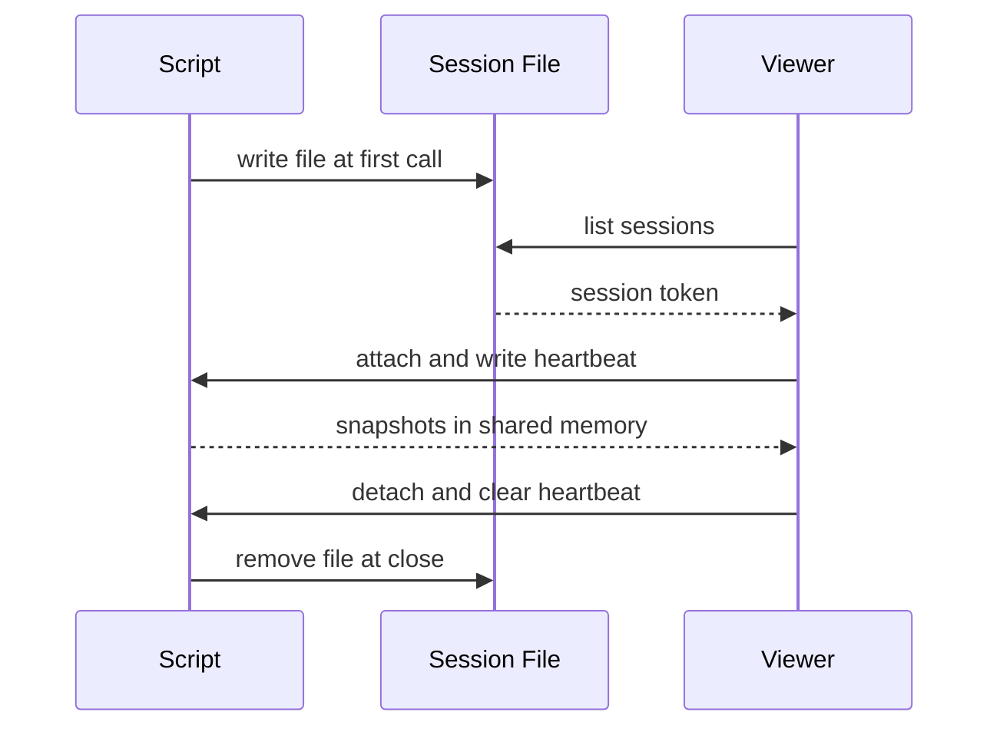

# Script Attachment

A viewer attaches to the live session of a running script, shows its views, and detaches again while the script continues to train.



The viewer finds the session file, attaches to the script, reads snapshots and detaches, while the script does not wait for it.

## Requirements

- A script that calls `caliper.show` or any other view call. The first call opens the live session.
- The Caliper app, or `caliper-viewer` from the Caliper LIB wheel.
- A computer with macOS and Metal, and the same user for the script and the viewer.

## Steps

### Session List

Each live session has a file `live/<pid>.json` in the data folder ([Folders and Environment](../reference/folders-and-environment.md)). The data folder is `$CALIPER_DATA_DIR` when you set it, and the app-data folder of Caliper if not. The session token looks like `clp-41222-9f03ab`.

```sh
ls ~/Library/Application\ Support/Caliper/live/
```

If the script sets `CALIPER_DATA_DIR`, start the viewer with the same root. Use `--data-dir` for `caliper-viewer`, or the same `CALIPER_DATA_DIR` for the Caliper app. Inside the script, `caliper.session()` returns the open session, where `.session` is the token and `.session_file` is the path of its file. Any other Python process lists the sessions as follows:

```python
from caliper import live
for s in live.list_sessions():
    print(s["pid"], s["script"], s["session"], s["view_count"], s["viewer_pid"])
```

Each entry also has `alive`, `protocol`, `compatible`, `start_unix_ms` and `path`. A listing removes the stale sessions, as [Live Streaming](live-streaming.md#session-end) shows.

### App Attachment

1. On the landing screen, push F4 or click `F4 Attach to process` in the Projects pane.
2. Select a row with ↑ and ↓, then push Enter. Or double-click the row, or click `⏎ Attach`.

The Projects pane lists the sessions and the streams of this computer, as [Viewer](viewer.md#session-list) shows. A row that cannot attach is faint, and `⏎ Attach` is off. Esc or `esc Back` returns to the ways in. The live page of the session opens, and the row of that session reads `attached`. For a stream, use the steps of [Stream Links](stream-links.md).

### Automated Attach

The variable `CALIPER_AUTOATTACH=<pid>` attaches to the session of that process as soon as the landing lists it. The variable `CALIPER_HOME_AFTER=<seconds>` goes to the landing screen that long after the page opens.

```sh
CALIPER_AUTOATTACH=41222 CALIPER_WINDOW_SIZE=1440x900 cmake-build-release/caliper
```

### Viewer Attachment

`caliper-viewer` is in the wheel as `caliper/bin/caliper-viewer`. The call `live.viewer_executable()` prints its path, and `$CALIPER_VIEWER` replaces that path for `auto_launch`. Without `--session`, the viewer opens a "Live sessions" window with an **Attach** button for each row. With `--session <token>`, the viewer attaches at once and waits for a session that is still starting. If no session has that token, the viewer exits with status 2 before it opens a window.

```sh
caliper-viewer --session clp-41222-9f03ab
```

The viewer has no flag for a pid. Select the row with that pid in the list, or read the token from the session file:

```sh
caliper-viewer --session "$(python3 -c 'import json,sys; print(json.load(open(sys.argv[1]))["session"])' \
    ~/Library/Application\ Support/Caliper/live/41222.json)"
```

### Auto Launch

The call `caliper.session(auto_launch=True)` starts `caliper-viewer --session <token>` in its own process session. Thus Ctrl-C in the terminal of the script does not close the viewer, and the viewer continues after the script stops.

```python
caliper.session(auto_launch=True)
```

### Detachment

1. On the live page, push `⌘D Detach`, or click **Detach** in the status window of `caliper-viewer`.

In the Caliper app, `⌘D Detach` drops the views, releases the claims on the shared slots and clears the heartbeat. For a stream, it closes the connection. Then the app returns to the landing screen, the `live:` sources of the spec go away, and its live panels show the offline state. The viewer does the same when you close its window. The script stops its snapshots at once and continues to train, and you can attach again from the list.

`esc Home` does not detach. The session stays attached on the landing screen, the spec page and the page of an applet, and `F5 Live page` returns to the live page. Then the landing command bar shows the live diamond, the script name and `F5 Live page`. Attaching a different session or stream detaches the first one, and the end of the app detaches too.

A series keeps its values in the session while no viewer is attached. After the next attach, the curve of the loss shows the values from before the detach and then the new values. The values that the script offers while no viewer is attached are not recorded.

## Result

The row of the session reads `attached` in the Projects pane, and the live page shows one window for each view. The bar of the page shows a filled diamond and `live` while the script runs. [Viewer](viewer.md#display) shows each part of the display, and [Viewer](viewer.md#session-end) shows what the display does when the script stops.

## Errors

| Symptom | Cause | Remedy |
|---|---|---|
| `attach failed` in Activity | One more viewer holds the session, the session closed, or the renderer is not Metal | Detach the first viewer, or select a different session |
| `caliper-viewer` exits with status 2 | No session has the token | Check the token and the data root in the session list |
| The session is not in the list | The script uses a different `CALIPER_DATA_DIR` | Start the viewer with the same root |
| `Attach` is off | The row is `viewed by <pid>`, `closing` or `protocol vN` | Read the state in [Viewer](viewer.md#session-list) |

## Limits

Attachment works only on macOS with Metal, on the local computer and for the same user. A session has one viewer, as [Live Streaming](live-streaming.md#limits) shows.

## Related Pages

- [Viewer](viewer.md)
- [Stream Links](stream-links.md)
- [Live Streaming](live-streaming.md)
- [Python Quickstart](../introduction/python-quickstart.md)
- [Embedding API](../web/embedding-api.md)
