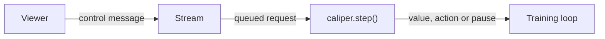

# Script Control

A training loop that streams its views with `caliper.serve()` can also take controls from its viewers while it trains. A viewer can pause the loop, run it one step at a time, change a learning rate and save a checkpoint. A viewer can also select samples in one view to highlight them in the others. This guide adds each control to a loop with Caliper LIB, the `caliper` Python package. The calls are in [Caliper LIB](run-control-calls.md#controls), and the messages that carry them are in [wire protocol 3.1](../reference/wire-protocol.md#controls).



A control travels on the stream, and the script applies it at `caliper.step()`.

Controls travel on the same stream as the views, so they reach the script while a notebook cell runs. A notebook's own widget messages cannot, because the kernel reads them only between cells.

## Checkpoints

Every control acts at one place in the loop: `caliper.step()`, the checkpoint. Call it once per step, on the training thread:

```python
import caliper

server = caliper.serve()

for step, (x, y) in enumerate(loader):
    caliper.step(step)
    loss = F.cross_entropy(model(x), y)
    opt.zero_grad()
    loss.backward()
    opt.step()
    caliper.series(loss.detach(), "loss")
```

`caliper.step()` is where parameter values change, actions run and a paused run waits. Thus the script never sees a change in the middle of a step. When nothing waits, the call only counts the step and adds almost no cost. The number you pass is the step that viewers show when the run pauses. Without it, `caliper.step()` counts its calls.

A script that never calls `caliper.step()` can still change parameters, which then take effect at once. Viewers cannot pause it, and its actions wait.

## Live Parameters

`caliper.param()` registers a value that viewers can change. The type comes from the first value: a float is a number, an int an integer, a bool a toggle, and a str with `choices` a menu. Read `.value` in the loop:

```python
lr = caliper.param("lr", 2e-3, min=1e-5, max=1e-1, log=True, help="learning rate")
augment = caliper.param("augment", True)

for step, (x, y) in enumerate(loader):
    caliper.step(step)
    for group in opt.param_groups:
        group["lr"] = lr.value
    if augment.value:
        x = jitter(x)
    ...
```

A viewer shows `lr` as a slider on a log scale between `min` and `max`. The script checks every value that a viewer sends and clamps it to the range. The new value reaches `lr.value` at the next `caliper.step()`, so a whole step always uses one value. Every viewer then shows the value that the script took. To change a value from the script, call `lr.set(1e-3)`.

## Actions

`caliper.action()` registers a function without arguments that a viewer can run with a button:

```python
@caliper.action("save checkpoint", help="saves the model's weights")
def save_checkpoint():
    torch.save(model.state_dict(), "checkpoint.pt")
    return "saved checkpoint.pt"
```

A viewer's request runs the function at the next `caliper.step()`, on the training thread, so it sees the model between two steps. The text that the function returns goes back to the viewer that asked. Every viewer sees that the action is queued or running. An exception goes back to the viewer with its message and appears in the script as a warning, and the loop goes on. Requests run in the order they arrive, and a second request for an action that already waits joins the first. A viewer can ask for an action only by its name and sends no code and no arguments.

## Pause, Resume and Step

A viewer pauses the run with Pause in the header of a notebook widget, or in the controls panel of a notebook or of the viewer page. The loop stops in its next `caliper.step()` and waits there. The controls keep working during the pause: values change and actions run. Resume continues the loop. Step runs it one step, or a given number of steps, and pauses it again. Every header shows the run state, such as `paused at 1897`.

Before the loop reports a pause, it sends what the views took in the step at which it stopped. Thus a header that reads `paused at 1897` sits over a loss curve that ends at that step. The WebAssembly views read the stream on a connection of their own and can take a moment longer to show it. A heatmap or a point cloud shows the last snapshot that its view took, which its rate limit can place a few steps earlier. A hub keeps the same order for its viewers.

The script can pause itself too, for example when its loss stops being finite:

```python
if not torch.isfinite(loss):
    caliper.pause()
```

A paused run does not wait forever. It continues when the server closes, or when no viewer that may control it has been connected for 10 seconds. This time lets you reload a page. Ctrl-C, or a notebook's interrupt, ends the wait at once.

## Linked Selection

When several views show the same items, such as the samples of an evaluation set, a selection in one view can highlight the same samples in the others. Name the item space of each view with `items=`:

```python
eval_x, eval_y = make_eval_set(512)

with torch.no_grad():
    logits, z = model(eval_x)
caliper.points(z, eval_y, "embedding", classes=10, items="eval")
caliper.show(logits.softmax(1), "predictions", items="eval")
```

The points of `embedding` and the rows of `predictions` are both samples of the item space `eval`, numbered from 0. Select a cluster of points in the embedding, and the predictions heatmap marks the rows of the same samples. For `show` the name applies to the rows, for `points` to the points, and for `series` to its index. With `dims`, `items={"sample": "eval"}` names a dimension instead.

`caliper.items()` adds details that a viewer shows in a small table under the view in which the selection was made:

```python
caliper.items("eval", details={"class": eval_y, "marker at": marker_positions})
```

The call copies a table of columns once, when you call it. A function `details=lambda ids: {...}` can compute the details instead. It runs on its own thread, never on the training thread, so it must read only data that the loop does not change in place. `caliper.items("eval").selection` holds the samples that are selected now, even while the training cell runs.

## Notebook Controls

`caliper.controls()` is a notebook widget with the run controls, every parameter and every action:

```python
from ipywidgets import VBox

VBox([caliper.controls(), caliper.widget("loss"), caliper.widget("embedding")])
```

The viewer page that the link of `caliper.serve()` opens shows the same panel above its views. The demo notebook `live_training.ipynb` uses every control in this guide.

## Security

Every viewer that holds the session token of `caliper.serve()` may control the script. The token is in the link that `caliper.serve()` prints, and the server listens on 127.0.0.1 only. To let viewers watch without control, start the server with `caliper.serve(control=False)`. The viewers still show the run state, the parameters and the actions, with every control disabled. Controls cannot run code that the script did not register. A viewer can only set a registered parameter to a value that the script checks, and run a registered action by its name.

A script that streams to the hub of Caliper CLI with `caliper.connect()` takes the same controls. The hub, `caliper serve`, forwards them only when you start it with `--allow-control`. [Run a hub](hub-setup.md#controls-and-selections) explains that option.
