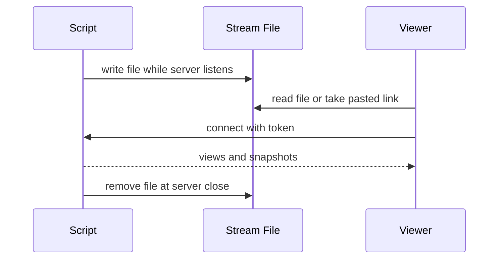

# Stream Links

A viewer attaches to a script that streams with `caliper.serve()`, either from the stream list of the Caliper app or with the link that the script prints.



The viewer reads the stream file or takes a pasted link, connects to the server with the token, and receives the views.

## Requirements

- A script that streams with `caliper.serve()`, or a hub that `caliper serve` starts. Its server listens on 127.0.0.1.
- The stream link, or the Caliper app on the same computer and for the same user.
- The Caliper app or `caliper-viewer`.

## Steps

### Stream Listing

A script that streams sends its views over a WebSocket on 127.0.0.1 ([Wire Protocol](../reference/wire-protocol.md)), not through shared memory. Thus it has no session file. While its server listens, it writes a stream file `streams/<pid>.json` in the data folder, and it removes the file when the server closes ([Live Session Layout](../development/live-session-layout.md) shows the file).

The session list of the Caliper app reads these files and lists each stream with the state `stream`. Thus F4 and Enter attach a stream without its link. The list of `caliper-viewer` does not show streams. The app lists a file only if all of these are true:

- The file belongs to the same user and no one else can read it.
- The script wrote it on this computer.
- It names a process that still runs.
- It holds a link to 127.0.0.1 at its port.

The app removes the file of a process that has stopped.

### Link Forms

A stream of a different computer, or of a script with a different `CALIPER_DATA_DIR`, is not listed. Attach to it with the link that it prints. The app and the viewer accept two forms, and `localhost` replaces `127.0.0.1` in each:

- The page link, `http://127.0.0.1:<port>/?token=<token>`.
- The stream link, `ws://127.0.0.1:<port>/v3/stream?token=<token>`.

A server with several sessions, such as the `caliper serve` hub, needs the session to show. Add `&session=<session id>` to the link. With one session, the server attaches the viewer to it.

### App Attachment

1. Push F4. Select a listed stream and push Enter.
2. For a stream that is not listed, paste the link into the field under the session list. Push Enter or click `Attach link`.
3. To open the app on a stream, give the link on the command line.

```sh
caliper --url "http://127.0.0.1:8765/?token=$TOKEN"
```

A refusal stays on the landing screen, and Activity gives the reason.

### Viewer Attachment

1. Pass the link to `caliper-viewer` with `--url`.

```sh
caliper-viewer --url "http://127.0.0.1:8765/?token=$TOKEN"
```

### Headless Check

Without a window, the viewer runs for a while and prints what it received. A terminal or a CI job uses this to check a script that streams.

```sh
caliper-viewer --headless --url "ws://127.0.0.1:8765/v3/stream?token=$TOKEN" --exit-after 5 --stats
```

```text
[caliper-viewer] received session=clp-41222-9f03ab script=train.py pid=41222 alive=1 views=3 updates=381
[caliper-viewer] received view=weights kind=heatmap updates=127 seq=135 series=0
[caliper-viewer] received view=loss kind=series updates=127 seq=135 series=135
[caliper-viewer] received view=acts kind=histogram updates=127 seq=135 series=0
```

The value `updates` counts the snapshots that the viewer drew, `seq` is the number of the last snapshot, and `series` is the number of values that a series holds.

## Result

The viewer subscribes to all views of the session, each with its default data view, and draws them as it draws a shared-memory view. If the connection stops, the views keep their last pixels, the status says that the session ended, and the viewer connects again. A series then continues from the values that the producer kept. When the script ends, the views keep their last pixels.

## Errors

| Symptom | Cause | Remedy |
|---|---|---|
| Refusal in Activity, nothing listens | No server uses that port | Check the port in the link |
| Refusal in Activity, HTTP 403 | The server refused the token | Copy the link again from the script |
| `caliper-viewer` exits with status 2 | The attach failed | Check the link and the session id again |
| The link is not accepted | The host is not 127.0.0.1 or `localhost` | Use a link to 127.0.0.1 or `localhost` |

## Security

The token in the link is the only secret of a stream. The viewer does not print it, and messages show the link without its query. Only links to 127.0.0.1 or `localhost` are accepted. The stream file has mode 0600 in a folder of mode 0700. The app attaches with the token of the file as it does with a pasted link, and thus a listing gives no access that the link does not give.

## Related Pages

- [Viewer](viewer.md)
- [Script Attachment](script-attachment.md)
- [Network Streaming](network-streaming.md)
- [Hub Setup](hub-setup.md)
- [Wire Protocol](../reference/wire-protocol.md)
