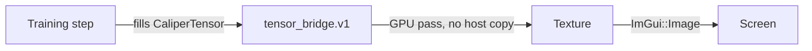

# Zero-Copy Tensors

A tensor goes from a training step to pixels without a CPU round trip. The renderer seam is in [Rendering](../applets/rendering.md), and the Windows interop machinery is in [Vulkan and CUDA on Windows](../development/vulkan-and-cuda.md).



The applet hands a tensor to the bridge, and a GPU pass turns it into a texture that the frame thread draws.

## Terms

The host claims zero-copy only when the zero-copy path drew ([Platform rules](../introduction/architecture.md#design-decisions)). Thus two phrases have separate meanings:

- **Zero-copy** means the tensor's data is copied nowhere, not into host memory and not to a second place in GPU memory. A GPU pass can still convert the data (a colormap, a buffer-to-texture write), because converting is work on the data and not a copy of it.
- **GPU-resident, no CPU staging** means the data never reaches host memory, but it is copied at least once inside the GPU.

Status lines in applets and in the host's log use the same words. An applet claims "zero-copy" only when the zero-copy path ran that frame.

## Tensor Texture Paths

An applet never talks to a graphics API. It fills a `CaliperTensor`, a plain C struct whose `device` field says where the bytes live, and hands it to the [`tensor_bridge.v1`](../applets/services/caliper-tensor-bridge-v1.md) service. The backend behind the host turns the tensor into a texture in the way that is best for the platform. It returns an `ImTextureID` for `ImGui::Image`. The contract does not name Metal or Vulkan.

### Apple Silicon

Apple Silicon has unified memory, so the CPU and GPU share one pool of physical RAM. The storage of a PyTorch MPS tensor is already an `MTLBuffer`, the object Metal renders from. There is no separate GPU memory to copy out of. The handoff is a pointer cast plus the rules that make the cast safe:

1. The worker's training kernels write the weight buffer.
2. The adapter checks that the tensor is contiguous and has `storage_offset() == 0`. The ABI has no offset channel, so the adapter rejects a view instead of guessing. The fresh result of a GPU operation always qualifies.
3. The bridge casts the pointer to `id<MTLBuffer>`. No bytes move.
4. A GPU pass reads the buffer in place and writes the `MTLTexture`. It is a compute kernel with the colormap table for f32 data, and a blit for u8.
5. The frame thread draws the texture with `ImGui::Image`, and the pixels appear that frame.

### Windows NVIDIA Path

A discrete GPU has no unified memory. VRAM and system RAM are separate and joined by PCIe. Zero-copy here means the data stays in VRAM, and the compute API and the graphics API reach the same memory.

Torch's caching allocator does not produce exportable allocations, so Vulkan cannot import a torch tensor. Instead, a CUDA kernel in torch's own context writes the Vulkan image. That context is the device's primary CUDA context, so the kernel can read any torch tensor through its device pointer. Caliper allocates the output image itself, as exportable memory. The update paths and the semaphore synchronization are in [Vulkan and CUDA on Windows](../development/vulkan-and-cuda.md).

The host does not need the CUDA toolkit. It loads the CUDA driver API from `nvcuda.dll` at run time, and the Vulkan loader comes from the GPU driver.

### CPU Tensors

For any CPU tensor, the bridge stages through host memory. It applies the colormap on the CPU into an RGBA scratch buffer and uploads it once. The ABI, the textures and the on-screen result are the same as on the other paths. Only the copy that the other paths avoid is added. Windows also uses this path when Vulkan starts but CUDA interop does not pair. Thus the worst case is a slow path that works. Where Metal or Vulkan cannot start at all, there is no fallback renderer, and Caliper refuses with a message that says why ([No Fallback Renderer](../applets/rendering.md#no-fallback-renderer)).

## Data Crossings per Path

| Path | Host copies | Copies inside the GPU | What does the work |
|---|---|---|---|
| Metal, any MPS tensor | 0 | 0 | One compute pass (f32 with a colormap) or blit (u8) reads the buffer in place |
| Metal, imported allocation | 0 | 0 | The pass reads the imported `MTLBuffer` at a byte offset |
| Vulkan with CUDA, any CUDA tensor, direct path | 0 | 0 | A CUDA kernel reads the tensor in place and writes the image |
| Vulkan with CUDA, any CUDA tensor, buffer path | 0 | 1 | A copy into the shared buffer, then a Vulkan pass. Used when the direct path refuses the tensor and for the offscreen canvas |
| Vulkan with CUDA, `alloc_shared` | 0 | 0 | The applet's kernels write the texture's own buffer, and a Vulkan pass converts it |
| Vulkan with CUDA, tensor in an exportable pool | 0 | 0 | The bridge imports the pool block once, and the pass reads it at a byte offset |
| Metal and Vulkan with CUDA, imported geometry (`geometry.v1` to `v1_3`) | 0 | 0 | Indexed triangles, lines and points are vertex-pulled in place from imported buffers |
| Any CPU tensor | 1 (staging) | 0 | The bridge converts on the CPU and uploads |

`alloc_shared` differs by platform. On Vulkan it returns a device-backed tensor, so a CUDA kernel can write the texture's memory in place. On Metal it returns a CPU vector in unified memory. That is zero-copy for CPU writers, but a device writer goes through the normal update path.

## Sync Ladder

The sync ladder says when it is safe to read the bytes. It has two rungs, negotiated at run time. The applet asks the bridge what the host honors, and the adapter does the right thing:

```cpp
uint32_t caps = bridge.caps();                          // caliper.tensor_bridge.v1_1
auto ct = caliper::adapters::stream_to_tensor(t, caps);
```

- **Drain** (`stream == NULL`). The adapter synchronizes the whole producer device before the handoff, with `torch::mps::synchronize()` or `torch::cuda::synchronize()`. The renderer can then read the tensor immediately. This is always correct and costs a full-device barrier. `synced_to_tensor` does this, and `stream_to_tensor` falls back to it when capability bit 0 is absent.
- **Stream-ordered** (capability bit 0, `CALIPER_BRIDGE_CAP_STREAM_ORDERED`). There is no drain. The adapter puts the producer's queue or stream in `CaliperTensor.stream` (an `MTLCommandQueue*` on MPS, a `CUstream` on CUDA). The renderer orders its work on the GPU after the producer's queued work. Metal uses a per-texture `MTLSharedEvent`, and Vulkan with CUDA uses a shared timeline semaphore on the producer's stream. The CPU never waits on the hot path.

Metal always grants the stream-ordered rung. Vulkan grants it when the device exports timeline semaphores. If it does not, the handoff stays synchronous and adapters keep draining.

Torch's public MPS stream calls are not serialized, and a handoff during kernel encoding can corrupt command-buffer state. Thus both adapter rungs run their MPS work as one block on torch's own stream dispatch queue, and any new adapter code that touches MPS must do the same. CUDA needs no such serialization, because driver calls are thread-safe by API contract.

A NULL stream from a CUDA producer can still be an honored handoff. `CUDAStream::stream()` returns `nullptr` for the legacy default stream, and the renderer's NULL rung enqueues on that same stream. To test the stream channel, pin a non-default pool stream.

### Drain Rung Geometry

The `geometry.v1` calls (`draw_points`, `draw_primitives`) address device memory as an allocation id and a byte offset. The ABI has no `CaliperTensor` and so no `stream` field. A stream-ordered handoff is thus impossible there, and it is not needed. Correctness rests on two invariants that the applet owns, and both are required:

1. **The drain, before publishing.** Every applet worker drains its device before it flips the ready slot under the publish mutex. When the frame thread learns which slot to draw, the producer's writes are retired. No in-flight producer work remains for a semaphore to order against. The renderer only makes completed writes visible to the vertex stage.
2. **The triple buffer, for slot stability.** The worker writes the slot that is neither the ready slot nor the display slot. Thus it never rewrites the slot that the frame thread reads in place.

Together the two invariants make the in-place path safe without the stream-ordered gate of the texture path. The rule is part of the contract in the [geometry reference](../applets/services/caliper-geometry-v1.md), so a new worker-to-frame publish path inherits it.

### Stream-Ordered Rung Benefits

The stream-ordered rung does not change training speed when the training loop already synchronizes each step, for example with `loss.item()`. The gain is that the frame thread stops waiting on the training queue.

Two habits keep the frame thread fast. Keep I/O off it, because the host [forbids I/O there](../introduction/architecture.md#frame-loop). Create a texture once and call `update_texture` afterwards, because an update costs less than a create.

## Imported Allocations

With an imported allocation, the applet exports a block of device memory once, and the host imports it once. Then both the texture path and the geometry path address the memory as an allocation id plus a byte offset. This is [`caliper.tensor_bridge.v1_2`](../applets/services/caliper-tensor-bridge-v1.md), and it is opt-in per allocation.

**Windows.** An applet allocates its torch CUDA tensors from `caliper::adapters::ExportablePool`, a torch `MemPool` whose blocks are created with `cuMemCreate` and a shareable handle. The host imports each block into Vulkan on first use. Then `update_texture_from_alloc` runs the colormap or blit pass directly on the imported buffer at the tensor's offset. Memory that was born in the pool needs no copy. Memory that was born unshareable, such as torch's default caching allocator, takes the ordinary update path.

**Metal.** Handle kind `CALIPER_ALLOC_HANDLE_MTLBUFFER` carries an in-process `id<MTLBuffer>`. There is no OS handle and no driver export, because with unified memory the pointer already is the resource. The renderer keeps a strong reference as the host's copy of the handle. It checks that the buffer lives on the renderer's own device, and it declines a buffer that is too short. `ExportablePool` on MPS makes any tensor eligible without an allocator change, because its `to_bridge` imports the tensor's own storage buffer. The tensor must stay alive until the pool is destroyed or the import is released. Otherwise torch's MPS allocator can hand the same buffer to an unrelated tensor while the host still draws from it.

Every miss returns `false`, and the caller falls back to the copying path. A miss is one of these cases: no capability bit, an import the host declined, a misaligned offset, a window that runs past the allocation, or a released allocation. A refusal never crashes, never shows a wrong image, and leaves the pixels and the reported path untouched. An allocation id is never reused, so an update after a release always refuses. Do not rewrite the bytes until the next update of the same texture.

## Derived Graphics

An applet can compute any graphic from the live training state on the GPU. Image-like results (heatmaps, feature maps, attention grids) go through the bridge as textures. Coordinates go through ImPlot and ImPlot3D as small arrays, which need no zero-copy path. Tokens and labels go through styled text. The routes compose in one panel, and the zero-copy path matters for the dense outputs.
