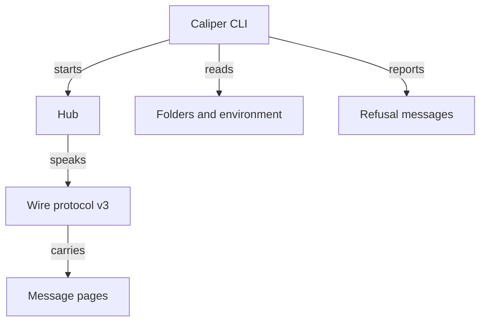

# Reference

Reference holds the facts that every area of Caliper shares. A reader comes here to look up an exact command, message, folder or term, not to learn a subject from the start. Each page states its facts once, and the other areas link to it.

## Command Line

The `caliper` executable starts the app and also takes subcommands. Every subcommand except `dev` runs without a window, and thus is safe in scripts and CI. The [CLI](cli.md) page gives the usage, the startup rules and the search order for applets. The subcommands that list, check, install, create and build applets are in [Applet Commands](applet-commands.md). The commands `caliper shot` and `caliper serve` are in [Shot and Serve Commands](shot-and-serve-commands.md). A shot writes a PNG of an applet page, and serve runs the hub.

## Files and Settings

Caliper keeps its files in one app-data folder, and the `CALIPER_DATA_DIR` variable moves it. A test or hidden run never uses the folder of the OS. [Folders and Environment](folders-and-environment.md) lists the folder for each operating system, every environment variable and the startup log lines.

When the host loads an applet, it first runs a negotiation check on the manifest. If a check fails, the host shows one message and runs no applet code. [Refusal Messages](refusal-messages.md) lists each message, the check that causes it and the action to take.

## Wire Protocol

Protocol v3 carries live data from a training process to viewers over one WebSocket. It defines three roles: the producer, the viewer and the hub. The [Wire Protocol](wire-protocol.md) page gives the roles, the message types and the versioning. Its details are on separate pages. [Wire Frames](wire-frames.md) defines the binary frame. The session, data, data view, linked selection and run control messages each have a page, for example [Session Messages](session-messages.md). [Wire Protocol 3.2](wire-protocol-3-2.md) is the draft of the next minor version: it specifies scenes, which Caliper LIB and the hub build, and the rest of the draft, which only the codecs build.

## Terms

The documentation uses each term with one meaning. The [Glossary](glossary.md) defines terms such as ABI epoch, Applet, Caliper Embed and Caliper LIB. Check it when a word is unclear.
