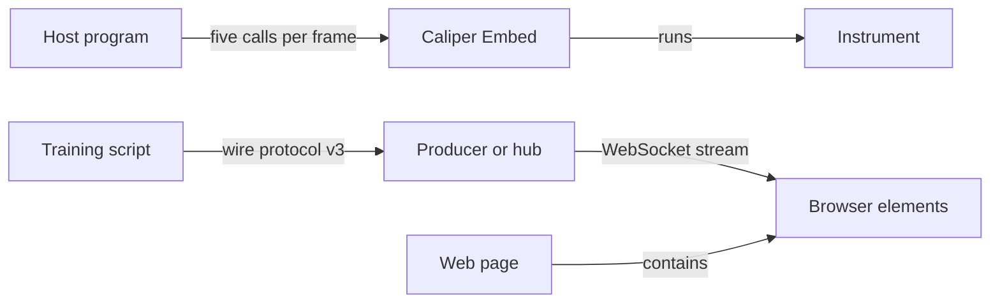

# Web and Embedding

Caliper runs in two places beside its own app. Another program can show instruments inside a view that it owns, and a web page can show live data from a training script. This area is for developers who build such a host program or a page. It does not cover the app itself.

## Embedded Host

Caliper Embed is the framework core as a shared library with a small C interface. A host program links the `caliper-embed` package and creates one core. It attaches a native view or an offscreen target, loads an instrument by its manifest id, and pumps one frame from its own event loop. The core never owns the process loop. As a result, the host needs no ImGui, no torch and no renderer type. Metal runs on macOS and Vulkan runs on Windows.

The usual way to start is to build the package, link `caliper::embed` with CMake, check the library version, and run a first frame offscreen. The guide [Program Embedding](program-embedding.md) shows each step. The [Embedding API](embedding-api.md) page holds the contract behind the calls, the versions and the per-core settings.

## Browser Views

The `web/` package defines two custom elements. `<caliper-view>` draws one live view, and `<caliper-controls>` is the second element. Both read a stream of [wire protocol v3](../reference/wire-protocol.md). Elements with the same `src` on one page share one WebSocket.

A view draws a heatmap, an image, points, a series or a histogram. Where WebGPU gives an adapter, views compiled to WebAssembly draw the data. Otherwise, views written in TypeScript draw it. The header, the gestures and the events are the same with both. The viewer page of `caliper.serve()` and the notebook widgets of Caliper LIB use these elements, and a page of your own can use them too. [Browser Elements](browser-elements.md) lists every attribute.

## Approach Selection

Use embedding when a native program must own the window and run instruments in it. Use the browser elements when the data comes from a training script and a page or a notebook shows it. The two do not depend on each other. Both rely on the same rule: the producer computes each data view on its own device, and the viewer only draws what it receives.
