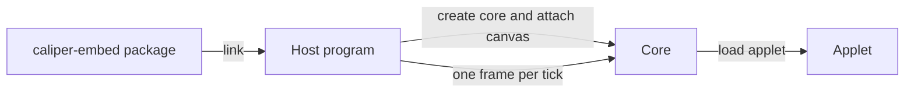

# Program Embedding

A program that owns its own window can run Caliper applets inside a view of
that window. It links the `caliper-embed` package, a shared library with a C
interface, and drives the core with five calls from its own event loop. This
guide builds such a program outside this repository, from the package to a
first run that opens no window.



The host links the package, then creates the core, attaches a canvas, loads an applet and pumps frames.

The contract behind each step is in [Embedding Caliper](embedding-api.md).
`examples/embed_host` is a complete program that follows this guide.

The steps use macOS with Metal. Windows uses the same package with Vulkan
(`caliper_embed.dll`).

## Installation

Build the core and install the `embed` component into a prefix of your choice.
The prefix can be the one that holds the SDK or a separate one.

```sh
cmake --preset release
cmake --build cmake-build-release --target caliper_embed
cmake --install cmake-build-release --prefix <prefix> --component embed
```

The prefix then holds the library (`lib/libcaliper_embed.dylib`), the headers
under `include/caliper-embed/caliper/` and the CMake package under
`lib/cmake/caliper-embed/`.

## CMake Linking

`find_package(caliper-embed)` gives one target, `caliper::embed`, which brings
the library and the include root. Nothing else of Caliper needs linking,
because the core's dependencies (DuckDB, ImGui, GLFW and the rest) live inside
the library. The library exports only the C functions of the embed headers.
Link whatever your own window code needs beside it.

```cmake
cmake_minimum_required(VERSION 3.18)
project(my_host LANGUAGES CXX OBJCXX)
find_package(caliper-embed 1.4 CONFIG REQUIRED)

add_executable(my_host main.mm)
target_link_libraries(my_host PRIVATE caliper::embed "-framework Cocoa")
```

```sh
cmake -S . -B build -DCMAKE_PREFIX_PATH=<prefix>
cmake --build build
```

The program finds the library through the rpath that CMake adds to binaries in
their build folder. An installed copy needs an rpath that reaches
`<prefix>/lib`, because the install name of the library is
`@rpath/libcaliper_embed.dylib`.

## Version Check

`caliper/embed.h` carries the version of the header you compiled against.
`caliper_embed_api_version()` returns the version of the library that the
process loaded. Refuse a library of another major version or of an older minor
version:

```c
#include <caliper/embed.h>

uint32_t lib = caliper_embed_api_version();
if ((lib >> 16) != CALIPER_EMBED_VERSION_MAJOR ||
    ((lib >> 8) & 0xff) < CALIPER_EMBED_VERSION_MINOR)
    return 1;
```

The encoding and the rule are in [Versions](embedding-api.md#versions).

## Core Frame Loop

Create one core, attach one canvas, load an applet, and then pump one frame per
tick of your own loop. The canvas is either your native view (`NSView*` on
macOS, `HWND` on Windows) with `CALIPER_CANVAS_WINDOW`, or an offscreen target
with `CALIPER_CANVAS_OFFSCREEN`. The offscreen target takes no view and opens
nothing on screen. This example uses the offscreen form.

```c
CaliperCoreDesc desc = { .struct_size = sizeof desc };
desc.renderer    = CALIPER_RENDERER_DEFAULT;   /* Metal on macOS */
desc.applets_dir = "<applets>";                /* searched first */
desc.data_dir    = "<data>";                   /* metrics, artifacts, imgui.ini */
CaliperCore* core = caliper_core_create(&desc);

CaliperCanvasDesc canvas = { .struct_size = sizeof canvas };
canvas.mode = CALIPER_CANVAS_OFFSCREEN;
canvas.width = 1280; canvas.height = 800; canvas.content_scale = 1.0f;
if (!caliper_core_attach_canvas(core, NULL, &canvas))
    fprintf(stderr, "%s\n", caliper_core_last_error(core));

caliper_core_load_applet(core, "dev.caliper.hello-world");
for (int i = 0; i < 60; ++i)
    caliper_core_frame(core);                  /* one frame per call */
caliper_core_shutdown(core);
```

For a window, pass your view and its size in physical pixels to
`caliper_core_attach_canvas`. Call `caliper_core_frame` from a timer or display
link. Translate the input of your toolkit into `CaliperInputEvent` values for
`caliper_core_event`. `examples/embed_host` does this for AppKit and Win32.

The core looks for applets in `applets_dir`, then in the folders of
`CALIPER_APPLET_PATH`, then in the user applets folder, and last in an
`applets` folder beside the executable.

An applet loads when its ABI epoch and UI-stack hash match those of the core,
and the core serves the services that the applet requires
([Compatibility](../development/compatibility-and-epochs.md)). This holds for
applets built against the `caliper-sdk` package of the same core build.

Without `data_dir`, the core keeps its stores in the app-data folder. This is
the folder that `CALIPER_DATA_DIR` names when it is set. Otherwise it is the
Caliper data folder of the operating system.

## Windowless Mode

`embed_host` runs the whole path on a machine where no window may open. Build
it against the package as above. Put the `hello_world` fixture (or any applet built
from the same core build) in a folder, and run its offscreen mode:

```sh
cp -R examples/embed_host <work>/embed_host
cmake -S <work>/embed_host -B <work>/embed_host-build -DCMAKE_PREFIX_PATH=<prefix>
cmake --build <work>/embed_host-build
CALIPER_EMBED_OFFSCREEN=1 CALIPER_EMBED_APPLETS=<applets> \
    <work>/embed_host-build/embed_host dev.caliper.hello-world
```

It prints the version of the library, the log lines of the core and the log
lines of the applet. Then it prints one line with the frames it pumped and the
pixels the applet drew. It exits with code 0 when the applet drew.
`CALIPER_EMBED_EXIT_AFTER` sets how many seconds it runs (1 by default).
